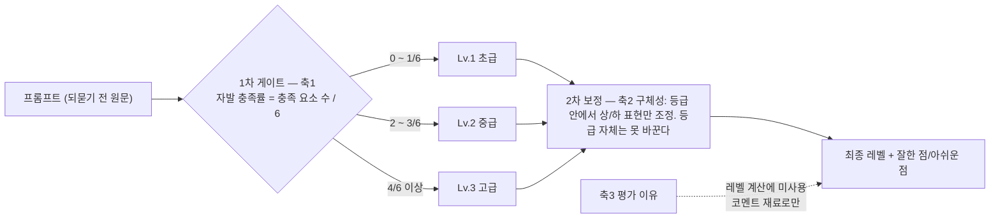
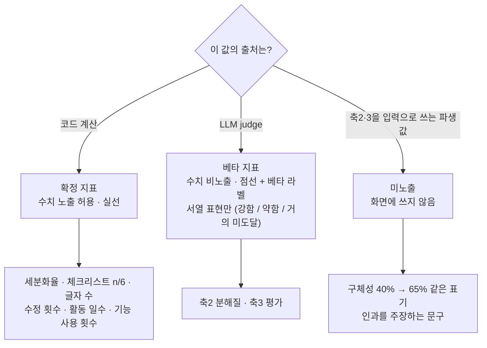
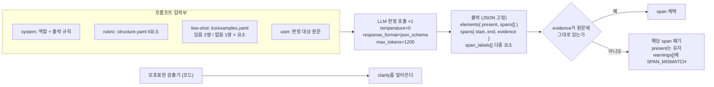
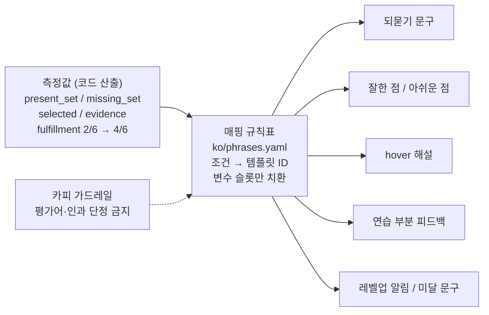
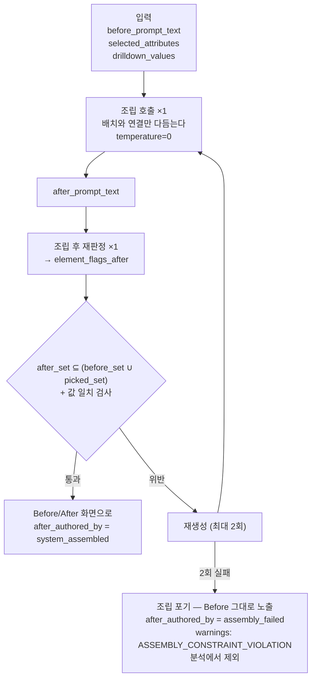

# 모델 설계 — 레벨·지표·루브릭·채점 로직

> 담당: LLM(조하린) · 최종 수정: 2026-11-19 · `rubric_version: v1.0`
> 출처: AI 파트 모델 설계서 v1.0 · AI 파트 시스템 설계서 v1.0 3·4.3–4.5·4.7·5장
> 기준 자료: 와이어프레임(온보딩 / 진단 / 연습 / 점검 / 로그인), 브랜딩 가이드(MVP)

레벨과 지표를 **어떻게 계산하는지**, 판정기·루브릭·문장 템플릿을 **어떻게 만드는지** 적는다.

| 알고 싶은 것 | 문서 |
| --- | --- |
| 서비스 정의·6요소·3모드·엔진 구성·호출 수·카피 가드레일 | `docs/dev/llm/system-design.md` |
| 요청/응답 스키마 (`level`, `metrics`, `elements` 필드) | `docs/dev/specs/interfaces.md` 3장 |
| 모델 식별자·타임아웃 환경변수 | `docs/ops/env.md` 2절 |

---

## 1. 레벨 평가 설계

### 1.1 결정 사항

| 항목 | 결정 | 근거 |
| --- | --- | --- |
| 척도 기준 | **절대 기준** | 초기에는 비교할 모집단이 없다. 상대 기준은 본인 실력이 그대로여도 모집단이 올라가면 레벨이 내려간다. |
| 등급 수 | **3단계** (Lv.1/2/3) | ① 자기신고가 3지선다라 "신고 vs 실측" 대조가 성립하려면 같은 라벨 집합이어야 한다. ② 진단은 단일 과제 1회 시행 = 1문항 검사다. 신뢰도 계수도 못 구하는 상태에서 5등급은 무리. |
| 신규 레벨 | 만들지 않음 | 자기신고 3지선다와 어긋나면 대조가 깨진다 |
| 중급 편중 대응 | 세분화 아님 → 프로파일 + 시계열 | 5단계로 늘려도 측정오차보다 작은 차이라 레벨이 진동한다 |
| 자기신고 | 채점 미개입 | 신고와 실측의 간극을 보여주는 용도 |
| 프롬프트 길이 | 레벨 기준 제외 | 장황함 ≠ 세분화. 보조 로깅만 |
| 레벨 변경 주체 | **진단 모드 단독** | 1.7 |

레벨 값은 FastAPI 응답에서 `beginner` · `intermediate` · `advanced`(Lv.1 · Lv.2 · Lv.3)다. DB 표기 대응(`LV1`~`LV3`)은 인터페이스 명세 9장 논의 사항 2.

### 1.2 3축 정의

| 축 | 이름 | 질문 | 산출 주체 | 레벨 반영 |
| --- | --- | --- | --- | --- |
| 축1 | 세분화 | 조건을 몇 개나 적었나 | 요소 존재는 LLM 판정, **충족률·게이트는 일반 코드** | **대역 결정** |
| 축2 | 분해질 | 그 조건을 얼마나 구체적으로 적었나 | LLM judge | 등급 내 보정만 |
| 축3 | 평가 | 결과를 보고 왜 좋은지 설명할 수 있나 | LLM judge | 미반영 (로깅만) |

### 1.3 3단 구조



| 단계 | 입력 | 산출 | 비고 |
| --- | --- | --- | --- |
| 1차 게이트 | 축1 형식 요소 충족률 | 0~1/6 → Lv.1 · 2~3/6 → Lv.2 · 4/6↑ → Lv.3 | 코드 계산, LLM 불필요 |
| 2차 보정 | 축2 구체성 | "Lv.2 중, 조건을 적되 값이 짧은 편" | 등급 안에서만. 상/하 등급 변경 불가 |
| — | 축3 평가 이유 | 로깅만 | 레벨 계산 미반영 |

**채택 근거**

- 축2·3은 축1이 있어야 성립한다. 조건을 거의 안 적은 사람이 "구체성이 높다"고 나오는 것은 논리적 모순이다. 세 축을 그냥 더하는 가중합산은 이 모순을 그대로 만든다.
- 축2는 judge 신뢰도 미검증 상태다. 검증 전에 대역을 바꾸는 결정에 쓰면 레벨이 측정오차 때문에 진동한다.
- **축1은 판정 결과만 있으면 코드로 계산된다.** 요소 존재(`present`)만 LLM이 정하고, 충족률·게이트는 결정적 코드다. 축2 judge 없이도 레벨을 산출할 수 있다는 뜻이다.
- 단 요소 존재 판정 자체가 실패하면(`degraded`) 6요소 중 `clarity`만 남아 충족률을 계산할 수 없다. 이때는 레벨을 내지 않는다 (1.10).

### 1.4 충족률 계산 방식

게이트 입력은 **속성 개수가 아니라 충족률**이다.

```
fulfillment_rate = 충족 요소 수 / element_set_size (MVP: 6)
```

#### 개수가 아니라 비율인 이유 — Goodhart 방어

본 서비스는 반복 측정 서비스다. 사용자는 두 번째부터 "체크박스를 다 고르면 점수가 오른다"를 학습한다. 그 순간 측정기가 죽는다.

```
            6개 고르고 2개만 실제로 채운 사람  vs  3개 골라서 3개 다 채운 사람
개수 기준  :                         6점      >      3점                   ← 틀린 판정
충족률 기준:                         2/6      <      3/3                   ← 올바른 판정
```

#### "고르기만 하고 안 채운" 케이스 처리

| 케이스 | 선택 | 드릴다운 값 | 판정 |
| --- | --- | --- | --- |
| A | 정보량 | "핵심만 간단하게" | 충족 |
| B | 정보량 | 빈칸 / "적당히" | **미충족** — 모호표현 검출기가 잡는다 |
| C | 미선택 | — | 빠짐 |

B가 점수 조작을 막는 방어선이다. 개수만 세면 A와 B가 같은 점수를 받는다.

#### 전이율 — 학습이 실제로 일어났는지

세션 안에서 재는 반영도는 구조적으로 항상 100%가 나온다(조립 모드). 의미 있는 측정은 **회차와 회차 사이**에 있다.

```
n회차   : 선택 속성 S_n = {정보량}  →  빠졌다고 코칭받음
n+1회차 : 첫 프롬프트(되묻기 전)에 '정보량' 조건이 자발적으로 등장하는가?
          → 등장하면 전이 성공. 이것이 학습의 증거.

전이율(항목별) = 그 항목을 스스로 쓴 회차 수 / 그 항목을 코칭받은 이후 회차 수
```

- 전이율은 **항목별로 따로 집계한다.** 하나로 합치면 "정보량은 늘었는데 대상은 그대로"라는 실제 성장 패턴이 사라진다.
- 회고 화면 문구가 여기서 바로 나온다: "지난달엔 정보량을 3번 중 1번 넣으셨는데, 이번 달엔 5번 중 4번 넣으셨어요."
- 전이율은 회차 간 집계라 **Spring이 계산한다** (인터페이스 명세 1.3).
- "코칭받은 항목"은 6요소 키로 기록한다. 화면 속성(정보량·말투 등)을 요소로 바꾸는 대응표와 기록 규칙은 4.6.
- "스스로 쓴 회차"는 그 회차 `INITIAL` 이벤트의 `element_flags`에서 해당 요소가 `present: true`인 경우다.

### 1.5 게이트 임계값 (초기 가설값)

| 레벨 | 되묻기 전 자발 충족률 | 되묻기 후 |
| --- | --- | --- |
| Lv.1 초급 | 0 ~ 1 / 6 | 되묻기 후에도 2/6 미만 |
| Lv.2 중급 | 2 ~ 3 / 6 | 되묻기 후 3/6 이상으로 증가 |
| Lv.3 고급 | 4 / 6 이상 | 되묻기해도 추가분이 거의 없음 |

- 와이어프레임 표기 `체크리스트 2/6 → 4/6 (다음 레벨 기준 4/6)` 및 `Lv.3 조건을 채우셨어요`와 그대로 맞물린다. 응답의 `level.next_level_threshold`가 이 값이다.
- **데이터 없이 설정한 가설값이다.** 런칭 전 20~30건 사전 테스트로 초기값을 보정한다 (8장).
- 레벨 게이트 입력은 **되묻기 전 충족률뿐이다** (1.3). "되묻기 후" 열은 레벨별 전형적인 모습을 설명하는 값이며 게이트에 쓰지 않는다.
- `되묻기 전 충족률`과 `되묻기 후 충족률`(`fulfillment_rate_after_probe`)의 **차이는 분석에 쓴다.** "물어보면 잘 답하는 사람인가"를 판단할 수 있다.
- 되묻기 후 충족률은 **별도 컬럼으로 저장하지 않고 이벤트에서 계산한다.**

| 모드 | 되묻기 전 | 되묻기 후 |
| --- | --- | --- |
| 진단 | `INITIAL` 이벤트의 `fulfillment_rate` | 같은 세션 `ASSEMBLED` 이벤트(조립 후 재판정)의 `fulfillment_rate` |
| 점검 | `INITIAL` 이벤트의 `fulfillment_rate` | 같은 세션 마지막 `REWRITE` 이벤트의 `fulfillment_rate` |
| 연습 | — | 분석 대상 아님 (빈칸 힌트) |

- 진단에서 조립이 실패하면(`assembly_failed`) `ASSEMBLED` 이벤트가 없으므로 되묻기 후 값은 없다(NULL). 이 세션은 Before/After 분석에서도 제외된다 (7.1).

### 1.6 중급 편중 문제 — 세분화가 아니라 두 가지로 해결

3단 척도는 중앙이 두꺼워진다. 5단계로 늘려도 중급2에 몰리고, 측정오차보다 작은 차이라 레벨이 진동한다.

**① 프로파일** — 레벨 밑에 잘한 점 / 아쉬운 점을 붙인다.

```
같은 Lv.2라도
  "목적은 잘 쓰는데 분량을 안 씀"   vs   "분량은 쓰는데 대상을 안 씀"
→ 사용자에게는 전혀 다른 결과로 읽힌다
```

**② 시계열 대조** — 레벨은 구간값이라 정체돼도, 그 구간을 만든 원자료는 연속값이라 움직인다.

```
1차 진단:  형식 요소 2/6 충족 · 첫 프롬프트 18자 · 수정 0회
5차 진단:  형식 요소 4/6 충족 · 첫 프롬프트 96자 · 수정 2회
→ 레벨 판정: 둘 다 Lv.2 중급
→ 그러나 행동은 명백히 달라졌다
```

대시보드의 `세분화율 62%`와 `세분화율 성장 추이` 그래프가 정확히 이 역할을 한다. 전부 코드 계산값이라 LLM judge가 필요 없다.

### 1.7 레벨 변경 주체는 진단 단독

- 레벨은 **똑같은 문제에서 나온 값**이어야 회차 간 비교가 된다.
- 연습은 문제가 매번 다르고 **빈칸이라는 힌트까지 준다.** 백지에서 쓴 진단 결과와 같은 잣대가 아니다.
- 연습에서 레벨을 올리면 연습만 반복해 레벨을 올리는 경로(레벨 인플레이션)가 생기고, 진단 모드의 존재 이유가 흐려진다.
- 응답의 `level.mutable`은 `mode=diagnose`일 때만 `true`다. `false`인 응답으로 사용자 레벨을 덮어쓰면 안 된다.

**적용 방식 (와이어프레임 반영 완료)**

```
연습 종료 시:
  "체크리스트 2/6 → 4/6 (다음 레벨 기준 4/6)
   Lv.3 조건을 채우셨어요!
   진단으로 확인해보면 정확한 레벨을 알 수 있어요."
        ↓
  진단 1회 → 레벨 확정
```

- 성취감은 그대로 주고, 레벨의 신뢰성도 지킨다.
- 부수 효과: 사용자가 아무 때나 재진단하는 대신 **조건을 채웠을 때 진단으로 유도된다.** 진단 재실행 빈도 문제가 같이 해결된다.
- 연습 상단의 레벨 바는 **표시 전용**이다. 측정 출처를 드러내기 위해 `Lv.2 · 중급 (지난 진단 8/20)`처럼 날짜를 병기한다.

### 1.8 도메인 처리

온보딩 STEP1의 "AI 사용 목적"(마케팅 / 학습·공부 / 코딩 / 창작 / 기타) 응답이 **진단 과제**를 결정한다. MVP에서는 요소 세트를 결정하지 않는다 (`system-design.md` 1.3).

| 조건 | 내용 |
| --- | --- |
| 1. 도메인 간 레벨 비교 금지 | 문제가 다르면 난이도가 다르다. 사용자에게 보여주는 레벨은 그대로 두되 **내부 분석·벤치마크에서 도메인을 섞지 않는다.** 임계값도 도메인별로 따로 검증한다. |
| 2. 도메인 변경 이력 보존 | MY에서 목적을 바꾸면 과제가 바뀌고 이전 회차와의 비교가 끊긴다. 매 이벤트에 `domain`을 남기고, 성장 그래프에 전환 경계선을 표시하거나 baseline을 재설정한다. |
| 3. `기타`는 고정 과제가 될 수 없다 | 문제가 열려 있어 사용자마다 다른 문제를 푼다. **대안 A** — 레벨 대신 요소 충족 현황만 표시 / **대안 B** — 4개 도메인 중 가장 가까운 것을 한 번 더 고르게 한다. (`system-design.md` 7장 미결정 #6) |

**진단 과제 설계 원칙**

> 좋은 진단 문제 = 조건을 넣을 자리를 여러 개 열어두되, 강제하지는 않는 문제

- 좋은 예 — "팀장이 5분 안에 이해할 수 있도록" : 분량·대상·형식을 동시에 **유도**한다.
- 나쁜 예 — "300자 이내로 요약해줘" : 조건이 문제에 이미 적혀 있어 사용자가 베껴 쓴다. 실력을 못 잰다.
- 문제를 추가할 때마다 난이도가 달라지므로 **추가 즉시 임계값 재검증**이 필요하다.
- 온보딩 과제와 사이드바 진단 과제는 **같은 요소를 요구하는 동일 난이도 쌍**으로 설계한다. 완전히 같은 문항으로 만들면 사용자가 온보딩에서 본 답을 그대로 재사용한다.

### 1.9 런칭 전/후 계획

| 시점 | 할 일 |
| --- | --- |
| 런칭 전 | 팀·지인 답변 20~30건으로 임계값 초기 감 잡기 (도메인별 분리) |
| 런칭 전 | 신뢰도 검증 1일 — 같은 답변 5회 반복 채점, 판정 일치율 + span 일치율 측정 (8장) |
| 런칭 후 | 사용자가 쌓이면 절대 임계값 → 상대 기준 전환 검토 (모집단이 생긴 이후에만) |
| 런칭 후 | 축2 검증 완료 시 계산 구조 변경 검토 / 축3 레벨 반영 여부 재검토 |

### 1.10 판정 실패(`degraded`) 시 레벨 — 내지 않는다

LLM 요소 판정이 실패하면(타임아웃·5xx 재시도 소진, 요청 기한 초과) 6요소 중 코드가 정하는 `clarity`만 남는다. 이 상태로 충족률을 계산하면 최대 1/6이라 **실력과 무관하게 항상 Lv.1**이 나온다. 그래서 레벨과 충족률을 비워서 응답한다.

| 항목 | `degraded: true` 응답 |
| --- | --- |
| `elements` | `null` |
| `metrics.fulfillment_rate` · `fulfilled_count` | `null` (`prompt_char_len` · `revision_count`는 코드 계산이라 채운다) |
| `level` | `null` — `mutable`도 없으므로 사용자 레벨을 갱신할 근거가 없다 |
| `ambiguity` | 정상 반환 (코드 검출) |
| `meta.warnings` | `JUDGE_TIMEOUT` |

**Spring 처리 (BE 협의 대상)**

- 이벤트는 저장한다(`degraded = true`). `fulfillment_rate` · `measured_level`은 NULL.
- `level_histories` INSERT와 `users.current_level` 갱신을 **하지 않는다.** 그러면 레벨 이력에는 정상 판정만 남아 `degraded` 표시 컬럼이 필요 없다.
- 세분화율·baseline 집계에서는 이미 `degraded = false` 조건으로 빠진다 (2.2).

**화면 처리 (PD·프론트 확인 필요)**

| 모드 | 처리 |
| --- | --- |
| 진단 (온보딩·사이드바) | 레벨 산정이 목적이므로 축소 결과로 진행하지 않는다. 재시도 안내만 띄우고, 재시도하면 새 판정을 받는다 |
| 점검 · 연습 | 모호표현 결과만으로 축소 화면을 그린다. `체크리스트 n/6`은 표시하지 않는다 |

- `502 JUDGE_INVALID_JSON`의 `fallback`도 같은 이유로 레벨·충족률을 담지 않는다 (인터페이스 명세 3.10).

---

## 2. 대시보드 지표

대시보드는 **채점 엔진이 만든 값을 보여주는 화면**이다. 엔진이 만들지 않는 값을 화면에 그리는 순간 새로 측정할 것이 생긴다. 그래서 화면 설계와 지표 정의를 같이 확정한다. 회차 간 집계는 Spring이 계산한다 (인터페이스 명세 1.3).

### 2.1 노출 등급 — 숫자를 띄울 수 있는 값과 없는 값



| 등급 | 출처 | 화면 처리 |
| --- | --- | --- |
| 확정 지표 | 코드 계산 | 수치 노출 허용 · 실선. 세분화율, n/6, 글자 수, 수정 횟수, 활동 일수, 기능 사용 횟수 |
| 베타 지표 | LLM judge | 수치 비노출 · 점선 + "베타" 라벨, 서열 표현만: 강함 / 약함 / 거의 미도달 |
| 미노출 | 검증 전 파생값 | 화면에 쓰지 않음. "구체성 40% → 65%", 인과 주장 문구 |

- 한 번 노출한 숫자는 되돌릴 수 없다. 사용자는 화면에 뜬 %를 정확한 값이라고 믿는다. 그 값이 다음 주에 이유 없이 내려가면 서비스 신뢰도 자체가 깨진다.
- 이 기준은 사이드바 연습 결과 화면에도 동일하게 적용된다. 연습 결과가 `구체성 40% → 65%`가 아니라 **`체크리스트 2/6 → 4/6 (다음 레벨 기준 4/6)`** 으로 표기된 것이 이 기준의 적용 결과다.
- 응답의 `axis_logging`(축2·3)은 **저장만 한다.** 화면에 수치로 노출하지 않는다.

### 2.2 `프롬프트 세분화율 62%` — 정의

```
화면 표기 "세분화율"
 = 내부 계산 fulfillment_rate
 = 충족한 형식 요소 수 / element_set_size (6)
 = 최근 5회 평균 (진단 · 점검 데이터만)
```

| 항목 | 확정 내용 |
| --- | --- |
| 이름 | 사용자에게 보여주는 말은 `세분화율`, 로그 필드명은 `fulfillment_rate`. 이름만 다르고 값은 하나다. 화면 레이블 매핑은 프론트 책임. |
| 집계 단위 | **최근 5회 평균.** 1회면 매번 크게 출렁이고, 전체 누적이면 최근에 잘하게 된 게 안 보인다. |
| 포함 데이터 | **진단 · 점검의 첫 입력(되묻기 전)만, `degraded = false`만.** 연습은 빈칸 힌트가 주어져 충족률이 구조적으로 높게 나오므로 **제외한다.** 재작성(`REWRITE`)·조립(`ASSEMBLED`) 이벤트는 되묻기 후 값이라 넣지 않는다. |
| 필터 조건 | DB 기준 `event_type = 'INITIAL' AND mode IN ('DIAGNOSE','REVIEW') AND degraded = false` (`erd.md` 인덱스 `idx_events_metric`과 같다). FastAPI 표기로는 `mode in (diagnose, review)` |
| 레벨과의 관계 | 레벨 게이트와 같은 값을 공유한다. 그래서 **"레벨은 그대로인데 세분화율은 올랐다"가 성립한다** (1.6의 시계열 대조). |

### 2.3 성장률 표기와 baseline

```
[틀린 출력]  "최초 프롬프트 세분화율 대비 42% 성장했어요!"
               → 20% → 62% 를 "42%"라고 쓰면 3.1배(210%) 증가로 읽힌다

[옳은 출력]  "최초 20% → 현재 62% (42%p 상승)"       ← 와이어프레임 적용 완료 확인
               → 원래 숫자를 같이 보여주면 헷갈릴 여지가 없다
```

**baseline 정의**

| 조건 | 처리 |
| --- | --- |
| 진단 3회 이상 | `baseline = 초기 3회 진단 충족률의 평균` |
| 진단 3회 미만 | **성장률 문구를 숨기고** 절대값만 표시 (`형식 요소 2/6`) |

- 첫 회차 하나만 기준선으로 잡으면 안 된다. 진단은 단일 과제 1회 시행 = 1문항 검사라 측정오차가 크다.
- 첫 회차가 우연히 잘 나온 사용자는 이후로 계속 마이너스 성장률을 본다. 반대로 대충 입력한 사용자는 성장률이 과대 표시된다.
- 그래프의 첫 점 라벨은 `온보딩(8/12)`으로 그대로 두되, **`42%p`의 계산 기준은 초기 3회 평균**을 쓴다.

### 2.4 세분화율 성장 추이 — 그래프가 조용히 왜곡되는 경로 3가지

```
 62% ┤                                   ●  오늘
     │                            ●  2차
 50% ┤                     ●  1차
     │              ●  온보딩(8/12)
 20% ┤
     └────────────────────────────────────────
       ↑ baseline = 초기 3회 평균 (첫 점 단독 아님)
```

| # | 왜곡 경로 | 처리 |
| --- | --- | --- |
| 1 | `rubric_version` 변경 | 그래프에 버전 경계선을 표시하거나 baseline을 재계산한다 |
| 2 | `domain` 변경 | 전환 지점에 경계선 표시 또는 기준선 재설정 (1.8 조건 2) |
| 3 | 모드 혼입 | **연습 데이터를 섞지 않는다.** 빈칸 힌트 때문에 구조적으로 높게 나온다 |

### 2.5 질문 역량 3축 프로파일 (레이더)

와이어프레임에 신규 도입된 영역이다. **축1만 실선·확정 지표, 축2·3은 점선·베타 지표**로 그린다. 범례에 "실선은 확정 지표, 점선은 베타 지표예요"를 명시한다.

| 축 | 라벨 | 출처 | 표기 |
| --- | --- | --- | --- |
| 축1 | 세분화 | 코드 계산 (충족률) | **실선 · 확정 지표** · 수치 노출 가능 |
| 축2 | 분해질 | LLM judge | 점선 · `베타` 배지 · **서열 라벨만** (강함 / 보통 / 약함) |
| 축3 | 평가 | LLM judge | 점선 · `베타` 배지 · 서열 라벨만 (도달 / 거의 미도달) |

- 축2·3에 `40%` 같은 수치를 붙이면 2.1의 비노출 규칙 위반이다. **서열 라벨까지만 허용한다.**
- 축2 검증(8장)이 통과하면 그때 실선으로 승격하고 수치를 연다. 그 전까지는 점선 유지.
- 축1 단독 세부 프로파일(목적·대상·분량·형식·페르소나·명확성 6축, 최근 N회 포함 비율)은 **전부 코드 계산값이라 2.1을 통과한다.** 3축 레이더와 별개 차트로 둘지, 3축 레이더를 6축으로 교체할지는 미결정이다 (`system-design.md` 7장 #8). 찌그러진 축이 곧 다음 연습 주제가 된다는 점에서 6축 쪽이 연습 동선과 직접 이어진다.

### 2.6 역량 지표와 활동 지표의 분리

```
[상단]  역량 — 현재 레벨 · 세분화율 · 성장 추이 · 3축 프로파일
────────────────  시각적 구분선  ────────────────
[하단]  활동 — 이번 주 활동 일수 · 기능 사용 빈도
```

- 같은 칸에 나란히 두면 사용자는 **"많이 접속하면 레벨이 오른다"**고 읽는다. 1.4에서 방어한 Goodhart가 다른 경로로 다시 들어온다.
- 문구에서 인과를 암시하지 않는다.
    - [옳은 출력] "이번 주 6일 활동하셨어요"
    - [틀린 출력] "꾸준히 접속해서 실력이 늘었어요"
- **연속 스트릭을 쓰지 않는다.** 하루 끊기는 순간 그대로 이탈한다. 와이어프레임이 `14일 연속 활동 중` → `6일 활동`으로 비연속 표기를 채택한 것이 이 판단의 적용이다.

### 2.7 Before / After 기록

- 로그에 Before/After **원문 쌍을 모두 보존**하고, 각 기록에 `rubric_version`과 그때의 채점 결과 스냅샷을 함께 저장한다.
- **열람 시 재채점하지 않는다.** 기준표를 고친 뒤 과거 기록을 열었을 때 그때와 다른 코멘트가 뜨면 사용자가 혼란스러워진다.
- 이 기록은 **회고 모드가 읽어가는 입력 데이터이기도 하다.** 열람용 저장 구조와 회고용 조회 구조를 따로 만들지 않는다.
- 카드에 이미 붙어 있는 라벨(`8/20 · 마케팅`, `8/14 · 학습·공부`)은 1.8 조건 2의 도메인 전환 추적과 같은 데이터다. 재사용한다.

---

## 3. 채점 엔진

### 3.1 역할별 모델 배정

| 역할 | 모델 등급 | 환경변수 | temperature | max_tokens | 출력 형식 | 비고 |
| --- | --- | --- | --- | --- | --- | --- |
| 형식 요소 판정 | 중급 (reasoning 계열) | `LLM_MODEL_JUDGE` | **0** | 1200 | `json_schema` 강제 | 결과가 흔들리면 서비스 전체가 흔들린다 |
| After 조립 | 중급 (판정과 동일) | `LLM_MODEL_JUDGE` | **0** | 400 | plain text | 다듬기만 하므로 출력이 짧다 |
| 조립 후 재판정 | 판정과 동일 모델 | `LLM_MODEL_JUDGE` | **0** | 1200 | `json_schema` | 판정기와 **같은 모델·같은 루브릭**이어야 비교가 성립 |
| Before/After 답변 생성 | **경량** | `LLM_MODEL_ANSWER` | 0.3 | **300** | plain text | 완결된 산출물이 아니라 차이 체감이 목적 |
| 이유 요약 (축3) | 경량 | `LLM_MODEL_ANSWER` | 0.2 | 150 | plain text | 채점이 아니라 요약 |

- 판정·조립·재판정은 **온도 0 고정**. `top_p=1`, seed 지원 시 고정값 주입.
- 응답의 `judge_model` 필드에 **실제 사용 모델명을 그대로 기록**한다. 모델을 바꾸면 `RUBRIC_VERSION`을 올려 이전 데이터와 경계를 긋는다.
- 타임아웃: 중급 모델 호출(판정·조립·재판정)은 `LLM_TIMEOUT_JUDGE_SEC`(12s), 경량 모델 호출(답변·요약)은 `LLM_TIMEOUT_ANSWER_SEC`(20s). 재시도는 `LLM_MAX_RETRY`(2회). 상세는 인터페이스 명세 1.4.
- LLM 공급자는 미정이다 (architecture 2.3 결정 대기). 공급자가 정해지면 위 모델 등급에 맞는 식별자를 고른다.

### 3.2 판정기 호출 구조



- `clarity`는 LLM이 아니라 모호표현 검출기(코드)가 결정한다.
- 요소별로 호출을 나누지 않는다 — 비용이 요소 수만큼 곱해진다. 화면별 호출 수는 `system-design.md` 4.1.

### 3.3 출력 스키마 — bool이 아니라 span

연습 화면의 hover 해설(마우스를 올리면 그 구절의 설명이 뜨는 기능)을 지원하려면, 판정기가 "분량 조건이 있다/없다"만이 아니라 **문장에서 어느 구간이 그 요소인지**를 알려줘야 한다.

| 요구사항 | 내용 |
| --- | --- |
| 다중 라벨 | 한 구간에 요소가 여러 개 걸릴 수 있다. 와이어프레임 예시 `'핵심 수치 3개만 담은' → 분량 + 우선순위`가 그 경우다. `span → [요소]` 다대다로 설계한다. |
| 근거 강제의 부수 효과 | 근거 span을 반드시 내놓게 하면 judge가 없는 요소를 있다고 말하기 어려워진다. **이진 판정 정확도 자체가 올라간다.** |
| 추가 검증 항목 | 대신 "위치를 매번 같게 짚는가"(span 일치율)라는 검증 항목이 하나 늘어난다 (8장). |
| hover 문구 | **미리 만든 템플릿**을 쓴다 (5.5). LLM 자유 생성으로 두면 같은 구절인데 매번 다른 설명이 뜬다. |
| 인과 금지 | 해설은 인과가 아니라 **나란히 놓기**로 쓴다. [옳은 출력] "'1분 안에 훑어볼 수 있게'라고 적으셨고, 답변은 항목 3개로 짧게 정리됐어요." [틀린 출력] "이 조건 때문에 저 답이 나왔어요." |

**판정기 출력 JSON Schema** (LLM에 강제하는 스키마. FastAPI 응답 스키마는 인터페이스 명세 3.3)

```json
{
  "type": "object",
  "required": ["elements", "span_labels"],
  "properties": {
    "elements": {
      "type": "object",
      "required": ["purpose", "audience", "length", "format", "persona"],
      "additionalProperties": false,
      "patternProperties": {
        "^(purpose|audience|length|format|persona)$": {
          "type": "object",
          "required": ["present", "spans"],
          "properties": {
            "present": { "type": "boolean" },
            "spans": {
              "type": "array",
              "items": {
                "type": "object",
                "required": ["start", "end", "evidence"],
                "properties": {
                  "start": { "type": "integer", "minimum": 0 },
                  "end": { "type": "integer", "minimum": 0 },
                  "evidence": { "type": "string", "maxLength": 120 }
                }
              }
            }
          }
        }
      }
    },
    "span_labels": {
      "type": "array",
      "items": {
        "type": "object",
        "required": ["start", "end", "labels"],
        "properties": {
          "start": { "type": "integer" },
          "end": { "type": "integer" },
          "labels": { "type": "array", "items": { "type": "string" } }
        }
      }
    }
  }
}
```

- `clarity`는 스키마에 넣지 않는다. 코드가 채운다.
- `present: true`인데 `spans`가 비면 **코드가 `present`를 `false`로 되돌린다.** 근거 없는 "있음"을 허용하지 않는다.
- `span_labels`는 다대다 구조다.

### 3.4 판정기 system 프롬프트

```
당신은 프롬프트의 '형식 요소' 존재 여부만 판정하는 검사기입니다.

[판정 규칙]
- 각 요소에 대해 "이 요소가 언급되었는가"만 답하세요.
- "충분히 구체적인가", "좋은 프롬프트인가"는 판단하지 마세요.
- 프롬프트의 목적이 타당한지, 내용이 옳은지도 판단하지 마세요.
- 있다고 판정할 때는 반드시 원문에서 해당 구간(start, end)과
  그 구간의 문자열(evidence)을 그대로 인용하세요.
- evidence를 만들어내지 마세요. 원문에 없는 문자열은 금지입니다.
- 근거를 찾을 수 없으면 present=false 입니다.
- 한 구간이 여러 요소에 해당하면 span_labels에 함께 기재하세요.
- 지정된 JSON 스키마 외의 텍스트를 출력하지 마세요.
```

---

## 4. 루브릭

> 이 장의 YAML 블록(요소 정의·few-shot·문구·사전)은 **루브릭 실체값**이다. `ai-server/prompts/rubric/v1.0/`로 이전할 대상이며, 이전 후에는 이 문서에 설계 원칙과 경계 사례만 남긴다. (루브릭 파일 이전은 별도 작업)

### 4.1 파일 구조 (영어 확장 대비)

지금 하는 유일한 조치는 **구조와 문구의 분리**다. 추가 비용은 거의 없고, 안 했을 때의 비용은 크다.

```
ai-server/prompts/rubric/
  v1.0/                 ← 버전 = 디렉터리. RUBRIC_VERSION 값과 이름이 같다
    structure.yaml      ← 요소 목록, 판정 질문, 출력 스키마, 속성 대응표(4.6)  (언어 무관)
    ko/
      examples.yaml     ← few-shot                              (언어 종속)
      phrases.yaml      ← 되묻기·잘한 점/아쉬운 점·hover 템플릿   (언어 종속)
      ambiguity.yaml    ← 모호표현 사전                          (언어 종속)
  v1.1/                 ← 버전업은 디렉터리를 통째로 새로 만든다
```

- **이미 배포된 버전 디렉터리는 수정하지 않는다** (CONTRIBUTING 7절). 과거 이벤트의 `rubric_version`을 그때의 기준으로 해석할 수 있어야 하기 때문이다.
- 판정에 영향이 없는 문구(`phrases.yaml`) 수정은 패치 버전(`v1.0.1`)으로 올린다. 성장 그래프 경계선·baseline 재계산(2.4)은 **판정 기준(`structure`·`examples`·`ambiguity`)이나 판정 모델이 바뀐 버전**에서만 한다.
- FastAPI는 부팅 시 `prompts/rubric/{RUBRIC_VERSION}/`을 읽는다. 디렉터리가 없으면 `/ready`가 `503 RUBRIC_NOT_LOADED`를 낸다.
- 영어 확장 시 버전 디렉터리 안에 `en/`만 추가한다. 지금 한 파일에 섞어 쓰면 나중에 전부 분해해야 한다.
- 단 **레벨 임계값은 언어 간 재사용 불가.** 한국어는 조사·어미로 조건을 압축할 수 있어 같은 정보량이라도 문장 구조가 다르다. 영어는 별도 모집단으로 취급하고 임계값을 다시 잡는다. 눈금의 단위는 `language × domain`이다.
- YAML은 Docker 이미지에 포함되며, `RUBRIC_VERSION` 환경변수와 일치해야 한다 (`docs/ops/env.md` 2절).

### 4.2 루브릭 작성 원칙

1. 질문을 하나로 고정한다 — "이 요소가 언급되었는가"
    - "충분히 구체적인가"가 섞이는 순간 같은 프롬프트에 매번 다른 답이 나온다.
2. 요소마다 few-shot 3쌍 (있음 2 / 없음 1).
3. 경계 사례를 반드시 명시한다. 애매한 것을 비워두면 judge가 멋대로 메운다.
    - 예: "보고서 써줘"에 `형식`이 있는가 → **없음** (산출물 종류는 목적에 귀속, 형식은 구조·레이아웃 명세를 의미).
4. 근거 span을 강제한다. 없는 요소를 있다고 말하기 어려워져 정확도가 올라간다.
5. 요소를 추가·수정하거나 판정 모델을 바꾸면 `rubric_version`을 올린다.
    - 올리지 않으면 과거 점수와 현재 점수를 비교할 근거가 사라진다.

### 4.3 요소 정의 (`structure.yaml`)

```yaml
rubric_version: v1.0
element_set_size: 6
elements:
  - key: purpose      # 목적
    question: "무엇을 만들어달라는 것인지 적혀 있는가"
    judge: llm
  - key: audience     # 대상
    question: "누가 읽거나 사용할 결과물인지 적혀 있는가"
    judge: llm
  - key: length       # 분량
    question: "길이 또는 정보량의 기준이 적혀 있는가"
    judge: llm
  - key: format       # 형식
    question: "구조·레이아웃·산출 형태가 적혀 있는가"
    judge: llm
  - key: persona      # 페르소나
    question: "AI가 맡을 역할 또는 관점이 적혀 있는가"
    judge: llm
  - key: clarity      # 명확성
    question: "모호 표현이 없는가"
    judge: code       # 모호표현 검출기가 결정
probe_priority: [purpose, audience, format, length, persona]
```

### 4.4 요소별 판정 기준과 few-shot

각 요소는 **있음 2쌍 / 없음 1쌍**을 둔다. 경계 사례를 반드시 포함한다.

#### 목적 (purpose)

| 구분 | 기준 |
| --- | --- |
| 있음 | 만들어야 할 산출물이나 수행할 작업이 명시됨 |
| 없음 | 주제만 던지고 무엇을 해달라는지 없음 |

```yaml
purpose:
  positive:
    - text: "이번 분기 캠페인 성과 보고서를 작성해줘"
      span: "보고서를 작성해줘"
      note: "산출물 + 동사. 전형적인 있음"
    - text: "다음 달 출시 예정인 신제품의 인스타그램 홍보 콘텐츠를 작성해줘"
      span: "홍보 콘텐츠를 작성해줘"
      note: "산출물 종류가 바뀌어도 판정은 동일"
  negative:
    - text: "캠페인 성과"
      note: "주제어만 있음. 무엇을 해달라는지 없음 → present=false"
```

#### 대상 (audience)

| 구분 | 기준 |
| --- | --- |
| 있음 | 읽는 사람·사용자·독자가 명시됨 (직함, 연령대, 집단) |
| 없음 | "사람들이 보기 좋게"처럼 대상이 특정되지 않음 |

```yaml
audience:
  positive:
    - text: "팀장님이 바쁘셔서 1분 안에 훑어볼 수 있게 작성해줘"
      span: "팀장님이 바쁘셔서"
      note: "직함 + 상태. 와이어프레임 연습 2번째 빈칸 정답 케이스"
    - text: "20~30대 직장인 대상으로 하고"
      span: "20~30대 직장인 대상으로"
      note: "연령·속성 집단도 대상으로 인정"
  negative:
    - text: "사람들이 보기 좋게 정리해줘"
      note: "'사람들'은 대상 특정이 아님 → present=false"
```

#### 분량 (length)

| 구분 | 기준 |
| --- | --- |
| 있음 | 길이·개수·정보량의 상한/하한 또는 범위가 적힘 |
| 없음 | "간단히", "적당히"처럼 기준 없는 수식어만 있음 (→ 동시에 모호표현으로 검출) |

```yaml
length:
  positive:
    - text: "핵심 수치 3개만 담은 보고서"
      span: "핵심 수치 3개만 담은"
      labels: [length, priority]
      note: "개수 제한. 한 구간에 분량+우선순위 두 요소"
    - text: "300자 내외로 정리해줘"
      span: "300자 내외"
      note: "명시적 글자 수"
  negative:
    - text: "간단하게 정리해줘"
      note: "기준 없는 수식어. clarity=false도 동시 발생"
```

> **경계 사례** — "핵심만 간단하게"는 `length` **있음**으로 본다. '핵심만'이 포함 범위를 한정하기 때문이다. 반면 '간단하게' 단독은 없음이다. 와이어프레임 진단 드릴다운의 보기 값(`핵심만 간단하게`)이 그대로 이 케이스에 해당한다.

#### 형식 (format)

| 구분 | 기준 |
| --- | --- |
| 있음 | 구조·배열·출력 형태가 명시됨 (표, 불릿, 결론 우선, 3개 문구 등) |
| 없음 | 산출물 종류만 있고 구조 명세가 없음 |

```yaml
format:
  positive:
    - text: "결론부터 나오게 작성해줘"
      span: "결론부터 나오게"
      note: "구조 명세"
    - text: "인스타그램 피드용 문구 3개로 만들어줘"
      span: "피드용 문구 3개로"
      labels: [format, length]
      note: "형식 + 개수"
  negative:
    - text: "보고서 써줘"
      note: "산출물 종류는 목적에 귀속. 형식은 구조·레이아웃 명세를 의미 → present=false"
```

#### 페르소나 (persona)

| 구분 | 기준 |
| --- | --- |
| 있음 | AI가 맡을 역할·시점·전문성이 지정됨 |
| 없음 | 사용자 자신의 역할만 서술됨 |

```yaml
persona:
  positive:
    - text: "너는 10년차 마케팅 팀장이야. 이 기획안을 검토해줘"
      span: "너는 10년차 마케팅 팀장이야"
    - text: "면접관 입장에서 질문을 만들어줘"
      span: "면접관 입장에서"
  negative:
    - text: "나는 마케팅팀 사원이야. 보고서를 작성해줘"
      note: "사용자 본인의 역할. AI의 역할이 아니다 → present=false"
```

> 이 경계는 중요하다. 진단 과제가 "당신은 마케팅팀 사원입니다"로 시작하므로, 사용자가 그 문장을 그대로 베껴 쓰는 일이 잦다. 베껴 쓴 것을 `persona` 있음으로 세면 과제가 점수를 대신 올려주는 꼴이 된다.

### 4.5 `신뢰성` · `창의성`의 조작적 정의

온보딩 속성 선택지 중 이 둘은 나머지와 성격이 다르다. 나머지는 프롬프트에 조건으로 적히지만, 이 둘은 **결과물의 성질**이라 존재 판정이 성립하지 않는다. 그대로 두면 judge가 "이 프롬프트는 창의적인가"를 판단하게 되고, 이는 가장 결과가 흔들리는 방식이다.

| 속성 | 조작적 정의 (판정 질문) | 있음 예 |
| --- | --- | --- |
| 신뢰성 | **검증 조건이 명시되었는가** — 출처 요구 / 사실 확인 요구 / 추측 금지 | "출처를 같이 표시해줘", "확실하지 않으면 모른다고 해" |
| 창의성 | **스타일·톤·레퍼런스가 명시되었는가** (금지 요소 포함) | "너무 광고 스럽지 않은 톤으로", "친근하고 자연스럽게" |

- 이렇게 두면 둘 다 존재 판정이 되고, 연습 주제 `검증 조건 넣기`와 채점 항목이 **같은 것**이 된다. 가르치는 것과 재는 것이 한 축으로 이어진다.
- 온보딩 결과 화면 문구가 이미 이 정의를 쓰고 있다: "'신뢰성'을 중요하게 선택했지만, 출처나 사실 확인 같은 검증 조건은 포함돼 있지 않았어요."
- MVP의 6요소 세트에는 들어가지 않는다(보조 로깅). 속성 선택 결과 문구 생성에만 쓴다.

### 4.6 화면 속성 → 6요소 대응표

화면에서 고르는 속성(진단)과 점검 질문은 6요소 키와 이름이 다르다. 조립 제약(7장)의 `picked_set`과 전이율(1.4)의 "코칭받은 항목"은 **6요소 키로만** 계산하므로, 속성을 요소로 바꾸는 표가 하나 필요하다. (`erd.md` 5장 주석·9장 미결정 #1에 대한 답)

| 속성 키 | 화면 라벨 | 나오는 곳 | 대응 요소 | 근거 |
| --- | --- | --- | --- | --- |
| `length` | 길이 | 사이드바 진단 | `length` | |
| `information_volume` | 정보량 | 사이드바 진단 | `length` | 분량 판정 질문이 "길이 **또는 정보량**의 기준"이다 (4.3). 경계 사례 "핵심만 간단하게"도 `length` (4.4) |
| `format` | 형식 | 사이드바 진단 | `format` | |
| `tone` | 말투 | 사이드바 진단 · 점검 질문 | 없음 (보조 속성) | 6요소 밖. 창의성의 조작적 정의(4.5 "스타일·톤")와 같은 성질 |
| `reliability` | 신뢰성 | 온보딩 | 없음 (보조 속성) | 4.5 |
| `creativity` | 창의성 | 온보딩 | 없음 (보조 속성) | 4.5 |
| 온보딩의 나머지 속성 | — | 온보딩 | **미정** | 온보딩 속성 8개 목록 확정 후 채운다 (`system-design.md` 7장 #3) |

- 점검 질문(5.7 `probe_questions`)은 키가 곧 요소 키다. `tone`만 보조 속성이다.
- `erd.md`가 예로 든 `must_include`는 LLM 문서에 정의된 키가 아니다. "꼭 넣을 정보"라는 뜻으로 추가한다면 `information_volume`과 같이 `length`로 대응한다.
- hover의 `priority`(우선순위, 5.5)도 6요소가 아닌 **보조 라벨**이다. `span_labels.labels`에는 6요소 키와 아래 `aux_labels`만 허용한다.

**적용 규칙**

| # | 규칙 |
| --- | --- |
| 1 | `picked_set` = `selected_attributes`를 이 표로 바꾼 요소 집합. 보조 속성은 들어가지 않는다. 보조 속성 값이 After에 반영됐는지는 **값 일치 검사**(7.4)로만 본다 |
| 2 | 여러 속성이 같은 요소로 가면 한 번만 센다 (`length` + `information_volume` → `{length}`) |
| 3 | `coached_elements` 기록: **진단(`ATTRIBUTE`)** = `picked_set ∖ before_set` (고른 요소 중 원래 없던 것 = "빠졌다고 코칭받은" 요소) · **점검(`PROBE`)** = 그 라운드에 질문으로 제시한 요소 · **연습(`PRACTICE`)** = 빈칸으로 제시한 요소 |
| 4 | 보조 속성은 MVP에서 `coached_elements`에 기록하지 않는다. 원값은 `before_after_records.selected_attributes`에 남으므로 Phase 2에서 복원할 수 있다 |
| 5 | 이 표는 루브릭 자산이다. `structure.yaml`에 두고, 바꾸면 `rubric_version`을 올린다 |

```yaml
# structure.yaml 추가분
attribute_map:            # 화면 속성 → 6요소. null = 보조 속성 (레벨 계산 밖)
  length: length
  information_volume: length
  format: format
  tone: null
  reliability: null
  creativity: null
aux_labels: [priority, tone, reliability, creativity]   # span_labels에 허용하는 보조 라벨
```

---

## 5. 문장 매핑 규칙표

### 5.1 생성 구조



**원칙: 문장을 사람이 직접 쓰지 않는다.**

> 판정 결과에서 자동으로 만들면 **이미 있는 요소를 다시 요구하는 일이 구조적으로 생기지 않는다.** (현재 시안은 `'대상'까지 더하면`으로 수정되어 있다.)

- 모든 템플릿은 카피 가드레일(`system-design.md` 1.5)을 작성 단계에서 통과해야 한다.

### 5.2 되묻기 (진단 1단계)

| 조건 | 템플릿 ID | 문장 |
| --- | --- | --- |
| `present_set ≠ ∅` 이고 `missing_set ≠ ∅` | `probe.partial` | 프롬프트를 확인했어요. 현재는 '{evidence_purpose}'는 목적은 잘 드러나지만, 원하는 결과의 기준은 아직 포함되어 있지 않아요. 이제 어떤 결과를 기대하셨는지 조금 더 알아볼게요. |
| `present_set = ∅` | `probe.empty` | 프롬프트를 확인했어요. 아직 어떤 결과를 원하시는지 드러나는 조건이 없어요. 하나씩 같이 채워볼게요. |
| `fulfillment ≥ 4/6` | `probe.rich` | 프롬프트를 확인했어요. 조건이 꽤 들어가 있어요. 남은 부분만 같이 살펴볼게요. |

**변수 슬롯**

```yaml
slots:
  evidence_purpose: elements.purpose.spans[0].evidence   # 사용자 원문 인용
  missing_label_1:  missing_set[0] → 요소 한글 라벨
  count_filled:     metrics.fulfilled_count
  count_total:      metrics.element_set_size
```

- **반드시 사용자 원문을 인용한다.** 판정 근거가 화면에 드러나야 사용자가 납득한다. span을 받아오면 이 인용을 자동 생성할 수 있다.
- 평가어(`부족합니다`, `미흡합니다`)를 쓰지 않는다. 있음/없음을 자연어로 풀어 말한다.

### 5.3 잘한 점 / 아쉬운 점 (진단 결과)

```
잘한 점   = present_set 에서 가장 우선순위 높은 요소 + 그 요소의 evidence
아쉬운 점 = (사용자가 고른 속성) ∖ (실제 프롬프트에 있는 요소)
            → 비어 있으면 missing_set 에서 우선순위 순으로 1개
```

| 조건 | 템플릿 ID | 문장 |
| --- | --- | --- |
| `purpose ∈ present_set` | `good.purpose` | 처음 프롬프트에서도 "{evidence_purpose}" 처럼 무엇을 원하는지는 명확하게 작성했습니다. 그래서 AI는 작업의 목적을 쉽게 이해할 수 있었습니다. |
| `selected ∖ present ≠ ∅` | `weak.selected_gap` | 사용자는 '{selected_label}'을 가장 중요하게 선택했습니다. 반면 처음 작성한 프롬프트에는 {sub_questions} 와 같은 {selected_label}에 대한 조건이 포함되어 있지 않았습니다. |
| `selected ⊆ present` | `weak.other_missing` | '{selected_label}'은 프롬프트에 잘 담겼어요. 다만 {missing_label_1} 조건은 아직 비어 있어요. |
| `missing_set = ∅` | `weak.none` | 이번 프롬프트에는 비어 있는 조건이 없었어요. |

`sub_questions`는 속성별로 고정된 하위 질문 묶음이다.

```yaml
sub_questions:
  information_volume:
    - "어느 정도까지 설명해야 하는지"
    - "어떤 정보를 포함해야 하는지"
    - "얼마나 자세해야 하는지"
  audience:
    - "누가 읽는 글인지"
    - "그 사람이 어떤 상태인지"
  format:
    - "어떤 순서로 보여줄지"
    - "어떤 형태로 받을지"
```

### 5.4 레벨 한 줄 + 신고 vs 실측

| 조건 | 템플릿 ID | 문장 |
| --- | --- | --- |
| `measured = Lv.2` | `level.line.lv2` | 현재 레벨 Lv.2 중급 — 목적은 명확하게 전달할 수 있는 수준입니다. |
| `self = measured` | `gap.match` | 스스로 보신 수준과 측정 결과가 같아요. 정확하게 파악하고 계시네요. |
| `self < measured` | `gap.under` | 스스로 보신 것보다 측정 결과가 높게 나왔어요. 생각보다 잘 하고 계세요. |
| `self > measured` | `gap.over` | 스스로 보신 수준과 측정 결과에 차이가 있어요. 어디가 비어 있었는지 같이 볼게요. |

> 온보딩 결과 화면에 신고 vs 실측 병렬 표기를 복원할지는 미결정이지만(`system-design.md` 7장 #5), **문구 템플릿은 세 경우를 모두 준비해 둔다.** 간극이 있는 경우만 상정하면 나머지 두 경우에 문장이 없다.

### 5.5 hover 해설 (연습)

```
요소 조합 → 설명 문장  (LLM 자유 생성 금지)
```

| labels | 문장 |
| --- | --- |
| `[length]` | 분량 기준을 명시하여 AI가 어디까지 쓸지 헷갈리지 않게 했어요. |
| `[length, priority]` | 분량과 우선순위를 명시하여 보고서의 구조를 구체화하였어요. |
| `[audience]` | 읽는 사람을 지정하여 눈높이를 맞출 수 있게 했어요. |
| `[audience, length]` | 읽는 사람과 분량을 함께 적어 어느 정도로 요약할지가 분명해졌어요. |
| `[format]` | 결과물의 구조를 지정하여 받고 싶은 형태를 분명히 했어요. |
| `[persona]` | AI에게 역할을 지정하여 답변의 관점을 좁혔어요. |

- 같은 구절에 매번 다른 설명이 뜨면 사용자가 서비스를 못 믿는다. 매핑표로 고정한다.
- **인과를 쓰지 않는다.** 같은 프롬프트도 재생성하면 답이 달라지므로 "이 조건 때문에 저 답이 나왔다"는 재현되지 않는다.

```
[X] "'1분 안에 훑어볼 수 있게'라고 적어서 답변이 3개 항목으로 나왔어요."
[O] "'1분 안에 훑어볼 수 있게'라고 적으셨고, 답변은 항목 3개로 짧게 정리됐어요."
```

### 5.6 연습 부분 피드백 / 결과 분기

| 조건 | 템플릿 ID | 문장 |
| --- | --- | --- |
| 빈칸 채움 성공 (요소 추가됨) | `practice.filled` | 좋아요! '{user_input}'처럼 {filled_labels}를 같이 적으면 AI가 무엇을 강조해야 할지 헷갈리지 않아요. 여기에 '{next_label}'까지 더하면 더 좋아질 수 있어요. (예: {next_example}) |
| 2번째 빈칸 채움 | `practice.filled2` | '{user_input}'까지 더해지니 {all_labels}가 모두 명확해졌어요. |
| 빈칸이 모호표현 | `practice.ambiguous` | '{user_input}'은 AI가 어느 정도인지 알기 어려워요. 숫자나 기준을 같이 적어볼까요? |
| `fulfillment ≥ next_threshold` | `practice.levelup_ready` | Lv.{next} 조건을 채우셨어요! 진단으로 확인해보면 정확한 레벨을 알 수 있어요. 체크리스트 {before}/6 → {after}/6 (다음 레벨 기준 {threshold}/6) |
| `fulfillment < next_threshold` | `practice.not_yet` | 이번엔 기준에 조금 못 미쳤어요. 그래도 이전보다 확실히 나아졌어요. 체크리스트 {before}/6 → {after}/6 (다음 레벨 기준 {threshold}/6) |

- `next_label`은 **반드시 `missing_set`에서 뽑는다.** `present_set`에서 뽑으면 "있다고 했다가 없다고" 하는 모순이 생긴다.
- 레벨업 문구는 "레벨이 올랐어요"가 아니라 **"조건을 채우셨어요 → 진단으로 확인"** 까지만 쓴다. 레벨 변경 주체는 진단 단독이다 (1.7).
- 연습 결과에 **`구체성 40% → 65%` 같은 축2 수치를 쓰지 않는다.** 코드 계산값인 `체크리스트 n/6`으로 표기한다 (2.1).

### 5.7 점검 모드 결손 질문

| 조건 | 템플릿 ID | 문장 |
| --- | --- | --- |
| 목적만 있고 나머지 결손 | `review.diagnosis` | 입력된 프롬프트에는 무엇을 원하는지는 담겨 있지만, 구체적인 조건은 아직 들어 있지 않아요. |
| 공통 | `review.instruction` | 다음의 내용을 추가하여 프롬프트를 다시 한번 작성해보세요. |
| 재작성 후 충족 | `review.enough` | 좋아요! 지금도 충분히 구체적으로 작성됐어요. 원하신다면 여기서 한 단계 더 구체적으로 다듬어볼 수 있어요. 더 구체적으로 다듬어볼까요? |
| 2라운드 진입 | `review.round2` | 좋아요. 다음의 내용을 추가해보면 더 구체적인 답변을 받을 수 있을 거예요. 한번 시도해볼까요? |
| 종료 | `review.done` | 알겠습니다! 지금까지 정리한 내용만으로도 충분히 구체적인 프롬프트가 되었어요. 처음 작성한 프롬프트와 비교해서 어떤 차이가 생겼는지 확인해볼까요? |

요소별 질문·예시 쌍:

```yaml
probe_questions:
  audience: { q: "누구를 위한 콘텐츠인가요?",   ex: "20~30대 직장인" }
  length:   { q: "어느 정도 분량이 좋을까요?",   ex: "피드 문구 3개, 300자 내외" }
  format:   { q: "어떤 형태의 콘텐츠인가요?",   ex: "인스타그램 피드 문구 3개" }
  persona:  { q: "AI가 어떤 입장에서 답할까요?", ex: "브랜드 운영자 입장에서" }
  tone:     { q: "어떤 분위기로 전달할까요?",   ex: "친근하고 자연스럽게, 감각적이고 트렌디하게" }
```

- 한 라운드에 **최대 3개**만 제시한다. 결손이 4개 이상이면 `probe_priority` 순(`purpose > audience > format > length > persona`)으로 자른다.
- `review.diagnosis`는 와이어프레임 원문("구체적인 조건이 부족한 상태입니다")이 `system-design.md` 1.5 가드레일의 평가어("부족합니다")에 걸려 있음/없음 표현으로 바꿨다. **와이어프레임 반영은 PD 확인 필요.**

---

## 6. 모호표현 검출 규칙

LLM 밖에서 처리한다. 지연 0 · 비용 0 · 항상 같은 결과.

### 6.1 사전 (`ko/ambiguity.yaml`)

```yaml
version: v1.0
categories:

  delegation:                      # 판단을 AI에 떠넘김
    weight: high
    terms: ["알아서", "적당히", "알아서 잘", "센스있게", "느낌 가게", "좋게", "대충"]

  vague_quantity:                  # 분량 기준 없음
    weight: high
    terms: ["간단하게", "짧게", "길게", "많이", "조금", "적당한 분량", "너무 길지 않게"]
    exception: ["핵심만 간단하게", "간단하게 3줄로", "1분 안에"]
    note: "범위를 한정하는 수식이 함께 오면 length 있음으로 처리"

  hedge:                           # 요청이 아니라 혼잣말
    weight: mid
    terms: ["애매한 것 같아", "고민이야", "잘 모르겠어", "어떻게 하지", "뭔가 이상해"]

  vague_quality:                   # 기준 없는 품질 요구
    weight: mid
    terms: ["좋은", "괜찮은", "멋진", "그럴듯하게", "퀄리티 있게", "프로처럼"]

  vague_reference:                 # 지시 대상 불명
    weight: low
    terms: ["이거", "그거", "저번 그거", "아까 그"]
```

### 6.2 패턴 규칙

```python
PATTERNS = [
    # 정도 부사 + 형용사 (기준 없는 수식)
    (r"(좀|약간|조금|많이|꽤|엄청)\s*(길게|짧게|자세히|간단히|간단하게)", "vague_quantity"),
    # ~것 같아 / ~인 듯 (판단 유보)
    (r"(것\s*같아|인\s*듯|같은데)[\.\s]*$", "hedge"),
    # 알아서 + 동사
    (r"알아서\s*(해|해줘|만들어|써|정리)", "delegation"),
    # 숫자 없는 '개' 요구
    (r"(여러|몇)\s*개", "vague_quantity"),
]

HOMONYM_GUARD = {
    # "쓰다" = use / write 구분. 문맥 단서로 분기하고 LLM에 맡기지 않는다
    "쓰다": {"write": ["글", "문서", "보고서", "메일", "작성"],
             "use":   ["도구", "툴", "기능", "활용"]},
}
```

### 6.3 판정 로직

```
1. 예외 문구(exception)를 먼저 매칭해 제외한다.
   "핵심만 간단하게" → vague_quantity 로 잡지 않는다
2. 남은 구간에서 terms 완전일치 + PATTERNS 정규식을 적용한다
3. weight=high 가 1건 이상이면 clarity = false
   weight=mid 가 2건 이상이면 clarity = false
   weight=low 만 있으면 clarity = true, warnings 에만 기록
4. 히트 문자열과 규칙 ID를 ambiguity.hits / matched_rules 에 담는다
```

### 6.4 적용 범위

| 적용 지점 | 처리 |
| --- | --- |
| 프롬프트 원문 | `clarity` 요소 판정 |
| 드릴다운 **자유 입력** (온보딩) | 값이 모호하면 "고르기만 하고 안 채운" 케이스 B(1.4)로 처리 → 충족에서 제외 |
| 연습 빈칸 채움값 | `practice.ambiguous` 문구 분기 (5.6) |
| 드릴다운 **보기 선택** (사이드바) | 적용하지 않음. 선택지 ID는 이미 정의된 값이다 |

- 단독 호출용 엔드포인트 `POST /v1/ambiguity/check`(LLM 미사용)가 있다 (인터페이스 명세 3.2).

### 6.5 영어 확장 시

이 사전은 **완전 종속 자산**이다. 한국어 다의어·어미 기반이라 영어로 이전할 수 없고 전면 재작성해야 한다. 반면 요소 판정 기준(`structure.yaml`)은 언어 무관이므로 재사용한다.

---

## 7. After 조립 제약

**적용 범위: 진단(온보딩·사이드바) 두 곳뿐.** 점검·연습은 사용자가 After를 직접 쓰므로 조립 호출이 없다 (`system-design.md` 2.4).

```
LLM은 문장을 다듬을 수 있으나, 없던 내용을 추가해서는 안 된다.
사용자가 제공하지 않은 조건이 은근슬쩍 들어가면 Before/After 비교가 무효가 된다.
```

### 7.1 흐름



### 7.2 시스템 프롬프트

```
당신은 사용자가 쓴 프롬프트에, 사용자가 직접 고른 조건을 끼워 넣어
한 문장으로 다듬는 조립기입니다.

[절대 제약]
- 사용자가 제공한 조건 외에는 어떤 내용도 추가하지 마세요.
- 새로운 항목, 예시, 수치, 톤 지시를 생성하지 마세요.
- 입력된 조건의 배치와 연결만 다듬으세요.
- 원문에 있던 표현을 임의로 바꾸거나 삭제하지 마세요.
- 조사·어미만 자연스럽게 맞추세요.

[입력]
원문: {before_prompt_text}
사용자가 고른 조건: {selected_attributes}
그 조건의 값: {drilldown_values}

[출력]
조립된 프롬프트 한 덩어리만 출력하세요. 설명이나 머리말을 붙이지 마세요.
```

### 7.3 사후 검증 로직

조립된 After에 형식 요소 판정기를 재실행하여, `원래 있던 항목 ∪ 사용자가 고른 항목` 외의 요소가 늘어났으면 재생성한다.

```python
def verify_assembly(flags_before, picked, flags_after):
    """조립기가 없던 조건을 끼워 넣었는지 검사한다."""
    before_set = {k for k, v in flags_before.items() if v["present"]}
    picked_set = {ATTRIBUTE_MAP[a] for a in picked if ATTRIBUTE_MAP[a]}  # 속성 → 요소 (4.6). 보조 속성 제외
    after_set  = {k for k, v in flags_after.items() if v["present"]}

    added = after_set - (before_set | picked_set)
    return {
        "passed": len(added) == 0,
        "added_elements": sorted(added),
        "rule": "after_set ⊆ (before_set ∪ picked_set)",
    }

def assemble_with_guard(payload, max_retry=2):
    for attempt in range(max_retry + 1):
        after = call_assembler(payload)                       # LLM ×1
        flags_after = judge_elements(after)                   # LLM ×1
        check = verify_assembly(payload.flags_before, payload.picked, flags_after)
        if check["passed"]:
            return after, flags_after, check, "system_assembled", attempt
    # 2회 재생성 후에도 위반 → 조립 포기
    return (payload.before_prompt_text, payload.flags_before,
            check, "assembly_failed", max_retry)
```

- 여기서 `max_retry`는 조립 **재생성** 횟수다. LLM 호출 실패 재시도(`LLM_MAX_RETRY`)와는 별개다.

### 7.4 걸러야 하는 실제 사례

```
사용자 선택 : 정보량 → "핵심만 간단하게"

[X] 조립 결과: "이번 분기 캠페인 성과를 핵심 수치 중심으로 간단하게 정리한 보고서를 작성해줘"
    → '수치'는 사용자가 고르지 않은 조건이다.
       added_elements = ["length"] 가 아니라, length의 값이 사용자 값과 다르다는 점이 문제다.

[O] 조립 결과: "이번 분기 캠페인 성과를 핵심만 간단하게 정리한 보고서를 작성해줘"
```

- `verify_assembly`는 **요소 집합**만 본다. 값 수준의 변질(위 사례)은 집합 검사로 못 잡는다.
- 따라서 **값 일치 검사를 추가로 건다**: `drilldown_values`의 각 값 문자열(또는 보기 ID에 대응하는 표준 문구)이 `after_prompt_text`에 포함되는지 확인한다. 포함되지 않으면 위반으로 처리한다.

```python
def verify_values(after_text, drilldown_values, option_phrases):
    missing = [k for k, v in drilldown_values.items()
               if option_phrases[k][v] not in after_text]
    return {"passed": not missing, "missing_values": missing}
```

### 7.5 제약의 근거

> 이런 미세한 추가가 쌓이면 After가 **항상** 좋아 보이게 된다. 그 순간 Before/After 비교는 측정 도구로서 쓸 수 없게 되고, 사용자가 Before를 고르는 신호(`user_preferred_side`)도 해석이 불가능해진다. 와이어프레임 주석의 "정답은 없음, 선택 자체를 분석 데이터로 활용"이 성립하려면 양쪽 카드가 공정해야 한다.

- Before/After 두 카드의 **크기와 강조를 똑같이 유지한다.** After에 강조 테두리나 배지를 붙이면 그 자체로 유도가 된다.
- 선택지 순서(`1. Before / 2. After`)는 고정하되 노출 순서를 로그에 남긴다. 앞에 있는 것을 더 고르는 경향이 있다.

---

## 8. 신뢰도 검증 계획

### 8.1 목적

```
"같은 프롬프트를 5번 채점했을 때 같은 답이 나오는가"
→ 안 나오면 그 점수는 못 쓴다. 레벨도, 대시보드 수치도 못 띄운다.
```

### 8.2 절차 (런칭 전 1일)

| 단계 | 내용 | 산출물 |
| --- | --- | --- |
| 1 | 팀·지인 프롬프트 20~30건 수집. **도메인별로 나눠서** (마케팅/학습/코딩/창작 각 5~8건) | `samples_v1.0.csv` |
| 2 | 각 샘플을 판정기에 **5회 반복 투입** (온도 0이어도 반복한다. 0이 결정적임을 보장하지 않는다) | `runs_v1.0.jsonl` |
| 3 | 요소별 **판정 일치율** 측정 (5회 중 다수 판정과 일치한 비율) | 일치율 리포트 |
| 4 | **span 일치율** 측정 (판정이 같아도 짚는 위치가 흔들리면 hover가 매번 달라진다) | span 리포트 |
| 5 | 기준 미달 요소는 루브릭·few-shot을 촘촘히 고쳐 재측정 | `rubric v1.0.x` |
| 6 | 임계값 초기 감 잡기 — 수집 샘플의 충족률 분포 확인 | 임계값 보정안 |

### 8.3 목표치

| 지표 | 정의 | 목표 | 미달 시 조치 |
| --- | --- | --- | --- |
| 요소별 판정 일치율 | 5회 중 최빈 판정과 일치한 비율 | **≥ 90%** | 해당 요소 루브릭 경계 사례 추가 |
| 전체 평균 일치율 | 6요소 평균 | ≥ 92% | — |
| span 일치율 (완전) | 5회의 `start/end`가 모두 동일 | ≥ 70% | 허용 |
| span 일치율 (중첩) | 5회 span의 IoU ≥ 0.5 | **≥ 90%** | 미달 요소는 hover 비활성 |
| evidence 원문 포함률 | `evidence`가 원문에 그대로 존재 | **100%** | 미달이면 프롬프트 제약 강화 |
| 레벨 일치율 | 5회 판정으로 산출한 레벨이 동일 | **≥ 95%** | 임계값 경계에 몰린 샘플 재검토 |

- **일치율 90% 미달 요소는 그 요소만 체크리스트에서 임시 제외**하고 `element_set_size`를 조정한다. 전체를 멈추지 않는다.
- 편차가 계속 크면 그때 self-consistency(다중 샘플링 다수결)를 검토한다. **처음부터 깔지 않는다 — 비용이 3~5배로 뛴다.**

### 8.4 결과 기록 양식

```
sample_id,domain,element,run_1,run_2,run_3,run_4,run_5,majority,agreement,span_iou,note
S001,marketing,purpose,T,T,T,T,T,T,1.00,1.00,
S001,marketing,audience,F,F,F,T,F,F,0.80,-,되묻기 문장을 대상으로 오인
S001,marketing,length,T,T,F,T,T,T,0.80,0.62,"핵심만 간단하게" 경계
S001,marketing,format,F,F,F,F,F,F,1.00,-,
S001,marketing,persona,F,T,F,F,F,F,0.80,-,과제문 "마케팅팀 사원" 베껴쓰기 오인
```

| 컬럼 | 의미 |
| --- | --- |
| `run_1..5` | 회차별 판정 (`T`/`F`) |
| `majority` | 최빈 판정 |
| `agreement` | 최빈 판정과 일치한 비율 |
| `span_iou` | 5회 span의 평균 IoU (`present=F`면 `-`) |
| `note` | 불일치 원인. **이 칸이 루브릭 수정의 입력이다** |

### 8.5 요약 리포트 양식

| 요소 | 샘플 수 | 평균 일치율 | span IoU | 판정 | 조치 |
| --- | --- | --- | --- | --- | --- |
| purpose | 25 | — | — | — | — |
| audience | 25 | — | — | — | — |
| length | 25 | — | — | — | — |
| format | 25 | — | — | — | — |
| persona | 25 | — | — | — | — |
| clarity | 25 | 1.00 | — | 통과 | 코드 산출이라 항상 동일 |

### 8.6 런칭 후

| 시점 | 할 일 |
| --- | --- |
| 상시 | `degraded` 비율, `SPAN_MISMATCH` 발생률을 모니터링 (알림 기준은 인터페이스 명세 3.11) |
| 데이터 축적 후 | 충족률 분포를 보고 절대 임계값 재조정. 모집단이 생기면 상대 기준 전환 검토 |
| 축2 검증 완료 후 | 축2를 레이더에서 실선으로 승격하고 수치 노출 허용 여부 결정 |
| 과제 추가 시 | **추가 즉시 임계값 재검증.** 문제가 바뀌면 난이도가 바뀐다 |
| 루브릭 수정 시 | `rubric_version`을 올리고, 성장 그래프에 버전 경계선을 표시하거나 baseline을 재계산 |

---

## 변경 이력

| 날짜 | 내용 | 작성 |
| --- | --- | --- |
| 2026-11-19 | 모델 설계서 v1.0 + 시스템 설계서 v1.0 3·5장(레벨·지표)을 목적 단위로 통합. 중복(호출 수·가드레일·조립 제약·검증)은 한 곳으로 정리. 확정 사항 반영(모델·타임아웃 환경변수, `rubric_version` 상향 조건) | LLM |
| 2026-11-19 | ERD 대조 반영: 되묻기 후 충족률은 이벤트에서 계산(1.5), 세분화율 필터에 `INITIAL` 추가·연습 제외 확정(2.2), `degraded` 시 레벨 미산출(1.10), 속성 → 6요소 대응표(4.6), 루브릭 버전 디렉터리 구조(4.1), `review.diagnosis` 문구 가드레일 적용(5.7) | LLM |
