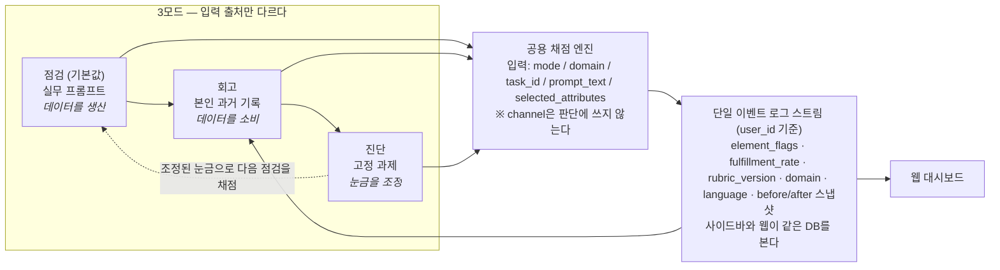
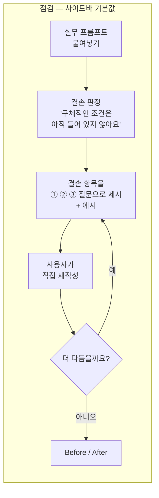
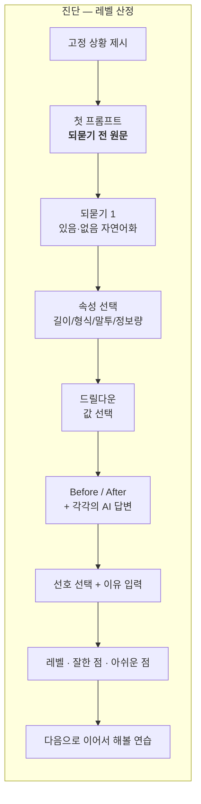
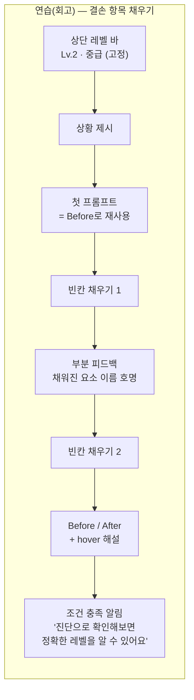
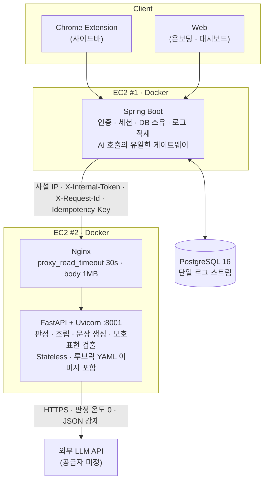
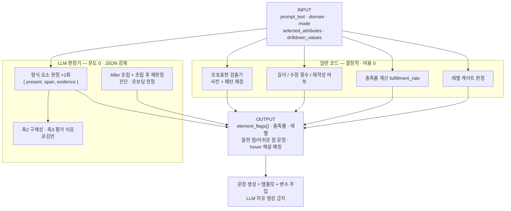

# 시스템 설계 — 서비스 정의·아키텍처·호출 흐름

> 담당: LLM(조하린) · 최종 수정: 2026-11-19
> 출처: AI 파트 시스템 설계서 v1.0 1·2·4장 · AI 파트 기술 명세서 v1.0 1.2·2장·5.5
> 기준 자료: 와이어프레임(온보딩 / 사이드바 진단·연습·점검 / 웹 대시보드), PD MVP 브랜딩 가이드

채점 엔진이 **무엇을, 어떤 구조로, 몇 번의 호출로** 판단하는지 적는다.

| 알고 싶은 것 | 문서 |
| --- | --- |
| 레벨·지표 계산식, 루브릭, 문장 템플릿, 모호표현, 조립 제약, 검증 계획 | `docs/dev/llm/model-design.md` |
| Spring ↔ FastAPI 엔드포인트·스키마·에러·호출 시퀀스 | `docs/dev/specs/interfaces.md` |
| 스택·선택 근거 | `docs/dev/llm/llm-tech-spec.md` |

---

## 1. 서비스 정의

### 1.1 포지션

사용자가 쓴 프롬프트를 실제 AI 서비스에 넣기 **전에 형식만 정비해주는 도구**다.

```
지적한다  →  무엇이 비어 있는지까지만 말한다
대신 쓰지 않는다  →  고쳐 쓰는 것은 사용자 본인
```

- 파는 것은 "한 번의 좋은 결과물"이 아니라 **역량 전이** — 다른 AI 모델로 옮겨가도 유지되는 능력.
- 자동 재작성(대필형)·프롬프트 라이브러리(템플릿형)와의 차별점이 여기서 갈린다.
- 외부 문헌 근거: 자동 프롬프트 재작성은 사용자 목표와 맞으면 소폭 개선되지만 어긋나면 모델 개선 효과를 훼손한다 (Information Systems Research — Prompt Adaptation).
- 과대 주장 금지: 짧은 프롬프트 교육은 과제 경계 안의 품질만 높였다 (Organization Science — Jagged Frontier). 따라서 "프롬프트 실력 = 업무 성과"는 카피로 쓰지 않는다.

### 1.2 판단 방식 — 형식 판단 vs 내용 판단

**맥락을 몰라도 형식은 판정할 수 있다.** 이 한 줄이 본 서비스의 기술적 성립 근거다.

|  | 내용 판단 | 형식 판단 (**채택**) |
| --- | --- | --- |
| 던지는 질문 | 이 프롬프트가 **좋은가** | 이 프롬프트에 **분량 조건이 적혀 있는가** |
| 필요한 것 | 사용자의 업무 맥락, 도메인 지식 | 없음 |
| 채점 방식 | 정도 판정 ("몇 점") | 존재 판정 ("있다 / 없다") |
| judge 편차 | 큼 | 작음 |
| 리스크 | 사용자 목적과 어긋난 재작성 | 낮음 |

- 존재 판정(이진)으로 바꾸는 순간 judge 편차 문제가 대부분 사라진다.
- 판정 질문을 **"충분히 구체적인가"가 아니라 "이 요소가 언급되었는가"로 고정**한다. 정도 판정이 섞이는 순간 편차가 커진다.

### 1.3 판정 대상 — 형식 요소 체크리스트 (MVP 확정)

**MVP는 도메인과 무관하게 공통 6요소 단일 세트로 고정한다.**

| # | 요소 | 키 | 판정 질문 | 판정 주체 |
| --- | --- | --- | --- | --- |
| 1 | 목적 | `purpose` | 무엇을 만들어달라는 것인지 적혀 있는가 | LLM |
| 2 | 대상 | `audience` | 누가 읽는 결과물인지 적혀 있는가 | LLM |
| 3 | 분량 | `length` | 길이·정보량의 상한/하한이 적혀 있는가 | LLM |
| 4 | 형식 | `format` | 구조·레이아웃·산출 형태가 적혀 있는가 | LLM |
| 5 | 페르소나 | `persona` | AI가 맡을 역할 또는 관점이 적혀 있는가 | LLM |
| 6 | 명확성 | `clarity` | 모호 표현이 없는가 (모호표현 검출의 역수) | **일반 코드** |

**6요소로 고정한 이유**

- 와이어프레임의 표기가 이미 `체크리스트 2/6 → 4/6 (다음 레벨 기준 4/6)`이다. 분모가 화면에 노출된 이상 세트 크기를 바꾸면 화면도 같이 깨진다.
- 도메인마다 요소 수가 달라지면 같은 사용자가 도메인 전환 시 분모가 바뀌어 회차 간 비교가 끊긴다.
- 대시보드 레이더 차트의 축 구성(`model-design.md` 2.5)과 분모가 일치한다.
- 도메인별 확장 세트(마케팅 `+채널·CTA·브랜드 톤`, 코딩 `+언어·버전·제약조건·에러 처리`, 학습 `+배경지식 수준·설명 깊이`, 창작 `+스타일 레퍼런스·금지 요소`)는 **보조 로깅 항목으로만 수집하고 레벨 계산에는 넣지 않는다.** Phase 2에서 도메인별 임계값 재검증과 함께 승격 여부를 결정한다.

요소별 판정 기준·few-shot은 `model-design.md` 4장.

### 1.4 모호표현은 LLM 밖에서 처리한다

```
판정 방식 :  단어 사전 + 패턴 매칭 (규칙 기반)
잡을 것   :  "적당히", "알아서", "애매한 것 같아", "고민이야", "좀", "잘"
이유      :  지연 시간 0 · 비용 0 · 항상 같은 결과(결정성)
```

- 한국어 특유 문제는 사전 설계에서 흡수한다. 예: "쓰다"(use / write) 같은 다의어는 LLM에 맡기지 않고 패턴 문맥으로 분기한다.
- 이 검출기는 자유 입력 드릴다운에도 그대로 적용한다 (`model-design.md` 1.4 케이스 B).
- 사전·패턴·판정 로직은 `model-design.md` 6장.

### 1.5 카피 가드레일 (브랜딩 가이드 MVP 연동)

AI가 생성·주입하는 모든 문장은 아래 표현을 쓰지 않는다. **템플릿 작성 단계에서 차단한다.**

| 금지 표현 | 이유 |
| --- | --- |
| "프롬프트를 잘 쓰면 업무 성과가 오릅니다" | 효과가 확인된 건 과제 경계 안뿐 |
| "가장 빠르게 실력을 높이는 방법입니다" | 학습 순서의 효과를 비교한 근거 없음 → "한 번에 하나씩 보는 편이 덜 헷갈려요"로 대체 |
| "이 조건 때문에 이 부분이 나왔습니다" | 같은 프롬프트도 재생성하면 답이 달라짐 — 인과 단정 불가 |
| "꾸준히 접속해서 실력이 늘었어요" | 접속은 행동 지표, 역량과의 인과 미확인 |
| "길고 상세할수록 좋은 프롬프트입니다" | 모든 과제·모델에서 우수하다는 근거 없음 |
| "부족합니다" · "미흡합니다" | 평가어. 판정은 있다/없다를 자연어로 풀어 말한다 |

- 허용 톤: "조건을 명시하면 AI가 무엇을 우선할지 헷갈리지 않아요" — 행동·조건 단위의 기술적 서술.
- **다정한 격려는 두 곳에서만 쓴다** — 연습·점검을 끝까지 마쳤을 때, 레벨업 조건을 채웠을 때. 아쉬운 점을 지적할 때는 섞지 않는다.
- 이 규칙은 에러 응답의 `user_message`에도 적용된다 (인터페이스 명세 3.10).

---

## 2. 기능 구조

### 2.1 3모드 역할

|  | **점검** | **진단** | **회고(연습)** |
| --- | --- | --- | --- |
| 나오는 결과 | 즉석 코칭 + Before/After | Lv.1 / Lv.2 / Lv.3 | 회차별 변화, 빠진 항목 |
| 결정 주체 | 사용자 | 채점기 | 사용자 본인 기록 |
| 과제 출처 | 사용자가 지금 쓰는 실무 프롬프트 | **고정 문제** | 본인 과거 프롬프트 (없으면 준비된 연습 1개) |
| 빈도 | 거의 항상 (기본값) | 가끔 | 가끔 |
| 채널 | 사이드바 (하단 입력창이 곧 진입점) | 사이드바 하단 버튼 / 온보딩 | 사이드바 하단 버튼 |
| 레벨 변경 | 불가 | **가능 (단독)** | 불가 — 조건 충족 알림까지만 |

- **기본값이 곧 사용률이다.** 점검은 별도 버튼 없이 입력창에 붙여넣으면 바로 시작된다.
- 모드 전환은 화면 이동이 아니라 **상태 변경**이므로 세션 컨텍스트가 유지된다. 웹으로 나가는 것은 대시보드 링크뿐이며 새 탭으로 연다.
- 모드 값: `diagnose`(진단) · `review`(점검) · `retrospect`(회고·연습).

### 2.2 데이터 흐름

```
점검이 데이터를 생산  →  회고가 그 데이터를 소비  →  진단이 고정 과제로 눈금을 조정
```



**엔진 설계 제약**

- 엔진은 **채널(지금 사이드바인지 웹인지)을 모른다.** 엔진 안에 채널 분기를 넣으면 같은 사용자가 화면에 따라 다른 레벨을 받는다. 채널은 로깅 필드로만 남긴다.
- 세 모드가 **동일한 채점 엔진**을 쓴다. 다른 것은 입력 출처와 과제 고정 여부뿐이다. 개발 관점에서 엔진은 하나만 만들면 된다.
- 로그 적재는 Spring이 한다. FastAPI는 DB에 붙지 않는다 (인터페이스 명세 1.2).

### 2.3 모드별 화면 시퀀스 (와이어프레임 기준)







### 2.4 After 생성 방식이 모드마다 다르다 — 측정 유효성의 핵심

|  | After를 만드는 주체 | 조립 제약 적용 | 반영도 측정 가능 여부 | `after_authored_by` |
| --- | --- | --- | --- | --- |
| 온보딩 진단 | 시스템 조립 | **필요** | 세션 내 측정 불가 (항상 100%) | `system_assembled` / `assembly_failed` |
| 사이드바 진단 | 시스템 조립 | **필요** | 세션 내 측정 불가 | `system_assembled` / `assembly_failed` |
| 점검 | **사용자가 직접 재작성** | 불필요 | **측정 가능 — After가 사용자 산출물** | `user_rewritten` |
| 연습 | 사용자가 빈칸 기입 | 불필요 (빈칸 외 생성 금지) | **측정 가능** | — |

- 최신 와이어프레임에서 점검 모드는 결손 항목을 질문으로 제시하고 **사용자가 프롬프트를 통째로 다시 쓴다.** 시스템이 끼워 넣는 구조가 아니다.
- 따라서 점검 모드의 After는 조립 코드의 정확도가 아니라 **사용자의 작성 능력**을 그대로 반영한다. 반영도·전이 측정의 1차 데이터 소스는 점검 모드로 둔다.
- 조립이 들어가는 것은 진단(온보딩·사이드바) 두 곳뿐이다. 여기에만 조립 제약과 사후 검증을 건다 (`model-design.md` 7장).

---

## 3. 아키텍처·컴포넌트

### 3.1 서버 구성도

인프라 배치(보안그룹·서브넷·환경 구분)는 `docs/dev/specs/architecture.md` 2절이 기준이다. 여기서는 AI 서버 관점의 구성만 그린다.



- AWS 환경은 ⏸ 보류 상태다. 무료 테스트 환경에서 AI 서버를 어디에 둘지는 미정 (architecture 2.2).

### 3.2 채점 엔진 구성



| 구성 요소 | 방식 | 상세 |
| --- | --- | --- |
| 모호표현 검출기 | 일반 코드 (사전 + 패턴) | `model-design.md` 6장 |
| 충족률 · 레벨 게이트 | 일반 코드 | `model-design.md` 1장 |
| 형식 요소 판정기 | LLM ×1 | `model-design.md` 3장 |
| 축2 구체성 · 축3 이유 요약 | LLM, 로깅만 | `model-design.md` 1.2 |
| After 조립 + 재판정 | LLM, 진단·온보딩만 | `model-design.md` 7장 |
| 문장 생성 | 템플릿 + 변수 주입 | `model-design.md` 5장 |

---

## 4. 호출 흐름

Spring ↔ FastAPI 사이의 엔드포인트 단위 시퀀스는 인터페이스 명세 2장이 기준이다. 여기서는 LLM 호출 수와 지연 대응만 다룬다.

### 4.1 LLM 호출 범위

**원칙: 프롬프트 1건당 형식 요소 판정 1회.** 요소별로 호출을 나누면 비용이 요소 수만큼 곱해진다.

| 화면 | 판정 | 조립 | 조립 검증 | 답변 생성 | 요약 | LLM 합계 |
| --- | --- | --- | --- | --- | --- | --- |
| 온보딩 — 첫 프롬프트 | 1 | — | — | — | — | 1 |
| 온보딩 — Before/After | — | 1 | 1 | 2 (병렬) | — | 4 |
| 진단 — 첫 프롬프트 | 1 | — | — | — | — | 1 |
| 진단 — Before/After | — | 1 | 1 | 2 (병렬) | — | 4 |
| 진단 — 이유 반영 | — | — | — | — | 1 | 1 |
| 점검 — 라운드당 | 1 | — | — | — | — | 1 |
| 점검 — Before/After | — | — | — | 2 (병렬) | — | 2 |
| 연습 — 빈칸 채움당 | 1 | — | — | — | — | 1 |
| 연습 — Before/After | — | — | — | 2 (병렬) | — | 2 |

- 위 수치는 재시도·재생성이 없을 때 기준이다. 조립 제약 위반 시 조립+재판정이 최대 2회 더 붙는다 (`model-design.md` 7.3).
- 점검·연습은 사용자가 After를 직접 쓰므로 **조립 호출이 없다.**

### 4.2 Before/After 답변 생성 구간 (지연 대응, 프론트·클라우드 공유)

```
[금지] : "5초 후 자동 전환"
          → 답변 2개를 생성해야 하는 구간이라 네트워크·모델 부하에 따라 흔들린다.
             아직 생성 중인 화면으로 넘어가거나, 끝났는데 기다리게 된다.

[적용] : 생성 완료 이벤트 기반 전환 + 대기 중 스켈레톤 표시
          + max_tokens 상한 (이 화면에 필요한 것은 완결된 산출물이 아니라
            Before/After의 차이 체감이다)
```

- 두 답변은 `asyncio.gather`로 **병렬 호출**한다. 직렬로 두면 체감 대기가 두 배가 된다.
- 응답은 `answers.before` / `answers.after` 두 필드로 함께 내려준다. **현재는 단일 응답이다.** SSE 스트리밍은 미결정 (인터페이스 명세 10장 범위 밖).
- 응답까지 걸리는 시간의 상한은 Spring 응답 타임아웃 35s다 (인터페이스 명세 4.1).

---

## 5. 로그 필드 — LLM 파트가 요구하는 것

이벤트 로그의 저장 구조(테이블·컬럼 타입)는 백엔드 소유다. 테이블 정의는 `docs/dev/specs/erd.md`, 컬럼의 기준은 Flyway `backend/src/main/resources/db/migration/V1__init.sql`이다. 여기서는 채점·지표 계산에 **반드시 필요한 값과 그 이유**, 그리고 **DB에서 어디서 읽는지**만 정의한다. 값 표기는 FastAPI 기준(snake_case·소문자)이며, DB 표기(대문자 열거형·`LV1`~`LV3`) 변환은 인터페이스 명세 7장을 따른다.

### 5.1 논리 필드 → DB 위치

| 논리 필드 | DB 위치 | 비고 |
| --- | --- | --- |
| `event_id` | `prompt_events.event_uuid` | 내부 PK(`id`)는 노출하지 않는다 |
| `user_id` · `session_id` · `channel` · `mode` · `task_id` · `domain` · `turn` | `prompt_events` 같은 이름 | `mode`·`domain`은 세션 값을 복사해 둔다 (집계 인덱스용) |
| `prompt_text` · `prompt_char_len` · `revision_count` | `prompt_events` 같은 이름 | |
| `is_rewrite` | `prompt_events.event_type = 'REWRITE'` | 별도 컬럼 없음 |
| `element_flags` | `prompt_events.element_flags` (JSONB) | FastAPI 응답 `elements` 원문 그대로 |
| `span_labels` · `ambiguity_hits` | `prompt_events` 같은 이름 (JSONB) | |
| `element_set_size` · `fulfilled_count` · `fulfillment_rate` | `prompt_events` 같은 이름 | `degraded`면 `fulfilled_count`·`fulfillment_rate` NULL (`model-design.md` 1.10) |
| `fulfillment_rate_after_probe` | **저장하지 않음 — 계산값** | 진단은 `ASSEMBLED`, 점검은 마지막 `REWRITE` 이벤트의 `fulfillment_rate` (`model-design.md` 1.5) |
| `measured_level` · `level_mutable` | `prompt_events` 같은 이름 | `degraded`면 `measured_level` NULL |
| `axis2_specificity_score` | `prompt_events.axis2_score` | 로깅 전용 |
| `degraded` · `judge_model` · `rubric_version` · `language` · `request_id` | `prompt_events` 같은 이름 | |
| `selected_attributes` · `drilldown_values` · `drilldown_input_type` · `attribute_option_order` | `before_after_records` 같은 이름 | 진단 세션당 1건 |
| `before_prompt_text` · `after_prompt_text` · `after_authored_by` | `before_after_records` 같은 이름 | 스냅샷 |
| `element_flags_after` | `before_after_records.after_event_id` → 그 이벤트의 `element_flags` | 별도 컬럼 없음. `assembly_failed`면 `after_event_id` NULL |
| `user_preferred_side` · `axis3_reason_text` · `reason_summary` | `before_after_records` 같은 이름 | |
| `self_reported_level` | `users.self_reported_level` | 이벤트에 복사하지 않는다 |
| 코칭받은 요소 | `coached_elements` (`element`, `source`) | 기록 규칙은 `model-design.md` 4.6 |

### 5.2 필수 값의 설계 의도

| 필드 | 없으면 생기는 일 |
| --- | --- |
| `rubric_version` | 루브릭을 한 번 고치는 순간 **전 사용자의 성장 그래프가 통째로 무효화된다.** 예전 점수와 지금 점수를 비교할 근거가 사라진다. |
| `domain` | 도메인이 바뀌면 과제가 바뀌므로 비교가 끊긴다. 전환 지점을 표시할 수 없다. |
| `language` | 영어 확장 시 언어별로 나눠 집계할 방법이 없다. 지금 안 넣으면 나중에 분리가 불가능하다. |
| `element_set_size` | 비율만 저장하면 원자료(몇 개 중 몇 개)를 복원할 수 없다. |
| `axis2` / `axis3` | 지금은 레벨에 안 쓰지만 자리를 비워 둔다. 검증 완료 후 과거 데이터로 재계산(backfill)하려면 처음부터 저장돼 있어야 한다. |
| `element_flags`가 객체 | bool이면 hover 해설과 span 일치율 검증이 불가능하다. FastAPI 응답 원문 그대로 저장한다 (인터페이스 명세 7.1). |
| `event_type` | 되묻기 전(`INITIAL`)과 후(`REWRITE`·`ASSEMBLED`)를 가르지 못하면 세분화율에 힌트를 받은 값이 섞인다 (`model-design.md` 2.2). |
| `after_authored_by` | 조립형 After와 사용자 재작성 After를 섞으면 반영도 분석이 무의미해진다 (2.4). `assembly_failed`는 Before/After 비교 분석에서 제외한다. |
| `degraded` | `true`면 요소 판정이 없어 충족률·레벨이 비어 있다. 성장 그래프 집계와 레벨 확정에서 제외한다 (`model-design.md` 1.10). |
| `drilldown_input_type` | 온보딩은 자유 입력, 사이드바는 보기 선택이라 반영도 판정 방식이 갈린다. 어느 쪽으로 들어왔는지 남겨야 분리 분석이 가능하다. |
| `attribute_option_order` | 위쪽 항목이 더 자주 선택되는 순서 효과를 사후에 보정할 수 있다. |
| `before/after_prompt_text` | 대시보드 열람용 스냅샷. **열람 시 재채점하지 않는다** (`model-design.md` 2.7). |

- `measured_level`의 DB 표기(`LV1`~`LV3`)는 인터페이스 명세 9장 논의 사항 2에서 확정한다. 측정 불가(`degraded`)는 NULL이다.
- 답변 생성 모델은 현재 DB에 남지 않는다. 답변 모델을 바꾸면 Before/After 선호(`user_preferred_side`) 분석에 경계를 그을 수 없어 `answer_model` 기록을 BE에 제안했다 (선택 사항).

---

## 6. 연동 파트 확인 사항

FastAPI 응답을 화면에 쓰는 쪽(Spring·프론트)이 놓치기 쉬운 항목이다.

- [ ] `degraded: true` 응답에서도 화면이 깨지지 않는지 (`elements`·`level`·`fulfillment_rate`가 `null`인 케이스, `model-design.md` 1.10)
- [ ] `SPAN_MISMATCH` 경고가 온 요소는 hover를 비활성했는지
- [ ] `level.mutable = false`인 응답으로 사용자 레벨을 갱신하고 있지 않은지
- [ ] Before/After 전환을 시간이 아니라 완료 이벤트로 받고 있는지
- [ ] `span`의 `start`/`end`를 JS `Array.from()` 기준으로 자르고 있는지 (인터페이스 명세 3.8)
- [ ] 대시보드 링크를 새 탭으로 열어 사이드바 입력이 유실되지 않는지
- [ ] 로그인 전 입력한 프롬프트를 로컬에 임시 보관했다가 복귀 후 복원하는지

---

## 7. 미결정 사항

| # | 항목 | 내용 | 중점 담당 | 영향 범위 |
| --- | --- | --- | --- | --- |
| 1 | 온보딩 속성 선택 방식 | 온보딩은 스크롤 리스트(다중선택으로 보임), 사이드바 진단은 단일선택 4개. 충족률 기준으로 레벨을 계산하면 눈금은 안 깨지지만, **다중/단일 여부와 선택지 개수는 명시 필요.** | PD + AI | 로그 스키마, 결과 문구 |
| 2 | 온보딩 드릴다운 입력 방식 | 온보딩은 자유 입력(`예) 300자 내외`), 사이드바 진단은 보기 3개. 둘 다 진단인데 입력 방식이 다르다. **제안 — 진단은 자유 입력으로 통일, 연습·점검은 보기 제공** (측정할 땐 스스로 떠올리게, 가르칠 땐 보기를 준다). 자유 입력 유지 시 온보딩만 LLM 판정이 추가된다. | PD + AI | LLM 호출 수, 반영도 판정 |
| 3 | 속성 선택지 목록 불일치 | 온보딩 8개(신뢰성·창의성 포함) vs 사이드바 4개(길이·형식·말투·정보량). 신뢰성을 중요하게 보는 사용자가 사이드바에서는 고를 수 없다. **목록을 맞추거나 도메인별 상위 4개 노출** 중 택1. | PD + AI | 결과 문구, 연습 주제 연결 |
| 4 | 용어 통일 | 온보딩 `잘한 점 / 개선점` vs 사이드바 `잘한 점 / 아쉬운 점`. 잘한 점은 통일됨, 뒤쪽만 남음. 요소 이름도 확정 필요 — `구조`=`형식`? `독자`=`대상`? | PD | 템플릿 전체 |
| 5 | 온보딩 결과 화면의 신고 vs 실측 | 현 시안은 `나의 프롬프팅 실력 — 중급`만 표시. **"직접 입력한 실력 / 실제 측정된 실력"을 나란히 보여주는 구조가 서비스 사용 동기를 만든다.** 복원 여부 결정 필요. | PD + AI | 결과 화면, 문구 템플릿 |
| 6 | `기타` 도메인의 진단 처리 | 문제가 열려 있어 고정 과제 전제가 깨진다. 대안 A(레벨 대신 충족 현황만) / 대안 B(4개 중 근접 도메인 재선택). 확정되면 `UNSUPPORTED_DOMAIN`의 Spring 대응을 채운다 (인터페이스 명세 6.2). | 팀 | 레벨 산정 가능 여부 |
| 7 | 진단·연습 과제 쌍 설계 | 동일 난이도·동일 요구 요소의 쌍으로 만들되 같은 문항은 아니어야 한다. 과제 추가 시마다 임계값 재검증 필요. | PD + AI | 임계값 |
| 8 | 레이더 축 구성 | 현 시안은 3축(축1/2/3). **6축(형식 요소별)이 전부 코드 계산값이고 연습 동선과 직접 이어진다.** 교체 / 병행 / 유지 중 택1. | PD + AI | 대시보드 |
| 9 | 대시보드 `다음 목표` 영역 | v0.1에 있던 배지·다음 연습 제안이 현 시안에 없음. 부활 여부 결정 필요. | PD | 대시보드, 연습 진입 동선 |
| 10 | "연습하기" 명칭 | `반복 연습을 통해 요령 체득` 설명문이 회고 컨셉과 어긋난다. 후보 — `내 프롬프트 돌아보기`, `지난 프롬프트 다시 보기`. | PD | 카피 전반 |
| 11 | 진단 재실행 트리거 | 하단 버튼이 상시 노출돼 아무 때나 재진단 가능. 막지는 않되 "지난 진단이 3일 전이에요" 되묻기로 빈도를 낮출지 결정. | 팀 | 레벨 안정성 |
| 12 | Lv. 경계 임계값 확정 | 현재 `0~1 / 2~3 / 4↑ (분모 6)`은 가설값. 런칭 전 20~30건 사전 테스트로 보정. | AI + 팀 | 레벨 전체 |
| 13 | Before/After 답변 생성 지연 | 시간 기반 전환 금지, 완료 이벤트 기반 + `max_tokens` 제한 + 병렬 호출. SSE 스트리밍 여부 합의 필요. | 프론트 + AI + 클라우드 | 온보딩·진단 UX |
| 14 | 도메인별 확장 요소 세트 승격 시점 | MVP는 공통 6요소 고정. 확장 세트는 보조 로깅만. Phase 2 승격 기준과 임계값 재검증 계획 필요. | AI | 레벨, 대시보드 분모 |
| 15 | 영어 확장 시점 | 지금은 루브릭 구조/문구 분리까지만. `language × domain`이 눈금 단위라는 전제만 공유. | 팀 | 전 영역 |

> 원본 v1.0의 #13(사이드바/웹 DB 연동 구조, 백엔드+프론트 담당)은 LLM 파트 범위가 아니라 제외했다.

---

## 변경 이력

| 날짜 | 내용 | 작성 |
| --- | --- | --- |
| 2026-11-19 | 시스템 설계서 v1.0·기술 명세서 v1.0에서 목적 단위로 분리. 레벨·지표·검증은 `model-design.md`, 계약은 `interfaces.md`로 이동. 확정 사항 반영(내부 토큰·타임아웃·포트·`assembly_failed`) | LLM |
| 2026-11-19 | ERD 대조 반영: 5장을 "논리 필드 → DB 위치" 대응표로 변경(`fulfillment_rate_after_probe`·`is_rewrite`·`element_flags_after`는 계산·참조로 대체), `degraded` 의미 수정, 점검 결손 문구 가드레일 적용 | LLM |
