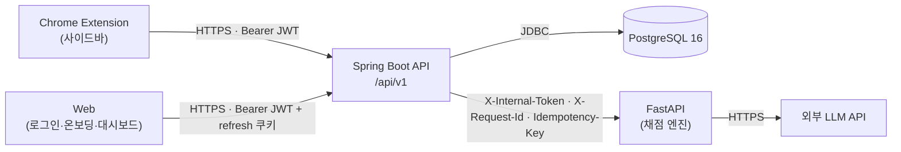
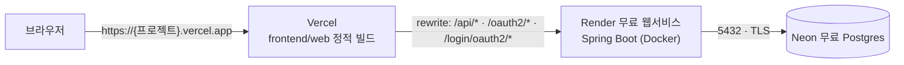
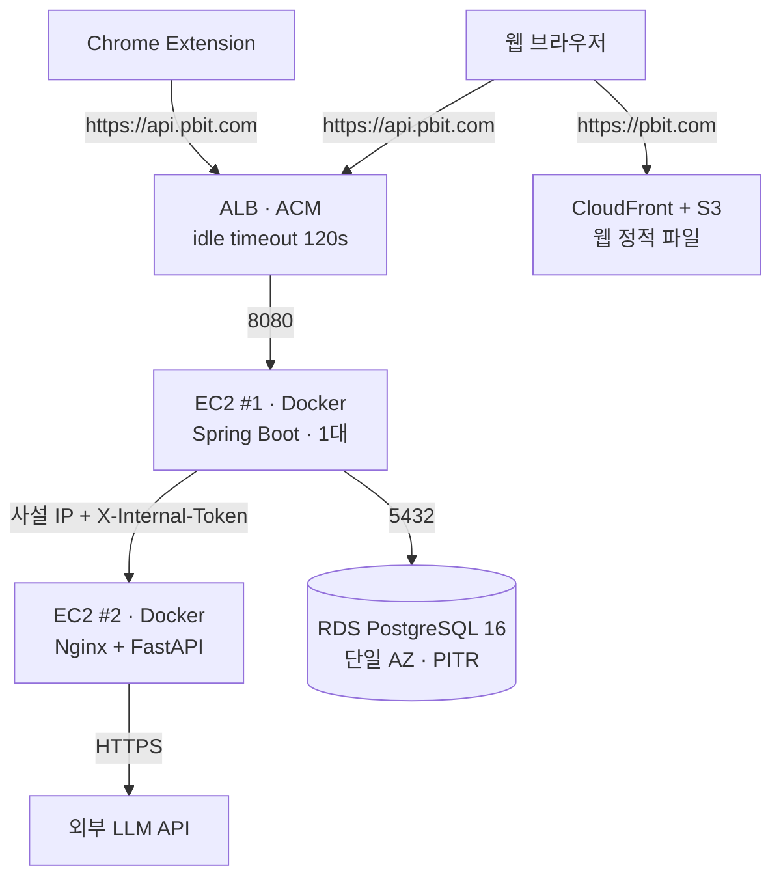
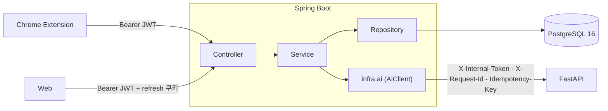

# 전체 서비스 아키텍처 다이어그램

> 1·2절: 클라우드(INFRA, KAN-62) · 3절: 백엔드(BE, KAN-66)
 
`architecture.md`는 인프라와 백엔드가 함께 쓴다. 1·2절은 클라우드, 3절(백엔드 아키텍처)은 백엔드(BE)가 작성한다. 겹치는 항목은 한 곳에만 쓰고 다른 곳은 링크한다.
 
| 항목 | 기준 문서 |
| --- | --- |
| 타임아웃 체인 | LLM ↔ 백엔드 인터페이스 명세 4.1 |
| 도메인·쿠키 | 이 문서 3.4 (2.5절은 같은 내용을 인프라 관점으로만 적는다) |
 
---
 
## 1. 전체 구성도
 
클라이언트 두 개(크롬 익스텐션 · 웹)가 **같은 Spring API(`/api/v1`)** 를 쓰고, 데이터는 **PostgreSQL 하나**에 모인다. AI 서버(FastAPI)는 **Spring만** 호출하고, 외부 LLM은 **FastAPI만** 호출한다.
 

 
| 구성 요소 | 역할 | 담당 파트 | 외부에서 직접 접근 |
| --- | --- | --- | --- |
| Chrome Extension | 진단·점검·연습 사이드바 | 프론트 | — (Chrome Web Store 배포) |
| Web | 로그인·가입·온보딩·대시보드 | 프론트 | 가능 |
| Spring Boot API | 인증·세션·로그 적재·지표 집계·AI 호출 게이트웨이 | 백엔드 | 가능 (유일한 API 출입구) |
| FastAPI | 형식 요소 판정·조립·답변 생성 | AI | **불가** (Spring만 호출) |
| PostgreSQL | 회원·세션·판정 로그 | 백엔드(스키마) · 클라우드(운영) | **불가** (Spring만 접근) |
| 외부 LLM API | 판정·답변 모델 | AI | — |
 
---
 
## 2. 인프라
 
### 2.1 환경 구분
 
| 환경 | 위치 | 용도 | 상태 | 비밀값 위치 |
| --- | --- | --- | --- | --- |
| local | 개발자 PC (`docker-compose`: DB만 컨테이너, 앱은 IntelliJ) | 개발 | ✅ 사용 중 | 각자 `.env` (커밋 금지) |
| CI | GitHub Actions (PostgreSQL 서비스 컨테이너) | PR마다 빌드·테스트 | ✅ 사용 중 | `ci.yml`의 더미 값 |
| test | Vercel + Render + Neon (무료) | 디자이너 화면 확인 | 🔨 구축 중 (KAN-61) | 각 서비스 대시보드 환경변수 |
| dev / prod | AWS 서울 리전 | 통합 테스트 / 파일럿 | ⏸ 보류 (11/12 회의) | SSM Parameter Store |
 
배포 절차는 `docs/ops/deploy.md`, 환경변수 목록은 `docs/ops/env.md` 참고.
 
### 2.2 현재: 무료 테스트 환경 (KAN-61)
 
디자이너가 실제 화면을 눌러보는 용도다. 파일럿 사용자용이 아니다.
 

 
| 구성 요소 | 서비스 | 알아둘 제약 (2026-11 공식 문서 기준) |
| --- | --- | --- |
| 웹 | Vercel Hobby | 비상업·개인 용도만, 팀 협업 기능 없음 → 배포 계정 1개로 운영 |
| 백엔드 | Render Free Web Service | 15분 요청 없으면 잠듦, 깨어나는 데 약 1분 · 월 750시간 |
| DB | Neon Free | 기간 제한 없음 · 프로젝트당 1GB · 복원 가능 기간 6시간 |
| AI 서버 | — | `ai-server` 코드가 생기면 추가 |
 
구축 시 지킬 것:
 
- **같은 사이트로 묶기:** 브라우저는 Vercel 주소만 본다. Refresh 쿠키가 `SameSite=Lax`라 API가 다른 사이트(`*.onrender.com`)에 있으면 쿠키가 안 실린다. 그래서 Vercel rewrite로 API를 넘긴다.
- **rewrite 대상:** `/api/*`와 Google 로그인 경로(`/oauth2/*`, `/login/oauth2/*`)만 Render로 보낸다. `/auth/callback` 같은 웹 화면 경로는 넘기지 않는다.
- **웹 경로 새로고침:** 웹이 `BrowserRouter`를 쓰므로 `/onboarding` 등을 새로고침해도 404가 나지 않게 나머지 경로는 `index.html`로 보낸다.
- **프로필:** Render에서는 `local` 프로필로 띄우지 않는다. `local`에서만 Refresh 쿠키 `Secure`가 꺼진다 (`application-local.yml`).
- **헬스체크:** `/actuator/health` (인증 없이 열려 있음).
- ⚠️ AI 기능을 붙일 때 Vercel rewrite 경유 응답 시간 제한을 다시 확인한다 (Before/After 최대 35초).
 
### 2.3 목표: AWS 운영 환경 (보류)
 
결정 대기 항목(도메인 구매, AWS 계정·예산, LLM 공급자)이 정해지면 착수한다. 상세 근거는 클라우드 기술기획서 V0.3.
 

 
| 계층 | 구성 | 핵심 규칙 |
| --- | --- | --- |
| 웹 정적 | S3 + CloudFront(OAC) | S3 직접 공개 금지. CloudFront 인증서는 us-east-1 발급 |
| API 진입 | ALB + ACM(서울) | API는 CloudFront 뒤에 두지 않는다 (CloudFront 오리진 응답 기본 30초 < 최대 35초 응답) |
| API 서버 | EC2 #1, Spring Boot | 파일럿은 1대 (2.6) |
| 채점 엔진 | EC2 #2, Nginx + FastAPI | DB 접근 없음. EC2 #1에서 오는 요청만 허용 |
| 데이터 | RDS PostgreSQL 16 | private subnet, 저장 암호화, 자동 백업 7일 + PITR, 삭제 방지 |
| 운영 | CloudWatch · ECR · Budgets · CloudTrail · Parameter Store | 로그·경보, 이미지 저장, 예산 경보, 감사, 비밀값 |
 
### 2.4 네트워크·보안
 
- **보안그룹 체인:** ALB → EC2 #1(8080) → EC2 #2(Nginx 80 → FastAPI 8001, 11/19 회의 잠정 결정·AWS 전환 시 재검토), EC2 #1 → RDS(5432). 그 외 인바운드는 막는다. SSH 포트는 열지 않고 SSM Session Manager로 접속한다.
- **EC2 #2 아웃바운드:** 외부 LLM API(HTTPS 443). private subnet이면 NAT 없이는 호출이 실패하므로, NAT Gateway 또는 public subnet 중 AWS 착수 시 결정한다.
- **내부 토큰(`X-Internal-Token`):** Spring과 FastAPI가 같은 값을 쓴다. 값 생성·보관은 클라우드가 맡는다 — 개발용은 Discord 🔒 채널로만 공유, 테스트 환경은 두 서비스에 같은 값 등록, AWS는 Parameter Store 한 곳에 두고 두 서버가 읽는다. 변수 이름은 양쪽 모두 `AI_INTERNAL_TOKEN`으로 통일한다 (인터페이스 명세 논의 사항 #4).
- **타임아웃:** 구간별 값은 인터페이스 명세 4.1을 따른다. 인프라가 추가로 맞출 값은 ALB idle timeout 120초와 EC2 #2 Nginx의 `proxy_read_timeout 30s` · `client_max_body_size 1m`이다.
- **로그:** 프롬프트 원문은 애플리케이션·Nginx·CloudWatch 로그에 남기지 않는다 (인터페이스 명세 7.3).
 
### 2.5 도메인·쿠키 (인프라 관점)
 
기준은 이 문서 3.4. 인프라는 이를 다음처럼 반영한다.
 
- 웹과 API는 같은 도메인 하위에 둔다 (예: `pbit.com` / `api.pbit.com`). 운영은 HTTPS 필수. **도메인 구매가 AWS 착수 조건이다.**
- ACM 인증서는 두 장: ALB용(서울), CloudFront용(us-east-1).
- Google OAuth 리디렉션 URI는 환경별(test·dev·prod)로 등록한다.
- 익스텐션 ID는 manifest `key`로 고정한다. CORS(`EXTENSION_ORIGIN`)와 `externally_connectable`이 ID에 묶여 있다. 고정용 비공개 키(.pem)는 저장소에 올리지 않는다.
 
### 2.6 단일 인스턴스 원칙
 
Spring은 파일럿 동안 1대로 운영한다. `Idempotency-Key`(60초)와 사용자당 AI 호출 제한(분당 20회, 이 문서 3.9 — 구현 방식 미정)이 서버 메모리에 상태를 두면, 2대로 늘렸을 때 서버마다 따로 동작해 제대로 막지 못한다. 확장이 필요하면 먼저 이 상태를 DB나 Redis로 옮긴다.
 
---
 
## 3. 백엔드 아키텍처
 
### 3.1 핵심 구조

**Spring Boot API 하나와 PostgreSQL 하나**로 운영한다. 크롬 익스텐션과 웹이 같은 API(`/api/v1`)와 같은 DB를 쓴다. AI 서버(FastAPI)는 Spring만 호출한다.

| 선택 | 이유 |
| --- | --- |
| API 하나를 익스텐션·웹이 공유 | 같은 사용자가 두 화면에서 같은 레벨·기록을 봐야 한다. API가 나뉘면 값이 어긋난다 |
| DB 하나 | 성장률·전이율은 회차 간 비교라 모든 기록이 한 곳에 있어야 계산된다 |
| AI 서버 분리 | LLM 호출·판정은 Python 생태계가 유리하고, 오래 걸리는 작업이 API 서버에 영향을 주지 않게 한다 |

### 3.2 경계 원칙

| 원칙 | 내용 | 이유 |
| --- | --- | --- |
| DB 단일 소유 | DB에는 Spring만 접근한다. FastAPI는 DB에 붙지 않는다 | 데이터 규칙과 집계를 한 곳에서 책임진다 |
| AI 비노출 | 클라이언트는 FastAPI를 직접 부르지 않는다. Spring이 유일한 출입구다 | 인증·호출 제한·로그 적재를 빠짐없이 거치게 한다 |
| 채널 무관 | `channel`(익스텐션/웹)은 로그에만 저장한다. 비즈니스 분기에 쓰지 않는다 | 화면에 따라 결과가 달라지면 사용자가 서비스를 못 믿는다 |
| 레벨 권한 | `users.current_level`은 진단 모드이고 AI 응답이 `mutable=true`일 때만 갱신한다 | 연습·점검은 힌트가 있어 실제 실력보다 높게 나온다 |
| 재채점 금지 | 저장된 Before/After 기록은 저장 당시 스냅샷을 그대로 보여준다 | 루브릭이 바뀌어도 과거 기록은 변하지 않아야 한다 |

### 3.3 내부 구조

- 패키지는 **기능 단위**(`domain/auth`, `domain/user`, `domain/term` …)로 나누고, 모든 기능이 같은 내부 모양(`controller` · `service` · `repository` · `entity` · `dto/request` · `dto/response`)을 갖는다.
- 공통 코드는 `global/`(설정·인증·에러·로깅), 외부 연동은 `infra/`(AI 서버 호출, AI 연동 시 추가)에 둔다.
- 이유: 기능별로 묶으면 한 기능을 고칠 때 한 폴더만 보면 된다. AI 연동을 `infra/`로 떼어내면 FastAPI 스키마가 바뀌어도 영향이 그 안에서 끝난다.
- 상세 규칙은 [`backend/AGENTS.md`](../../../backend/AGENTS.md) 참고.

### 3.4 인증 구조

| 선택 | 이유 |
| --- | --- |
| 서버 세션 대신 JWT (Access 30분) | 서버가 로그인 상태를 들고 있지 않아, 익스텐션·웹이 같은 방식으로 인증한다 |
| Refresh(14일)는 DB에 해시로 저장, 재발급마다 교체 | DB가 털려도 토큰 원문은 없고, 탈취된 토큰은 한 번만 쓸 수 있다. 기기별 로그아웃도 가능하다 |
| 웹은 Refresh를 `HttpOnly` 쿠키, 익스텐션은 본문으로 전달 | 웹은 스크립트가 토큰을 읽지 못하게 막고, 익스텐션은 쿠키를 쓸 수 없다 |
| 웹과 API는 같은 도메인 하위 (`pbit.com` / `api.pbit.com`) | Refresh 쿠키가 `SameSite=Lax`라, 다른 도메인이면 쿠키가 안 실려 새로고침마다 로그아웃된다. 운영은 HTTPS 필수 |

웹 토큰 흐름과 쿠키 속성은 [`api.md`](api.md) 2장.

### 3.5 데이터 구조

| 선택 | 이유 |
| --- | --- |
| 판정 기록은 **단일 이벤트 로그**(`prompt_events`) 하나에 쌓는다 | 모드가 달라도 같은 방식으로 집계할 수 있다 |
| AI 판정 원문은 `JSONB`, 집계에 쓰는 값은 별도 컬럼 | 원문은 나중에 다시 분석할 수 있게 보존하고, 자주 쓰는 값은 빠르게 조회한다 |
| 판정 로그에 `rubric_version` · `domain` · `language` 필수 | 채점 기준이 바뀌면 이전 값과 비교할 수 없다. 구분할 기준이 있어야 한다 |
| 클라이언트에 보이는 ID는 UUID, 내부 로그는 숫자 ID | UUID는 다른 사람의 ID를 추측할 수 없다. 내부 로그는 숫자가 저장·정렬에 유리하다 |
| 시간은 `TIMESTAMPTZ` UTC 저장, Java는 `Instant` | 서버와 로컬의 시간대가 달라도 값이 어긋나지 않는다. 한국 시간은 표시·주간 집계에서만 변환 |
| 스키마는 Flyway로만 변경, JPA는 검증만(`validate`) | 팀원 모두 같은 스키마를 쓰고, 변경 이력이 파일로 남는다 |

테이블 상세는 [`erd.md`](erd.md).

### 3.6 AI 서버 연동

- FastAPI 호출은 **DB 트랜잭션 밖에서** 하고, 응답을 받은 뒤 짧은 트랜잭션으로 저장한다. 최대 35초 걸리는 호출 동안 DB 연결을 잡고 있으면 다른 요청이 막힌다.
- 요청마다 `X-Request-Id`를 만들어 응답 헤더·에러 응답·FastAPI 호출까지 전달한다. 한 요청을 두 서버 로그에서 같은 ID로 찾는다.
- 재시도·멱등성·에러 대응은 [`interfaces.md`](interfaces.md) 4–6장을 따른다.

### 3.7 지표 집계

- MVP는 대시보드를 열 때 **실시간으로** 집계한다 (세분화율·baseline·전이율·활동 일수).
- 이유: 사용자가 적을 때는 배치·스냅샷 테이블 없이도 충분히 빠르다. 자주 쓰는 조회는 부분 인덱스(`idx_events_metric`)로 받친다.
- 재검토: 조회가 느려지면 일 단위 집계 테이블(`user_metric_snapshots`)을 추가한다.

### 3.8 기술 스택 (사용 중)

| 분류 | 기술 | 버전 | 선택 이유 |
| --- | --- | --- | --- |
| 언어 | Java | 17 | LTS, 팀 경험 |
| 프레임워크 | Spring Boot | 4.0.9 (Spring Framework 7.0) | 최신 안정 버전으로 시작해 업그레이드 부담을 줄인다 |
| 빌드 | Gradle | 9.8 | Spring Boot 기본 구성 |
| ORM | Spring Data JPA / Hibernate | 7.2 | 엔티티 중심 개발, 반복 CRUD 축소 |
| DB | PostgreSQL | 16 | `JSONB` · `UUID` · 부분 인덱스가 판정 원문 저장·지표 집계에 맞다 |
| 마이그레이션 | Flyway | 11.14 | SQL 파일로 스키마 변경 이력 관리 |
| 보안 | Spring Security | 7.0 | 인증 필터·CORS·에러 응답을 표준 방식으로 처리 |
| JSON | Jackson | 3.1 | Spring Boot 4 기본 (`tools.jackson` 패키지) |
| API 문서 | springdoc-openapi | 3.0.3 | 코드에서 Swagger UI 자동 생성. `local`에서만 열린다 |
| 편의 | Lombok | | 반복 코드 축소 |
| 테스트 | JUnit 5 · Spring Security Test | | 웹 계층은 `@WebMvcTest`(DB 불필요), 서비스·리포지토리는 `@DataJpaTest`(실제 PostgreSQL) |
| 로컬 환경 | Docker Compose | | DB만 컨테이너, 앱은 IntelliJ 실행 |
| CI | GitHub Actions | | PR마다 빌드·테스트, PostgreSQL 서비스 컨테이너 |

> ⚠️ Spring Boot 4는 Boot 3과 패키지가 다른 곳이 있다 (Jackson 3, 테스트 어노테이션 위치, springdoc 3.x). 인터넷 예제는 대부분 Boot 3 기준이라 그대로 쓰면 컴파일이 안 된다.

### 3.9 예정

| 항목 | 내용 | 시점 |
| --- | --- | --- |
| 사용자당 AI 호출 제한 | AI 경유 API를 사용자당 분당 20회로 제한한다. LLM 비용 보호와 429 예방용이다 (인터페이스 명세 4.3). 구현 방식은 미정 | AI 연동 API 구현 시 |
 
---
 
## 변경 이력
 
| 날짜 | 내용 | 작성 |
| --- | --- | --- |
| 2026-11-16 | 1·2절 초안 작성 (클라우드 기술기획서 V0.3 기반, BE 절 구조에 맞춤) | 클라우드(INFRA) |
| 2026-11-23 | 3절 백엔드 아키텍처 작성 (노션 [BE] 서비스 아키텍처 이전, KAN-81) | 백엔드(BE) |
