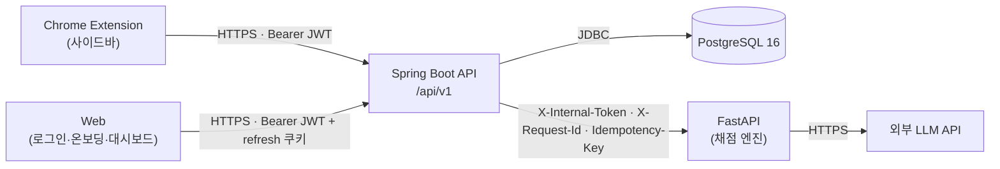
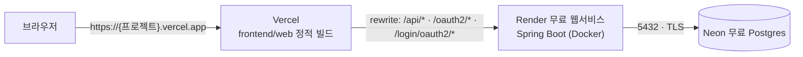
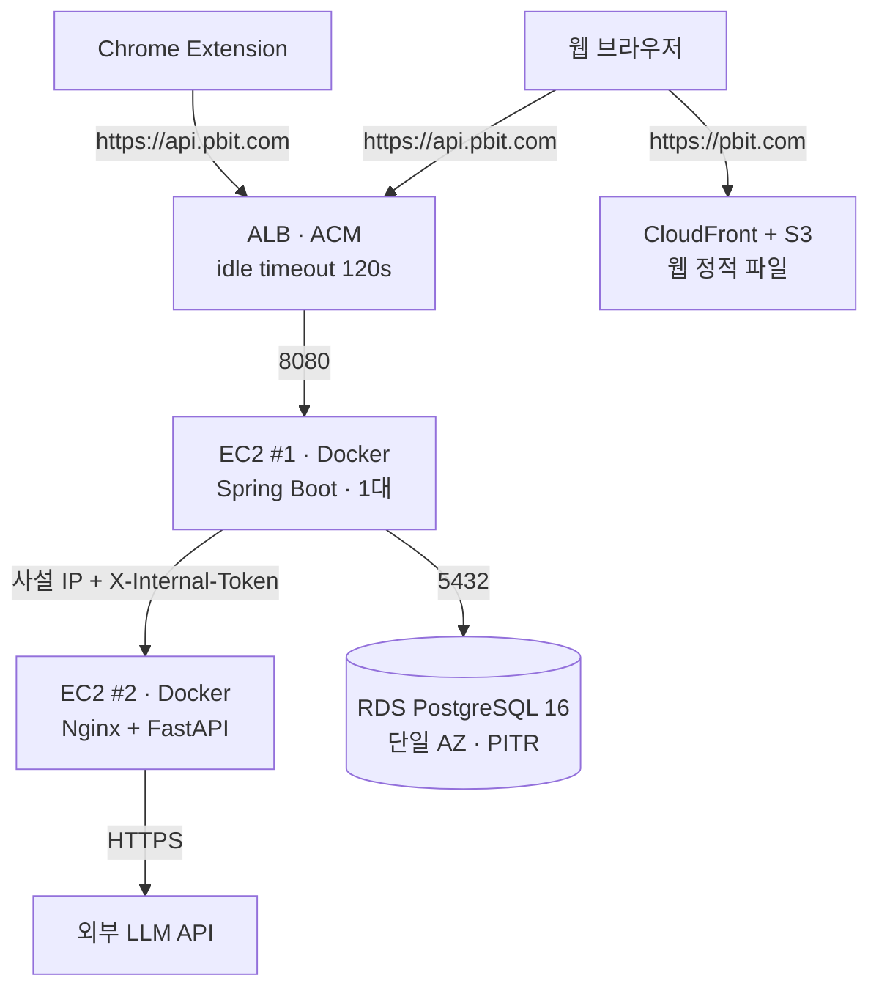

# 전체 서비스 아키텍처 다이어그램

> 1·2절: 김성민(클라우드, KAN-62) · 3절: 김현재(백엔드, KAN-66)
 
`architecture.md`는 인프라와 백엔드가 함께 쓴다. 1·2절은 클라우드, 3절(백엔드 아키텍처)은 김현재가 작성한다. 겹치는 항목은 한 곳에만 쓰고 다른 곳은 링크한다.
 
| 항목 | 기준 문서 |
| --- | --- |
| 타임아웃 체인 | LLM ↔ 백엔드 인터페이스 명세 4.1 |
| 도메인·쿠키 | 이 문서 3.4 (2.5절은 같은 내용을 인프라 관점으로만 적는다) |
 
---
 
## 1. 전체 구성도
 
클라이언트 두 개(크롬 익스텐션 · 웹)가 **같은 Spring API(`/api/v1`)** 를 쓰고, 데이터는 **PostgreSQL 하나**에 모인다. AI 서버(FastAPI)는 **Spring만** 호출하고, 외부 LLM은 **FastAPI만** 호출한다.
 

 
| 구성 요소 | 역할 | 담당 파트 | 외부에서 직접 접근 |
| --- | --- | --- | --- |
| Chrome Extension | 진단·점검·연습 사이드바 | 프론트 | — (Chrome Web Store 배포) |
| Web | 로그인·가입·온보딩·대시보드 | 프론트 | 가능 |
| Spring Boot API | 인증·세션·로그 적재·지표 집계·AI 호출 게이트웨이 | 백엔드 | 가능 (유일한 API 출입구) |
| FastAPI | 형식 요소 판정·조립·답변 생성 | AI | **불가** (Spring만 호출) |
| PostgreSQL | 회원·세션·판정 로그 | 백엔드(스키마) · 클라우드(운영) | **불가** (Spring만 접근) |
| 외부 LLM API | 판정·답변 모델 | AI | — |
 
---
 
## 2. 인프라
 
### 2.1 환경 구분
 
| 환경 | 위치 | 용도 | 상태 | 비밀값 위치 |
| --- | --- | --- | --- | --- |
| local | 개발자 PC (`docker-compose`: DB만 컨테이너, 앱은 IntelliJ) | 개발 | ✅ 사용 중 | 각자 `.env` (커밋 금지) |
| CI | GitHub Actions (PostgreSQL 서비스 컨테이너) | PR마다 빌드·테스트 | ✅ 사용 중 | `ci.yml`의 더미 값 |
| test | Vercel + Render + Neon (무료) | 디자이너 화면 확인 | 🔨 구축 중 (KAN-61) | 각 서비스 대시보드 환경변수 |
| dev / prod | AWS 서울 리전 | 통합 테스트 / 파일럿 | ⏸ 보류 (11/12 회의) | SSM Parameter Store |
 
배포 절차는 `docs/ops/deploy.md`, 환경변수 목록은 `docs/ops/env.md` 참고.
 
### 2.2 현재: 무료 테스트 환경 (KAN-61)
 
디자이너가 실제 화면을 눌러보는 용도다. 파일럿 사용자용이 아니다.
 

 
| 구성 요소 | 서비스 | 알아둘 제약 (2026-11 공식 문서 기준) |
| --- | --- | --- |
| 웹 | Vercel Hobby | 비상업·개인 용도만, 팀 협업 기능 없음 → 배포 계정 1개로 운영 |
| 백엔드 | Render Free Web Service | 15분 요청 없으면 잠듦, 깨어나는 데 약 1분 · 월 750시간 |
| DB | Neon Free | 기간 제한 없음 · 프로젝트당 1GB · 복원 가능 기간 6시간 |
| AI 서버 | — | `ai-server` 코드가 생기면 추가 |
 
구축 시 지킬 것:
 
- **같은 사이트로 묶기:** 브라우저는 Vercel 주소만 본다. Refresh 쿠키가 `SameSite=Lax`라 API가 다른 사이트(`*.onrender.com`)에 있으면 쿠키가 안 실린다. 그래서 Vercel rewrite로 API를 넘긴다.
- **rewrite 대상:** `/api/*`와 Google 로그인 경로(`/oauth2/*`, `/login/oauth2/*`)만 Render로 보낸다. `/auth/callback` 같은 웹 화면 경로는 넘기지 않는다.
- **웹 경로 새로고침:** 웹이 `BrowserRouter`를 쓰므로 `/onboarding` 등을 새로고침해도 404가 나지 않게 나머지 경로는 `index.html`로 보낸다.
- **프로필:** Render에서는 `local` 프로필로 띄우지 않는다. `local`에서만 Refresh 쿠키 `Secure`가 꺼진다 (`application-local.yml`).
- **헬스체크:** `/actuator/health` (인증 없이 열려 있음).
- ⚠️ AI 기능을 붙일 때 Vercel rewrite 경유 응답 시간 제한을 다시 확인한다 (Before/After 최대 35초).
 
### 2.3 목표: AWS 운영 환경 (보류)
 
결정 대기 항목(도메인 구매, AWS 계정·예산, LLM 공급자)이 정해지면 착수한다. 상세 근거는 클라우드 기술기획서 V0.3.
 

 
| 계층 | 구성 | 핵심 규칙 |
| --- | --- | --- |
| 웹 정적 | S3 + CloudFront(OAC) | S3 직접 공개 금지. CloudFront 인증서는 us-east-1 발급 |
| API 진입 | ALB + ACM(서울) | API는 CloudFront 뒤에 두지 않는다 (CloudFront 오리진 응답 기본 30초 < 최대 35초 응답) |
| API 서버 | EC2 #1, Spring Boot | 파일럿은 1대 (2.6) |
| 채점 엔진 | EC2 #2, Nginx + FastAPI | DB 접근 없음. EC2 #1에서 오는 요청만 허용 |
| 데이터 | RDS PostgreSQL 16 | private subnet, 저장 암호화, 자동 백업 7일 + PITR, 삭제 방지 |
| 운영 | CloudWatch · ECR · Budgets · CloudTrail · Parameter Store | 로그·경보, 이미지 저장, 예산 경보, 감사, 비밀값 |
 
### 2.4 네트워크·보안
 
- **보안그룹 체인:** ALB → EC2 #1(8080) → EC2 #2(Nginx 포트), EC2 #1 → RDS(5432). 그 외 인바운드는 막는다. SSH 포트는 열지 않고 SSM Session Manager로 접속한다.
- **내부 토큰(`X-Internal-Token`):** Spring과 FastAPI가 같은 값을 쓴다. 값 생성·보관은 클라우드가 맡는다 — 개발용은 Discord 🔒 채널로만 공유, 테스트 환경은 두 서비스에 같은 값 등록, AWS는 Parameter Store 한 곳에 두고 두 서버가 읽는다. 변수 이름은 양쪽 모두 `AI_INTERNAL_TOKEN`으로 통일한다 (인터페이스 명세 논의 사항 #4).
- **타임아웃:** 구간별 값은 인터페이스 명세 4.1을 따른다. 인프라가 추가로 맞출 값은 ALB idle timeout 120초뿐이다.
- **로그:** 프롬프트 원문은 애플리케이션·Nginx·CloudWatch 로그에 남기지 않는다 (인터페이스 명세 7.3).
 
### 2.5 도메인·쿠키 (인프라 관점)
 
기준은 이 문서 3.4. 인프라는 이를 다음처럼 반영한다.
 
- 웹과 API는 같은 도메인 하위에 둔다 (예: `pbit.com` / `api.pbit.com`). 운영은 HTTPS 필수. **도메인 구매가 AWS 착수 조건이다.**
- ACM 인증서는 두 장: ALB용(서울), CloudFront용(us-east-1).
- Google OAuth 리디렉션 URI는 환경별(test·dev·prod)로 등록한다.
- 익스텐션 ID는 manifest `key`로 고정한다. CORS(`EXTENSION_ORIGIN`)와 `externally_connectable`이 ID에 묶여 있다. 고정용 비공개 키(.pem)는 저장소에 올리지 않는다.
 
### 2.6 단일 인스턴스 원칙
 
Spring은 파일럿 동안 1대로 운영한다. `Idempotency-Key`(60초)와 사용자당 AI 호출 제한(분당 20회, 이 문서 3.9 — 구현 방식 미정)이 서버 메모리에 상태를 두면, 2대로 늘렸을 때 서버마다 따로 동작해 제대로 막지 못한다. 확장이 필요하면 먼저 이 상태를 DB나 Redis로 옮긴다.
 
---
 
## 3. 백엔드 아키텍처
 
> 김현재(백엔드) 작성 예정 — KAN-66
 
---
 
## 변경 이력
 
| 날짜 | 내용 | 작성 |
| --- | --- | --- |
| 2026-11-16 | 1·2절 초안 작성 (클라우드 기술기획서 V0.3 기반, BE 절 구조에 맞춤) | 김성민 |
 
