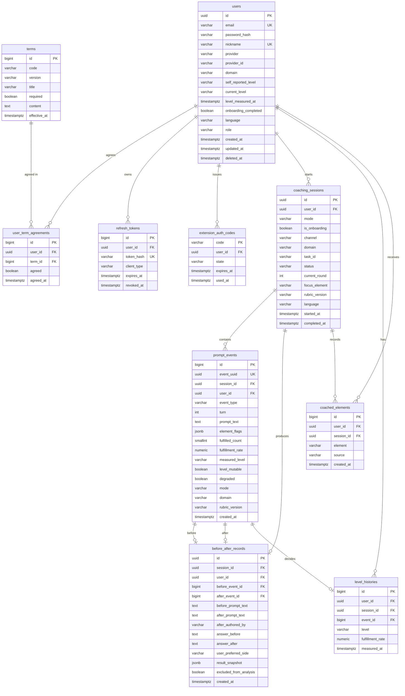

# DB ERD 명세

> 담당: 백엔드 · 최종 수정: 2026-11-21
> 출처: DB ERD 명세 (Notion, 백엔드 초안) · 기준: 백엔드 기술 기획서 v1.1 5장

| 항목 | 값 |
| --- | --- |
| DB | PostgreSQL 16 (단일 DB — 익스텐션·웹 공용) |
| 마이그레이션 | Flyway (`backend/src/main/resources/db/migration`) |

---

## 1. 설계 원칙

| 항목 | 규칙 |
| --- | --- |
| DB 접근 | Spring Boot만 접근. FastAPI는 DB에 붙지 않음 |
| PK | 클라이언트 노출 테이블 `UUID` / 내부·로그 테이블 `BIGINT IDENTITY` |
| 열거형 | `VARCHAR`  • `CHECK` 제약 (PG ENUM 미사용 — 값 추가 시 마이그레이션 번거로움) |
| 판정 원문 | `JSONB` (span 포함). 집계에 쓰는 값은 별도 컬럼으로 정규화 |
| 버전 필드 | 모든 판정 로그에 `rubric_version` · `domain` · `language` 필수 |
| 시간 | `TIMESTAMPTZ`, UTC 저장. 활동 일수 집계만 `Asia/Seoul` |
| 네이밍 | 테이블·컬럼 `snake_case`, 테이블 복수형 |
| 삭제 | `users`만 소프트 삭제(`deleted_at`) + 개인정보 마스킹 |
| 재채점 금지 | `before_after_records.result_snapshot`은 저장 후 변경하지 않음 |

---

## 2. ERD



> ERD는 핵심 컬럼만. 전체 컬럼은 4장 테이블 명세.
> 

---

## 3. 테이블 목록

| # | 테이블 | 도메인 | 역할 | 화면 |
| --- | --- | --- | --- | --- |
| 1 | `users` | user | 회원·현재 레벨·도메인·자가 레벨 | JOIN-02, ONB-00/001, MY |
| 2 | `terms` | terms | 약관 버전 | WEB-JOIN-01 |
| 3 | `user_term_agreements` | terms | 약관 동의 이력 | WEB-JOIN-01 |
| 4 | `refresh_tokens` | auth | 기기별 리프레시 토큰 | 로그인 유지 |
| 5 | `extension_auth_codes` | auth | 익스텐션 로그인 1회용 코드 | AUTH-01/02 |
| 6 | `coaching_sessions` | session | 코칭 흐름 1회 단위 | 온보딩, 진단·점검·연습 |
| 7 | `prompt_events` | event | 단일 이벤트 로그 (AI 판정 1회 = 1행) | 전 모드 |
| 8 | `before_after_records` | record | B/A 쌍 + 답변 + 선호·이유 + 결과 스냅샷 | B/A, 대시보드 기록 |
| 9 | `level_histories` | user | 진단 확정 레벨 이력 | 대시보드 레벨, 연습 레벨 카드 |
| 10 | `coached_elements` | event | 코칭받은 요소 (전이율 계산) | 대시보드 |

---

## 4. 테이블 명세

### 4.1 `users`

| 컬럼 | 타입 | 제약 | NULL | 기본값 | 설명 |
| --- | --- | --- | --- | --- | --- |
| id | UUID | PK | N | gen_random_uuid() | 회원 ID |
| email | VARCHAR(255) | UNIQUE | N |  | 이메일 (탈퇴 시 마스킹) |
| password_hash | VARCHAR(100) |  | Y |  | BCrypt. GOOGLE 가입자 NULL |
| nickname | VARCHAR(20) | UNIQUE | N |  | 2~10자 |
| provider | VARCHAR(10) | CHECK | N | 'LOCAL' | LOCAL / GOOGLE |
| provider_id | VARCHAR(100) |  | Y |  | Google sub |
| domain | VARCHAR(20) | CHECK | Y |  | MARKETING / STUDY / CODING / CREATIVE / ETC |
| self_reported_level | VARCHAR(20) | CHECK | Y |  | BEGINNER / INTERMEDIATE / ADVANCED |
| current_level | VARCHAR(5) | CHECK | Y |  | LV1 / LV2 / LV3 (진단으로만 갱신) |
| level_measured_at | TIMESTAMPTZ |  | Y |  | 마지막 진단 시각 |
| onboarding_completed | BOOLEAN |  | N | false | 온보딩 완료 |
| language | VARCHAR(5) |  | N | 'ko' | 언어 |
| role | VARCHAR(10) | CHECK | N | 'USER' | USER / ADMIN |
| created_at | TIMESTAMPTZ |  | N | now() |  |
| updated_at | TIMESTAMPTZ |  | N | now() |  |
| deleted_at | TIMESTAMPTZ |  | Y |  | 탈퇴 시각 |
- UNIQUE (provider, provider_id) WHERE provider_id IS NOT NULL

### 4.2 `terms`

| 컬럼 | 타입 | 제약 | NULL | 기본값 | 설명 |
| --- | --- | --- | --- | --- | --- |
| id | BIGINT | PK, IDENTITY | N |  |  |
| code | VARCHAR(20) | CHECK | N |  | SERVICE / PRIVACY / MARKETING |
| version | VARCHAR(10) |  | N |  | 1.0 |
| title | VARCHAR(100) |  | N |  | 약관명 |
| required | BOOLEAN |  | N |  | 필수 여부 |
| content | TEXT |  | N |  | 전문 (마크다운) |
| effective_at | TIMESTAMPTZ |  | N |  | 시행일 |
- UNIQUE (code, version). 현재 약관 = code별 effective_at 최신

### 4.3 `user_term_agreements`

| 컬럼 | 타입 | 제약 | NULL | 기본값 | 설명 |
| --- | --- | --- | --- | --- | --- |
| id | BIGINT | PK, IDENTITY | N |  |  |
| user_id | UUID | FK → users | N |  |  |
| term_id | BIGINT | FK → terms | N |  | 동의한 약관 버전 |
| agreed | BOOLEAN |  | N |  | 동의 여부 (선택 약관 거부도 기록) |
| agreed_at | TIMESTAMPTZ |  | N | now() |  |
- UNIQUE (user_id, term_id)

### 4.4 `refresh_tokens`

| 컬럼 | 타입 | 제약 | NULL | 기본값 | 설명 |
| --- | --- | --- | --- | --- | --- |
| id | BIGINT | PK, IDENTITY | N |  |  |
| user_id | UUID | FK → users | N |  |  |
| token_hash | VARCHAR(64) | UNIQUE | N |  | SHA-256 해시 (원문 저장 금지) |
| client_type | VARCHAR(10) | CHECK | N |  | WEB / EXTENSION |
| expires_at | TIMESTAMPTZ |  | N |  | 발급 + 14일 |
| revoked_at | TIMESTAMPTZ |  | Y |  | 로그아웃·회전 시각 |
| created_at | TIMESTAMPTZ |  | N | now() |  |

### 4.5 `extension_auth_codes`

| 컬럼 | 타입 | 제약 | NULL | 기본값 | 설명 |
| --- | --- | --- | --- | --- | --- |
| code | VARCHAR(64) | PK | N |  | 1회용 코드 |
| user_id | UUID | FK → users | N |  |  |
| state | VARCHAR(64) |  | N |  | 익스텐션 state (폴링 조회 키) |
| expires_at | TIMESTAMPTZ |  | N |  | 발급 + 60초 |
| used_at | TIMESTAMPTZ |  | Y |  | 사용 시각 (재사용 방지) |
| created_at | TIMESTAMPTZ |  | N | now() |  |
- INDEX (state). 만료 행은 배치 삭제

### 4.6 `coaching_sessions`

| 컬럼 | 타입 | 제약 | NULL | 기본값 | 설명 |
| --- | --- | --- | --- | --- | --- |
| id | UUID | PK | N | gen_random_uuid() | 세션 ID |
| user_id | UUID | FK → users | N |  |  |
| mode | VARCHAR(12) | CHECK | N |  | DIAGNOSE / REVIEW / RETROSPECT |
| is_onboarding | BOOLEAN |  | N | false | 온보딩 진단 여부 |
| channel | VARCHAR(10) | CHECK | N |  | SIDEBAR / WEB |
| domain | VARCHAR(20) | CHECK | N |  | 세션 시작 당시 도메인 |
| task_id | VARCHAR(64) |  | Y |  | 고정 과제 / 연습 상황 ID (점검 NULL) |
| status | VARCHAR(12) | CHECK | N | 'IN_PROGRESS' | IN_PROGRESS / COMPLETED / ABANDONED |
| current_round | INT |  | N | 0 | 점검 라운드 / 연습 빈칸 진행 |
| focus_element | VARCHAR(30) |  | Y |  | 연습 주제 요소 (진단 → 연습 연결) |
| rubric_version | VARCHAR(20) |  | Y |  | 첫 판정 시 기록 |
| language | VARCHAR(5) |  | N | 'ko' |  |
| started_at | TIMESTAMPTZ |  | N | now() |  |
| completed_at | TIMESTAMPTZ |  | Y |  |  |

### 4.7 `prompt_events` (단일 이벤트 로그)

| 컬럼 | 타입 | 제약 | NULL | 기본값 | 설명 |
| --- | --- | --- | --- | --- | --- |
| id | BIGINT | PK, IDENTITY | N |  | 내부 ID |
| event_uuid | UUID | UNIQUE | N | gen_random_uuid() | 외부 노출 ID (eventId) |
| session_id | UUID | FK → coaching_sessions | N |  |  |
| user_id | UUID | FK → users | N |  | 집계용 비정규화 |
| event_type | VARCHAR(15) | CHECK | N |  | INITIAL / REWRITE / PRACTICE_FILL / ASSEMBLED |
| turn | INT |  | N |  | 세션 내 순번 (1부터) |
| prompt_text | TEXT |  | N |  | 판정 대상 프롬프트 원문 |
| prompt_char_len | INT |  | N |  | 길이 (분석용, 분해도와 무관) |
| revision_count | INT |  | N | 0 | 수정 횟수 |
| element_flags | JSONB |  | Y |  | 요소별 present + spans (AI 응답 원문) |
| span_labels | JSONB |  | Y |  | span 라벨 |
| ambiguity_hits | JSONB |  | Y |  | 모호 표현 감지 |
| element_set_size | SMALLINT |  | Y |  | 전체 요소 수 (6) |
| fulfilled_count | SMALLINT |  | Y |  | 충족 요소 수 |
| fulfillment_rate | NUMERIC(4,3) |  | Y |  | 충족률 0~1 |
| measured_level | VARCHAR(5) |  | Y |  | 단일 회차 레벨 |
| level_mutable | BOOLEAN |  | N | false | 레벨 갱신 가능 (DIAGNOSE만 true) |
| axis2_score | SMALLINT |  | Y |  | 축2 분해 질 (로깅 전용, 화면 비노출) |
| degraded | BOOLEAN |  | N | false | AI 축소 결과 |
| mode | VARCHAR(12) | CHECK | N |  | 세션 mode 복사 (집계 인덱스용) |
| channel | VARCHAR(10) |  | N |  | SIDEBAR / WEB |
| domain | VARCHAR(20) |  | N |  |  |
| task_id | VARCHAR(64) |  | Y |  |  |
| rubric_version | VARCHAR(20) |  | N |  | 루브릭 버전 (필수) |
| judge_model | VARCHAR(50) |  | Y |  | 판정 모델명 |
| language | VARCHAR(5) |  | N | 'ko' |  |
| request_id | UUID |  | Y |  | X-Request-Id |
| created_at | TIMESTAMPTZ |  | N | now() |  |

### 4.8 `before_after_records`

| 컬럼 | 타입 | 제약 | NULL | 기본값 | 설명 |
| --- | --- | --- | --- | --- | --- |
| id | UUID | PK | N | gen_random_uuid() | recordId |
| session_id | UUID | FK → coaching_sessions, UNIQUE | N |  | 세션당 1건 |
| user_id | UUID | FK → users | N |  |  |
| before_event_id | BIGINT | FK → prompt_events | N |  | INITIAL 이벤트 |
| after_event_id | BIGINT | FK → prompt_events | Y |  | ASSEMBLED / 마지막 REWRITE / 마지막 PRACTICE_FILL |
| before_prompt_text | TEXT |  | N |  | 스냅샷 |
| after_prompt_text | TEXT |  | Y |  | 스냅샷 |
| after_authored_by | VARCHAR(20) | CHECK | N |  | SYSTEM_ASSEMBLED / USER_REWRITTEN / ASSEMBLY_FAILED |
| selected_attributes | JSONB |  | Y |  | 진단 선택 속성 |
| drilldown_values | JSONB |  | Y |  | 드릴다운 값 |
| drilldown_input_type | VARCHAR(10) | CHECK | Y |  | CHOICE / FREE_TEXT |
| attribute_option_order | JSONB |  | Y |  | 화면 노출 순서 |
| answer_before | TEXT |  | Y |  | Before 답변 |
| answer_after | TEXT |  | Y |  | After 답변 |
| user_preferred_side | VARCHAR(6) | CHECK | Y |  | BEFORE / AFTER (진단·온보딩) |
| axis3_reason_text | TEXT |  | Y |  | 선택 이유 원문 (축3 로깅) |
| reason_summary | TEXT |  | Y |  | 이유 요약 |
| result_snapshot | JSONB |  | Y |  | 레벨·잘한 점·아쉬운 점·체크리스트 (변경 금지) |
| excluded_from_analysis | BOOLEAN |  | N | false | 조립 실패 등 분석 제외 |
| mode | VARCHAR(12) |  | N |  |  |
| domain | VARCHAR(20) |  | N |  |  |
| rubric_version | VARCHAR(20) |  | N |  |  |
| created_at | TIMESTAMPTZ |  | N | now() |  |

### 4.9 `level_histories`

| 컬럼 | 타입 | 제약 | NULL | 기본값 | 설명 |
| --- | --- | --- | --- | --- | --- |
| id | BIGINT | PK, IDENTITY | N |  |  |
| user_id | UUID | FK → users | N |  |  |
| session_id | UUID | FK → coaching_sessions | N |  | DIAGNOSE 세션만 |
| event_id | BIGINT | FK → prompt_events | N |  | 근거 INITIAL 이벤트 |
| level | VARCHAR(5) | CHECK | N |  | LV1 / LV2 / LV3 |
| fulfillment_rate | NUMERIC(4,3) |  | N |  |  |
| is_onboarding | BOOLEAN |  | N | false |  |
| domain | VARCHAR(20) |  | N |  |  |
| rubric_version | VARCHAR(20) |  | N |  |  |
| measured_at | TIMESTAMPTZ |  | N | now() |  |

### 4.10 `coached_elements`

| 컬럼 | 타입 | 제약 | NULL | 기본값 | 설명 |
| --- | --- | --- | --- | --- | --- |
| id | BIGINT | PK, IDENTITY | N |  |  |
| user_id | UUID | FK → users | N |  |  |
| session_id | UUID | FK → coaching_sessions | N |  |  |
| element | VARCHAR(30) |  | N |  | purpose / audience / length / format / persona / clarity |
| source | VARCHAR(10) | CHECK | N |  | ATTRIBUTE(진단) / PROBE(점검) / PRACTICE(연습) |
| created_at | TIMESTAMPTZ |  | N | now() |  |

---

## 5. 코드값 (Enum)

| 구분 | 값 | 사용 컬럼 |
| --- | --- | --- |
| 도메인 | MARKETING 마케팅 / STUDY 학습·공부 / CODING 개발 / CREATIVE 창작 / ETC 기타 | users.domain, sessions.domain |
| 자가 레벨 | BEGINNER / INTERMEDIATE / ADVANCED | users.self_reported_level |
| 레벨 | LV1 초급 / LV2 중급 / LV3 고급 | users.current_level, level_histories.level |
| 모드 | DIAGNOSE 진단 / REVIEW 점검 / RETROSPECT 연습 | sessions.mode, events.mode |
| 이벤트 | INITIAL 첫 입력 / REWRITE 점검 재작성 / PRACTICE_FILL 빈칸 / ASSEMBLED 진단 After | events.event_type |
| 채널 | SIDEBAR / WEB | sessions.channel, events.channel |
| 6요소 | purpose 목적 / audience 대상 / length 분량 / format 형식 / persona 역할 / clarity 명료성 | element_flags 키, coached_elements.element |

> 진단 속성(tone, information_volume)·점검 질문(must_include) ↔ 6요소 매핑표는 AI 파트 협의 후 확정.
> 

---

## 6. 모드별 적재 규칙

| 모드 | event_type 흐름 | 레벨 갱신 | 세분화율 집계 | coached_elements |
| --- | --- | --- | --- | --- |
| 온보딩 진단 | INITIAL → ASSEMBLED | ○ | ○ (INITIAL만) | ATTRIBUTE |
| 사이드바 진단 | INITIAL → ASSEMBLED | ○ | ○ (INITIAL만) | ATTRIBUTE |
| 점검 | INITIAL → REWRITE × 라운드 | ✕ | ○ (INITIAL만) | PROBE |
| 연습 | INITIAL → PRACTICE_FILL × 빈칸 | ✕ | ✕ 제외 | PRACTICE |
- 자발적 세분화율 = 되묻기 전 원문 → `event_type='INITIAL'`만 집계
- 레벨 확정 트랜잭션: `level_histories` INSERT → `users.current_level`, `level_measured_at` UPDATE

---

## 7. 인덱스

| 인덱스 | 테이블 | 컬럼 | 용도 |
| --- | --- | --- | --- |
| `idx_events_metric` (부분) | prompt_events | (user_id, created_at DESC) WHERE INITIAL·DIAGNOSE/REVIEW·degraded=false | 세분화율·baseline |
| `idx_events_session` | prompt_events | (session_id, turn) | 세션 복원 |
| `idx_events_user_time` | prompt_events | (user_id, created_at DESC) | 활동 일수 |
| `idx_sessions_user_time` | coaching_sessions | (user_id, started_at DESC) | 최다 사용 모드 |
| `idx_ba_user_time` | before_after_records | (user_id, created_at DESC) | 기록 목록 |
| `idx_level_user_time` | level_histories | (user_id, measured_at DESC) | 최신 레벨 |
| `idx_coached_user_el` | coached_elements | (user_id, element, created_at) | 전이율 |
| `idx_refresh_user` | refresh_tokens | (user_id) | 로그아웃·탈퇴 |
| `idx_ext_state` | extension_auth_codes | (state) | 폴링 |

---

## 8. DDL (Flyway `V1__init.sql`)

```sql
CREATE TABLE users (
  id                   UUID PRIMARY KEY DEFAULT gen_random_uuid(),
  email                VARCHAR(255) NOT NULL UNIQUE,
  password_hash        VARCHAR(100),
  nickname             VARCHAR(20)  NOT NULL UNIQUE,
  provider             VARCHAR(10)  NOT NULL DEFAULT 'LOCAL' CHECK (provider IN ('LOCAL','GOOGLE')),
  provider_id          VARCHAR(100),
  domain               VARCHAR(20)  CHECK (domain IN ('MARKETING','STUDY','CODING','CREATIVE','ETC')),
  self_reported_level  VARCHAR(20)  CHECK (self_reported_level IN ('BEGINNER','INTERMEDIATE','ADVANCED')),
  current_level        VARCHAR(5)   CHECK (current_level IN ('LV1','LV2','LV3')),
  level_measured_at    TIMESTAMPTZ,
  onboarding_completed BOOLEAN      NOT NULL DEFAULT false,
  language             VARCHAR(5)   NOT NULL DEFAULT 'ko',
  role                 VARCHAR(10)  NOT NULL DEFAULT 'USER' CHECK (role IN ('USER','ADMIN')),
  created_at           TIMESTAMPTZ  NOT NULL DEFAULT now(),
  updated_at           TIMESTAMPTZ  NOT NULL DEFAULT now(),
  deleted_at           TIMESTAMPTZ
);
CREATE UNIQUE INDEX uq_users_provider ON users (provider, provider_id) WHERE provider_id IS NOT NULL;

CREATE TABLE terms (
  id           BIGINT GENERATED ALWAYS AS IDENTITY PRIMARY KEY,
  code         VARCHAR(20)  NOT NULL CHECK (code IN ('SERVICE','PRIVACY','MARKETING')),
  version      VARCHAR(10)  NOT NULL,
  title        VARCHAR(100) NOT NULL,
  required     BOOLEAN      NOT NULL,
  content      TEXT         NOT NULL,
  effective_at TIMESTAMPTZ  NOT NULL,
  UNIQUE (code, version)
);

CREATE TABLE user_term_agreements (
  id        BIGINT GENERATED ALWAYS AS IDENTITY PRIMARY KEY,
  user_id   UUID    NOT NULL REFERENCES users(id),
  term_id   BIGINT  NOT NULL REFERENCES terms(id),
  agreed    BOOLEAN NOT NULL,
  agreed_at TIMESTAMPTZ NOT NULL DEFAULT now(),
  UNIQUE (user_id, term_id)
);

CREATE TABLE refresh_tokens (
  id          BIGINT GENERATED ALWAYS AS IDENTITY PRIMARY KEY,
  user_id     UUID        NOT NULL REFERENCES users(id),
  token_hash  VARCHAR(64) NOT NULL UNIQUE,
  client_type VARCHAR(10) NOT NULL CHECK (client_type IN ('WEB','EXTENSION')),
  expires_at  TIMESTAMPTZ NOT NULL,
  revoked_at  TIMESTAMPTZ,
  created_at  TIMESTAMPTZ NOT NULL DEFAULT now()
);
CREATE INDEX idx_refresh_user ON refresh_tokens (user_id);

CREATE TABLE extension_auth_codes (
  code       VARCHAR(64) PRIMARY KEY,
  user_id    UUID        NOT NULL REFERENCES users(id),
  state      VARCHAR(64) NOT NULL,
  expires_at TIMESTAMPTZ NOT NULL,
  used_at    TIMESTAMPTZ,
  created_at TIMESTAMPTZ NOT NULL DEFAULT now()
);
CREATE INDEX idx_ext_state ON extension_auth_codes (state);

CREATE TABLE coaching_sessions (
  id             UUID PRIMARY KEY DEFAULT gen_random_uuid(),
  user_id        UUID        NOT NULL REFERENCES users(id),
  mode           VARCHAR(12) NOT NULL CHECK (mode IN ('DIAGNOSE','REVIEW','RETROSPECT')),
  is_onboarding  BOOLEAN     NOT NULL DEFAULT false,
  channel        VARCHAR(10) NOT NULL CHECK (channel IN ('SIDEBAR','WEB')),
  domain         VARCHAR(20) NOT NULL CHECK (domain IN ('MARKETING','STUDY','CODING','CREATIVE','ETC')),
  task_id        VARCHAR(64),
  status         VARCHAR(12) NOT NULL DEFAULT 'IN_PROGRESS' CHECK (status IN ('IN_PROGRESS','COMPLETED','ABANDONED')),
  current_round  INT         NOT NULL DEFAULT 0,
  focus_element  VARCHAR(30),
  rubric_version VARCHAR(20),
  language       VARCHAR(5)  NOT NULL DEFAULT 'ko',
  started_at     TIMESTAMPTZ NOT NULL DEFAULT now(),
  completed_at   TIMESTAMPTZ
);
CREATE INDEX idx_sessions_user_time ON coaching_sessions (user_id, started_at DESC);

CREATE TABLE prompt_events (
  id               BIGINT GENERATED ALWAYS AS IDENTITY PRIMARY KEY,
  event_uuid       UUID        NOT NULL UNIQUE DEFAULT gen_random_uuid(),
  session_id       UUID        NOT NULL REFERENCES coaching_sessions(id),
  user_id          UUID        NOT NULL REFERENCES users(id),
  event_type       VARCHAR(15) NOT NULL CHECK (event_type IN ('INITIAL','REWRITE','PRACTICE_FILL','ASSEMBLED')),
  turn             INT         NOT NULL,
  prompt_text      TEXT        NOT NULL,
  prompt_char_len  INT         NOT NULL,
  revision_count   INT         NOT NULL DEFAULT 0,
  element_flags    JSONB,
  span_labels      JSONB,
  ambiguity_hits   JSONB,
  element_set_size SMALLINT,
  fulfilled_count  SMALLINT,
  fulfillment_rate NUMERIC(4,3),
  measured_level   VARCHAR(5),
  level_mutable    BOOLEAN     NOT NULL DEFAULT false,
  axis2_score      SMALLINT,
  degraded         BOOLEAN     NOT NULL DEFAULT false,
  mode             VARCHAR(12) NOT NULL CHECK (mode IN ('DIAGNOSE','REVIEW','RETROSPECT')),
  channel          VARCHAR(10) NOT NULL,
  domain           VARCHAR(20) NOT NULL,
  task_id          VARCHAR(64),
  rubric_version   VARCHAR(20) NOT NULL,
  judge_model      VARCHAR(50),
  language         VARCHAR(5)  NOT NULL DEFAULT 'ko',
  request_id       UUID,
  created_at       TIMESTAMPTZ NOT NULL DEFAULT now()
);
CREATE INDEX idx_events_metric ON prompt_events (user_id, created_at DESC)
  WHERE event_type = 'INITIAL' AND mode IN ('DIAGNOSE','REVIEW') AND degraded = false;
CREATE INDEX idx_events_session   ON prompt_events (session_id, turn);
CREATE INDEX idx_events_user_time ON prompt_events (user_id, created_at DESC);

CREATE TABLE before_after_records (
  id                     UUID PRIMARY KEY DEFAULT gen_random_uuid(),
  session_id             UUID   NOT NULL UNIQUE REFERENCES coaching_sessions(id),
  user_id                UUID   NOT NULL REFERENCES users(id),
  before_event_id        BIGINT NOT NULL REFERENCES prompt_events(id),
  after_event_id         BIGINT REFERENCES prompt_events(id),
  before_prompt_text     TEXT   NOT NULL,
  after_prompt_text      TEXT,
  after_authored_by      VARCHAR(20) NOT NULL CHECK (after_authored_by IN ('SYSTEM_ASSEMBLED','USER_REWRITTEN','ASSEMBLY_FAILED')),
  selected_attributes    JSONB,
  drilldown_values       JSONB,
  drilldown_input_type   VARCHAR(10) CHECK (drilldown_input_type IN ('CHOICE','FREE_TEXT')),
  attribute_option_order JSONB,
  answer_before          TEXT,
  answer_after           TEXT,
  user_preferred_side    VARCHAR(6) CHECK (user_preferred_side IN ('BEFORE','AFTER')),
  axis3_reason_text      TEXT,
  reason_summary         TEXT,
  result_snapshot        JSONB,
  excluded_from_analysis BOOLEAN     NOT NULL DEFAULT false,
  mode                   VARCHAR(12) NOT NULL,
  domain                 VARCHAR(20) NOT NULL,
  rubric_version         VARCHAR(20) NOT NULL,
  created_at             TIMESTAMPTZ NOT NULL DEFAULT now()
);
CREATE INDEX idx_ba_user_time ON before_after_records (user_id, created_at DESC);

CREATE TABLE level_histories (
  id               BIGINT GENERATED ALWAYS AS IDENTITY PRIMARY KEY,
  user_id          UUID         NOT NULL REFERENCES users(id),
  session_id       UUID         NOT NULL REFERENCES coaching_sessions(id),
  event_id         BIGINT       NOT NULL REFERENCES prompt_events(id),
  level            VARCHAR(5)   NOT NULL CHECK (level IN ('LV1','LV2','LV3')),
  fulfillment_rate NUMERIC(4,3) NOT NULL,
  is_onboarding    BOOLEAN      NOT NULL DEFAULT false,
  domain           VARCHAR(20)  NOT NULL,
  rubric_version   VARCHAR(20)  NOT NULL,
  measured_at      TIMESTAMPTZ  NOT NULL DEFAULT now()
);
CREATE INDEX idx_level_user_time ON level_histories (user_id, measured_at DESC);

CREATE TABLE coached_elements (
  id         BIGINT GENERATED ALWAYS AS IDENTITY PRIMARY KEY,
  user_id    UUID        NOT NULL REFERENCES users(id),
  session_id UUID        NOT NULL REFERENCES coaching_sessions(id),
  element    VARCHAR(30) NOT NULL,
  source     VARCHAR(10) NOT NULL CHECK (source IN ('ATTRIBUTE','PROBE','PRACTICE')),
  created_at TIMESTAMPTZ NOT NULL DEFAULT now()
);
CREATE INDEX idx_coached_user_el ON coached_elements (user_id, element, created_at);
```

---

## 9. 미결정

| # | 항목 | 내용 |
| --- | --- | --- |
| 1 | 요소 매핑 | 진단 속성·점검 질문 키 ↔ 6요소 매핑 (AI 협의) |
| 2 | 탈퇴 후 프롬프트 | 삭제 vs 익명화 보관 (약관 확정 후) |
| 3 | 집계 스냅샷 | 사용자 증가 시 `user_metric_snapshots` 일 배치 테이블 추가 |
| 4 | 배포 | RDS vs EC2 내 PostgreSQL, 백업 정책 (클라우드) |
