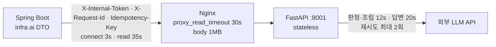
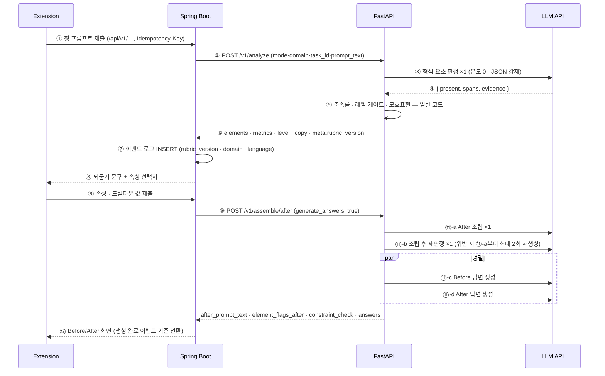
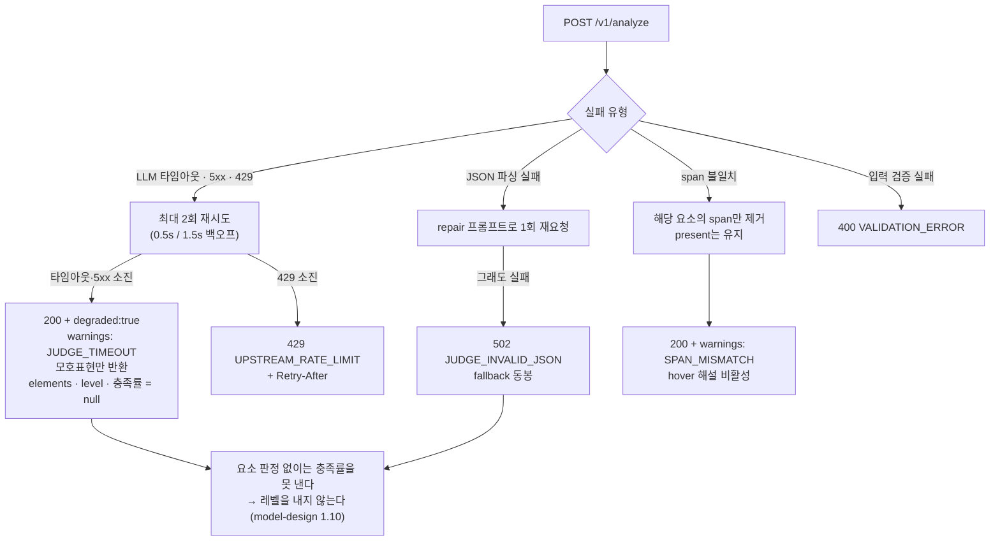

# 인터페이스 계약 — Spring Boot ↔ FastAPI

> 담당: 백엔드 · LLM 파트 공동 — 양쪽 승인 후 확정 · 상태: 초안 · 작성일: 2026-11-14 · 최종 수정: 2026-11-19
> 관련 이슈: KAN-66 · KAN-43
> 기준 문서: LLM 파트 기술 명세서 v1.0 · 백엔드 기술 기획서 v1.0

---

## 0. 이 문서의 역할

Spring Boot(백엔드)가 FastAPI(AI 서버)를 호출할 때 양쪽이 지키는 계약이다. 한쪽이 바꾸면 다른 쪽이 깨지므로, 변경은 이 문서를 먼저 고치고 양쪽이 확인한다.

| 절 | 내용 | 담당 |
| --- | --- | --- |
| 1–3 | 개요·경계 원칙, 호출 시퀀스, 엔드포인트·스키마 | LLM |
| 4 | 호출 정책 (타임아웃·재시도) | BE |
| 5 | 내부 헤더·멱등성 | BE + LLM |
| 6 | 에러 처리·코드 대응 | BE + LLM |
| 7 | 표기 변환 책임 | BE |
| 8–10 | 결정 사항 · 논의 사항 · 범위 밖 | 공동 |

---

## 1. 개요·경계 원칙 (LLM 작성)

### 1.1 구성

Spring Boot가 AI 서버의 **유일한 호출자**다. 클라이언트(익스텐션·웹)는 FastAPI를 직접 부르지 않는다.



- 인프라 배치(EC2·보안그룹·테스트 환경)는 `docs/dev/specs/architecture.md` 2절이 기준이다.
- FastAPI의 엔진 구성과 내부 LLM 호출 수는 `docs/dev/llm/system-design.md` 3·4장.

### 1.2 경계 원칙

| 원칙 | 이유 |
| --- | --- |
| **FastAPI는 DB에 직접 붙지 않는다** | 회차 간 비교(전이율·성장률·baseline)는 Spring Boot가 DB로 계산한다. AI 서버에 상태를 두면 익스텐션과 웹이 서로 다른 값을 보게 된다. |
| **FastAPI는 `channel`을 판단에 쓰지 않는다** | 로깅 필드로만 전달받는다. 엔진 안에 사이드바/웹 분기를 넣으면 같은 사용자가 화면에 따라 다른 레벨을 받는다. |
| **FastAPI는 한 번의 요청 안에서만 판단한다** | 한 번의 호출에 들어온 프롬프트 하나를 채점할 뿐이다. "지난번보다 나아졌는가"는 백엔드 질문이다. |
| **AI 서버는 외부에 직접 노출하지 않는다** | 보안 그룹에서 Spring Boot(EC2 #1)만 허용한다. 익스텐션이 FastAPI를 직접 호출하지 않는다. 모든 요청은 `X-Internal-Token`으로 검증한다. |
| **FastAPI는 snake_case·소문자 열거형을 유지한다** | 표기 변환은 Spring AI 연동 DTO 한 곳에서 한다 (7장). |
| **`prompt_text`는 AI 서버 로그에 남기지 않는다** | 원문 보관은 DB 단일 창구다 (7.3). 검증 에러 응답에도 입력값을 되돌려 담지 않는다. |

### 1.3 계산 주체

| 값 | 계산 주체 | 이유 |
| --- | --- | --- |
| `fulfillment_rate`, `measured_level` | **FastAPI** | 단일 프롬프트 안에서 끝난다 |
| 세분화율(최근 5회 평균), 성장률, `baseline`(초기 3회 평균) | **Spring Boot** | 회차 간 집계. DB 질의가 필요하다 |
| 전이율(항목별) | **Spring Boot** | `n회차 코칭 → n+1회차 자발 등장` 비교. 이력 질의 |
| 활동 일수 / 기능 사용 빈도 | **Spring Boot** | 이벤트 카운트 |

> 성장 그래프 집계에는 **진단·점검의 첫 입력(되묻기 전)만** 넣고, 연습 모드 이벤트와 `degraded` 이벤트는 제외한다. DB 필터 조건은 `event_type = 'INITIAL' AND mode IN ('DIAGNOSE','REVIEW') AND degraded = false`(`erd.md` 인덱스 `idx_events_metric`). 계산식 정의는 `docs/dev/llm/model-design.md` 2장.
> 되묻기 후 충족률은 저장하지 않고 이벤트에서 계산한다 (`model-design.md` 1.5).

### 1.4 FastAPI 쪽 타임아웃·재시도

Spring 쪽 값(연결 3s · 응답 35s · 재시도 정책)은 4장이 기준이다. FastAPI가 지키는 값은 아래와 같다.

| 구간 | 값 | 환경변수 | 근거 |
| --- | --- | --- | --- |
| FastAPI → LLM (판정·조립·재판정, 중급 모델) | 12s | `LLM_TIMEOUT_JUDGE_SEC` | 판정은 출력이 짧다 |
| FastAPI → LLM (답변 생성·이유 요약, 경량 모델) | 20s | `LLM_TIMEOUT_ANSWER_SEC` | `max_tokens` 상한을 걸어 길이를 눌러둔다 |
| LLM 호출 재시도 | 최대 2회, 0.5s → 1.5s 백오프 | `LLM_MAX_RETRY` | 타임아웃·5xx·429만 재시도 (3.11) |

- Nginx 30s는 Before/After 답변 2개 병렬 생성을 최장 구간으로 잡은 값이다.

> ⚠️ **논의 필요 — 요청 전체 시간 예산.** 위 값은 LLM 호출 1회 기준이다. 재시도를 더하면 판정 1회 최악 12s×3+2s = 38s, 답변 1회 최악 20s×3+2s = 62s로 Nginx 30s를 넘는다. `/v1/assemble/after`는 조립→재판정이 직렬이고 제약 위반 시 최대 2회 재생성까지 붙는다. FastAPI가 **요청 단위 기한**(예: 27s)을 두고, 남은 시간이 부족하면 재시도를 멈추고 `degraded`(200)로 응답할지 결정 필요 (9장 추가 제안 A).

---

## 2. 호출 시퀀스 (LLM 작성)

### 2.1 진단 1회차 (대표 흐름)

Spring의 외부 API 경로는 `docs/dev/specs/api.md`가 기준이다. 아래는 FastAPI 경계 기준으로 그린다.



- ⑪ 순서 변경: v1.0 명세는 조립과 답변 2개를 병렬로 그렸으나, After 답변은 **조립이 끝난 After 프롬프트가 있어야** 만들 수 있다. 조립 → 재판정(통과) → 답변 2개 병렬 순서로 고쳤다. Before 답변만 조립과 병렬로 앞당길지는 구현 시 결정한다.
- 이후 진단 단계(선호 선택 + 이유 입력)는 `POST /v1/summarize/reason`(LLM 1회)을 부른다.
- 점검 모드는 라운드마다 `POST /v1/analyze` → `POST /v1/review/probe`를 반복하고, 사용자가 재작성한 프롬프트를 다시 `/v1/analyze`로 보낸다 (3.5).
- 헤더 전파 규칙은 5장. Spring은 같은 요청을 다시 보낼 때 같은 `Idempotency-Key`를 쓴다.

---

## 3. 엔드포인트·스키마 (LLM 작성)

### 3.1 코어

| 메서드 | URL | 설명 | LLM 호출 |
| --- | --- | --- | --- |
| `POST` | `/v1/analyze` | 형식 요소 판정 + 모호표현 검출 + 충족률 + 레벨 + 되묻기/결과 문장. **모든 모드의 공통 진입점** | 1 |
| `POST` | `/v1/assemble/after` | 사용자가 고른 조건으로 After 조립 + 조립 후 재판정. `generate_answers: true`면 답변 2개까지 생성 | 2 (+답변 2) |
| `POST` | `/v1/generate/answers` | Before/After 프롬프트에 대한 AI 답변 2개 병렬 생성 (점검·연습용) | 2 |
| `POST` | `/v1/review/probe` | 점검 모드 — 결손 요소를 질문 세트로 변환 | 0 |
| `POST` | `/v1/practice/blank` | 연습 모드 — 결손 요소 기준 빈칸 문제 생성 / 채움값 부분 피드백 | 0~1 |
| `POST` | `/v1/explain/hover` | span → 해설 문구 매핑 (템플릿) | 0 |
| `POST` | `/v1/summarize/reason` | 축3 자유 서술 요약 (진단 이유 반영 단계) | 1 |

### 3.2 보조

| 메서드 | URL | 설명 |
| --- | --- | --- |
| `GET` | `/health` | 프로세스 생존 확인 (Nginx·Docker 헬스체크용. ALB는 EC2 #1 앞에만 있다 — architecture 2.3) |
| `GET` | `/ready` | 루브릭·템플릿 로드 완료 + LLM 키 유효성. 실패 시 503 `RUBRIC_NOT_LOADED` |
| `GET` | `/v1/rubric/version` | 현재 `rubric_version`, 요소 목록, `element_set_size` |
| `GET` | `/v1/tasks/{domain}` | 도메인별 고정 진단 과제 문구 |
| `POST` | `/v1/ambiguity/check` | 모호표현 검출만 단독 호출 (드릴다운 자유 입력 검증용, LLM 미사용) |

- `/health`·`/ready`의 `X-Internal-Token` 요구 여부는 미정이다 (헬스체크 주체가 토큰 없이 부를 수 있어야 함).

### 3.3 `POST /v1/analyze`

**Request**

```json
{
  "request_id": "7c1e...",
  "mode": "diagnose",
  "channel": "sidebar",
  "domain": "marketing",
  "task_id": "fixed_marketing_001",
  "turn": 1,
  "language": "ko",
  "prompt_text": "이번 분기 캠페인 성과 보고서를 작성해줘",
  "selected_attributes": [],
  "drilldown_values": {},
  "drilldown_input_type": "choice",
  "revision_count": 0,
  "self_reported_level": "beginner"
}
```

| 필드 | 타입 | 필수 | 비고 |
| --- | --- | --- | --- |
| `request_id` | string | — | ⚠️ 9장 논의 사항 1: 본문에서 제거하고 `X-Request-Id` 헤더만 쓰는 안 검토 중 |
| `mode` | `diagnose` · `retrospect` · `review` | ✅ | 레벨 변경 가능 여부가 여기서 갈린다 |
| `channel` | `sidebar` · `web` | ✅ | **로깅 전용.** 판정 로직에 쓰지 않는다 |
| `domain` | `marketing` · `study` · `coding` · `creative` · `etc` | ✅ | 과제 선택과 보조 로깅용. `etc` 처리는 10장 |
| `task_id` | string · null | — | 고정 과제일 때만. 점검은 `null` |
| `turn` | integer | — | 세션 안 회차 |
| `language` | `ko` | ✅ | 영어 확장 대비. 지금은 `ko` 고정 |
| `prompt_text` | string (1~4000자) | ✅ | **되묻기 전 원문.** 수정 전 값을 그대로 보낸다 |
| `selected_attributes` | string[] | — | 속성 선택 이후 턴에서만 채워진다 |
| `drilldown_values` | object | — | `{ 속성: 보기 ID 또는 자유 입력 }` |
| `drilldown_input_type` | `choice` · `free_text` | — | |
| `revision_count` | integer | — | |
| `self_reported_level` | `beginner` · `intermediate` · `advanced` | — | 채점에 쓰지 않는다. 신고 vs 실측 문구용 |

- `turn` 이하 필드의 필수 여부는 v1.0 명세에 없었다. 구현 시 확정한다.

**Response (200)**

```json
{
  "meta": {
    "request_id": "7c1e...",
    "rubric_version": "v1.0",
    "judge_model": "...",
    "element_set_size": 6,
    "degraded": false,
    "warnings": [],
    "latency_ms": 1840
  },
  "elements": {
    "purpose": {
      "present": true,
      "spans": [
        { "start": 0, "end": 22, "evidence": "이번 분기 캠페인 성과 보고서를 작성해줘" }
      ]
    },
    "audience": { "present": false, "spans": [] },
    "length":   { "present": false, "spans": [] },
    "format":   { "present": false, "spans": [] },
    "persona":  { "present": false, "spans": [] },
    "clarity":  { "present": true,  "spans": [] }
  },
  "span_labels": [
    { "start": 0, "end": 22, "labels": ["purpose"] }
  ],
  "ambiguity": {
    "hits": [],
    "matched_rules": []
  },
  "metrics": {
    "fulfillment_rate": 0.333,
    "fulfilled_count": 2,
    "element_set_size": 6,
    "prompt_char_len": 22,
    "revision_count": 0
  },
  "level": {
    "measured_level": "intermediate",
    "level_label": "Lv.2 중급",
    "gate_basis": "axis1_fulfillment",
    "next_level_threshold": "4/6",
    "mutable": true
  },
  "copy": {
    "probe": "프롬프트를 확인했어요. 현재는 '보고서를 작성해달라'는 목적은 잘 드러나지만, 원하는 결과의 기준은 아직 포함되어 있지 않아요. 이제 어떤 결과를 기대하셨는지 조금 더 알아볼게요.",
    "attribute_options": ["length", "format", "tone", "information_volume"],
    "good_points": [],
    "weak_points": []
  },
  "axis_logging": {
    "axis2_specificity_score": 61,
    "axis3_reason_text": null
  }
}
```

**백엔드가 꼭 알아야 할 것**

| 필드 | 주의 |
| --- | --- |
| `level` | `degraded`면 **`null`**이다. 레벨 이력 INSERT·사용자 레벨 갱신을 하지 않는다 (`model-design.md` 1.10) |
| `level.mutable` | `mode=diagnose`일 때만 `true`. **`false`면 이 응답의 레벨로 사용자 레벨을 덮어쓰면 안 된다.** 연습·점검은 표시용이다 |
| `level.measured_level` | `beginner` · `intermediate` · `advanced`. DB 표기 `LV1`~`LV3` 대응은 9장 논의 사항 2 |
| `level.next_level_threshold` | 연습 결과 화면의 `체크리스트 2/6 → 4/6 (다음 레벨 기준 4/6)` 표기에 그대로 쓴다 |
| `axis_logging` | **저장만 한다.** 화면에 수치로 노출하지 않는다 (`model-design.md` 2.1) |
| `meta.degraded` | `true`면 LLM 요소 판정이 실패한 것이다. `elements`·`level`·`metrics.fulfillment_rate`·`metrics.fulfilled_count`는 `null`, `ambiguity`와 `prompt_char_len`·`revision_count`만 들어 있다. 이벤트는 저장하되 성장 그래프 집계에서 제외 |
| `meta.warnings` | `JUDGE_TIMEOUT`, `SPAN_MISMATCH` 등 200 응답 안의 표시 코드 (3.10). 에러가 아니다 |
| `meta.rubric_version` | 이벤트 로그에 **반드시** 같이 적재한다. 없으면 시계열 비교가 통째로 무효화된다 |
| `elements` | DB JSONB에 **응답 원문 그대로** 저장한다 (7.1). 요소 키도 바꾸지 않는다 |
| `elements.clarity` | LLM이 아니라 모호표현 검출기(코드)가 결정한다. `ambiguity.hits`가 비어 있으면 `true` |

### 3.4 `POST /v1/assemble/after`

진단(온보딩·사이드바) 전용이다.

**Request**

```json
{
  "request_id": "9ab2...",
  "mode": "diagnose",
  "domain": "marketing",
  "before_prompt_text": "이번 분기 캠페인 성과 보고서를 작성해줘",
  "selected_attributes": ["information_volume"],
  "drilldown_values": { "information_volume": "brief_only" },
  "element_flags_before": { "purpose": true, "audience": false, "length": false, "format": false, "persona": false, "clarity": true },
  "generate_answers": true
}
```

**Response (200)**

```json
{
  "meta": { "request_id": "9ab2...", "rubric_version": "v1.0", "assembly_retry": 0, "warnings": [] },
  "after_prompt_text": "이번 분기 캠페인 성과를 핵심만 간단하게 정리한 보고서를 작성해줘.",
  "after_authored_by": "system_assembled",
  "element_flags_after": {
    "purpose": { "present": true,  "spans": [{ "start": 0, "end": 18, "evidence": "이번 분기 캠페인 성과를" }] },
    "length":  { "present": true,  "spans": [{ "start": 19, "end": 29, "evidence": "핵심만 간단하게" }] },
    "audience":{ "present": false, "spans": [] },
    "format":  { "present": false, "spans": [] },
    "persona": { "present": false, "spans": [] },
    "clarity": { "present": true,  "spans": [] }
  },
  "constraint_check": {
    "passed": true,
    "added_elements": [],
    "rule": "after_set ⊆ (before_set ∪ picked_set)"
  },
  "answers": {
    "before": "캠페인 성과 요약: 매출 전년 대비 8% 증가, 신규 고객 유입 확대되었습니다. (세부 지표는 첨부 참고)",
    "after": "① 매출 12%↑ ② 신규 고객 320명 확보 ③ 재구매율 8%p↑ — 핵심 수치 3가지만 정리했습니다."
  }
}
```

| 필드 | 주의 |
| --- | --- |
| `after_authored_by` | `system_assembled` · `assembly_failed` (점검 재작성은 `/v1/analyze` 경로에서 `user_rewritten`) |
| `assembly_failed` | 조립 제약 위반이 2회 재생성 후에도 계속되면 조립을 포기하고 `after_prompt_text`에 Before를 그대로 담는다. `meta.warnings`에 `ASSEMBLY_CONSTRAINT_VIOLATION`. 이 이벤트는 **Before/After 비교 분석에서 제외**한다 |
| `answers` | 답변 생성이 실패하면 `answers = null` + `meta.warnings`에 `ANSWER_GENERATION_FAILED`. 프롬프트 비교만 표시한다 |
| `element_flags_before` | 요청에는 bool 맵으로 받는다. 응답의 `element_flags_after`는 span 포함 객체다 |

조립 제약·검증 로직은 `model-design.md` 7장.

### 3.5 `POST /v1/review/probe` (점검 모드)

점검 모드는 **시스템이 조립하지 않고 사용자가 프롬프트를 다시 쓴다.** 이 엔드포인트는 결손 요소를 질문 세트로 바꿔주는 역할만 한다.

**Request** — v1.0 명세에 없음. 구현 시 확정 (3.7).

**Response (200)**

```json
{
  "diagnosis_copy": "입력된 프롬프트에는 무엇을 원하는지는 담겨 있지만, 구체적인 조건은 아직 들어 있지 않아요.",
  "instruction_copy": "다음의 내용을 추가하여 프롬프트를 다시 한번 작성해보세요.",
  "probes": [
    { "element": "audience", "question": "누구를 위한 콘텐츠인가요?", "example": "20~30대 직장인" },
    { "element": "length",   "question": "어느 정도 분량이 좋을까요?", "example": "피드 문구 3개, 300자 내외" },
    { "element": "format",   "question": "어떤 형태의 콘텐츠인가요?", "example": "인스타그램 피드 문구 3개" }
  ],
  "round": 1,
  "next_round_available": true
}
```

- 한 라운드에 **최대 3개**만 제시한다. 결손이 4개 이상이면 우선순위 순으로 자른다 (`purpose > audience > format > length > persona`).
- `next_round_available=true`면 2라운드("더 구체적으로 다듬어볼까요?")를 띄울 수 있다. 2라운드는 남은 결손 요소로 구성한다.
- 사용자가 재작성한 프롬프트는 다시 `/v1/analyze`로 보낸다. `after_authored_by`는 `user_rewritten`이 된다.

### 3.6 `POST /v1/explain/hover`

```json
// Request
{ "prompt_text": "...", "span_labels": [ { "start": 22, "end": 34, "labels": ["length", "priority"] } ] }

// Response
{
  "explanations": [
    {
      "start": 22, "end": 34,
      "evidence": "핵심 수치 3개만 담은",
      "labels": ["length", "priority"],
      "text": "분량과 우선순위를 명시하여 보고서의 구조를 구체화하였어요."
    }
  ]
}
```

- 문구는 **미리 만든 템플릿**에서 나온다. LLM 자유 생성을 쓰지 않는다. 같은 구절에 매번 다른 설명이 뜨면 사용자가 서비스를 못 믿는다.
- 한 구간에 라벨이 여러 개 걸릴 수 있다 (`span → [요소]` 다대다).

### 3.7 스키마 미작성 엔드포인트

v1.0 명세에 요청/응답 스키마가 없어 구현 전에 이 문서에 추가해야 한다.

| 엔드포인트 | 상태 |
| --- | --- |
| `POST /v1/generate/answers` | 미작성. 응답은 `answers.before` / `answers.after` (3.4와 동일 구조) 예정 |
| `POST /v1/review/probe` | Request 미작성 |
| `POST /v1/practice/blank` | 미작성 |
| `POST /v1/summarize/reason` | 미작성 |
| `GET /v1/rubric/version`, `GET /v1/tasks/{domain}`, `POST /v1/ambiguity/check` | 미작성 |

### 3.8 공통 규칙

| 규칙 | 내용 |
| --- | --- |
| 표기 | 필드는 `snake_case`, 열거형은 소문자. Spring 변환 규칙은 7장 |
| 인코딩 | UTF-8. `start`/`end`는 **파이썬 문자열 인덱스(코드포인트) 기준**. 프론트는 JS `Array.from()` 기준으로 맞춰야 이모지·한글 조합에서 어긋나지 않는다 |
| 시간 | 모든 타임스탬프는 UTC ISO8601 (`2026-10-20T13:00:00Z`) |
| 열거형 | 모르는 값이 오면 `400 VALIDATION_ERROR`. 조용히 기본값으로 바꾸지 않는다 |
| 요청 크기 | 본문 1MB 상한 (Nginx `client_max_body_size`). `prompt_text`는 4000자 상한 |
| 응답 래핑 | 성공은 도메인 객체 직접 반환, 실패는 `error` 봉투 (3.10) |
| 필드 추가 | 하위 호환으로만. 필드 삭제·의미 변경은 `rubric_version`과 함께 올리고 이 문서를 먼저 고친다 |

### 3.9 에러 처리 원칙



### 3.10 에러 응답 형식과 코드

```json
{
  "error": {
    "code": "JUDGE_INVALID_JSON",
    "message": "판정기 응답을 JSON으로 해석하지 못했습니다.",
    "user_message": "지금은 분석이 어려워요. 잠시 후 다시 시도해주세요.",
    "retryable": true,
    "request_id": "7c1e...",
    "rubric_version": "v1.0"
  },
  "fallback": {
    "ambiguity": { "hits": ["간단하게"], "matched_rules": ["vague_quantity"] },
    "metrics": { "prompt_char_len": 22, "revision_count": 0 }
  }
}
```

| 필드 | 규칙 |
| --- | --- |
| `code` | Spring은 **HTTP 상태가 아니라 `code`로** 대응을 고른다 (6.2) |
| `user_message` | **그대로 화면에 띄워도 되는 문구**다. Spring이 `userMessage`로 전달한다 (6.1). 카피 가드레일(평가어 금지)이 적용되어 있다 |
| `message` | 개발자용. Spring 로그에만 남고 프론트로 나가지 않는다 (6.1). **입력값(`prompt_text`)을 담지 않는다** |
| `fallback` | 코드로 계산한 값(모호표현·글자 수)만 담는다. 요소 판정이 없으므로 **레벨·충족률은 담지 않는다** (`model-design.md` 1.10). 점검·연습은 이것으로 축소 화면을, 진단은 재시도 안내만 띄운다. `502 JUDGE_INVALID_JSON`에는 항상 동봉한다 |

| code | HTTP | retryable | 발생 조건 | 화면 처리 |
| --- | --- | --- | --- | --- |
| `VALIDATION_ERROR` | 400 | X | 필수 필드 누락, 열거형 불일치, `prompt_text` 길이 초과 | 개발 단계 버그. 사용자에게는 일반 오류 |
| `UNAUTHORIZED` | 401 | X | `X-Internal-Token` 불일치 | 사용자 노출 없음 (Spring은 `AI_UNAVAILABLE`로 변환) |
| `UNSUPPORTED_DOMAIN` | 400 | X | `domain=etc`로 고정 과제를 요청 | 미정 (10장) |
| `PROMPT_TOO_SHORT` | 422 | X | 공백 제외 2자 미만 | "프롬프트를 조금만 더 적어주세요" |
| `JUDGE_INVALID_JSON` | 502 | ○ | 스키마 위반 응답, repair 실패 | `fallback` 사용 + 재시도 버튼 |
| `UPSTREAM_RATE_LIMIT` | 429 | ○ | LLM 쿼터 초과 (내부 재시도 소진) | `Retry-After` 헤더 포함. Spring은 큐 없이 `AI_RATE_LIMITED`로 전달 (4.3) |
| `RUBRIC_NOT_LOADED` | 503 | ○ | 부팅 중 / YAML 로드 실패 | `/ready` 실패. Spring 1회 재시도 (4.2) |

**200 응답 안의 표시 코드** (`meta.warnings`, 에러가 아님 — Spring은 저장·전달만 한다)

| code | 발생 조건 | 화면 처리 |
| --- | --- | --- |
| `JUDGE_TIMEOUT` | LLM 응답 지연, 재시도 소진. `degraded: true` 동반 | 진단: 재시도 안내 / 점검·연습: 모호표현만으로 축소 표시 |
| `SPAN_MISMATCH` | `evidence`가 원문에 없음 | 해당 요소 hover만 비활성 |
| `ASSEMBLY_CONSTRAINT_VIOLATION` | 조립 결과에 없던 조건 추가, 재생성 2회 실패 | After 생략, Before만 표시. 분석에서 제외 |
| `ANSWER_GENERATION_FAILED` | Before/After 답변 생성 실패 | 프롬프트 비교만 표시, 답변 영역은 재시도 버튼 |

- FastAPI 기본 검증 에러는 422로 나간다. `PROMPT_TOO_SHORT`(422)와 겹치지 않도록 **커스텀 핸들러로 `400 VALIDATION_ERROR` 봉투**로 바꾸고, 기본 응답의 입력값 에코(`input`)를 빼야 한다.
- `PROMPT_TOO_SHORT`는 외부 API(`api.md`)에도 같은 코드로 있다. 기준(공백 제외 2자 미만)은 **이 문서 한 곳에서 정의**하고, Spring이 먼저 검사해 FastAPI 호출을 아끼는지·FastAPI 응답을 그대로 넘기는지는 BE와 정한다.

### 3.11 FastAPI 재시도·멱등성·관측

| 항목 | 정책 |
| --- | --- |
| 재시도 대상 | LLM 호출의 타임아웃, 5xx, 429만. **4xx는 재시도하지 않는다** |
| 백오프 | 0.5s → 1.5s, 최대 2회 (`LLM_MAX_RETRY`) |
| 멱등성 | 같은 `Idempotency-Key`는 60초간 같은 응답을 반환한다. 같은 프롬프트가 두 번 채점돼 로그가 중복되는 것을 막는다. 키는 프론트가 만들고 Spring이 그대로 전달한다 (5.2). 캐시 대상은 9장 #8(LLM 제안 B) |
| 로그 | `request_id`(=`X-Request-Id`), `mode`, `domain`, `rubric_version`, `latency_ms`, `retry_count`, `degraded`를 구조화 로그로 남긴다. **`prompt_text`는 AI 서버 로그에 남기지 않는다** |
| 알림 | `degraded` 비율 5% 초과 또는 `JUDGE_INVALID_JSON` 연속 10건 시 알림 (클라우드 협의) |

---

## 4. 호출 정책

### 4.1 타임아웃

| 구간 | 값 | 근거 |
| --- | --- | --- |
| Spring → FastAPI 연결 | 3s | AI 서버가 꺼져 있으면 빨리 알아차린다 |
| Spring → FastAPI 응답 | 35s | Nginx(30s)보다 길게 잡아 중간 절단을 피한다 |
| Nginx → FastAPI | 30s | 1.1 · 1.4 |
| FastAPI → LLM | 12s(판정) · 20s(답변) | 1.4 |
- 응답 타임아웃은 **모든 엔드포인트 35s로 통일**한다.
- 이유: 서버 다운은 연결 타임아웃(3s)에서 잡힌다. 35s를 다 기다리는 건 “접속은 됐는데 멈춘” 경우뿐이다. 엔드포인트별로 나누면 AI 쪽이 기능을 바꿀 때(예: `/v1/practice/blank` LLM 호출 0~1회) 정상 요청이 잘릴 위험이 더 크다.
- 재검토: 특정 API의 지연이 문제가 되면 그 API만 따로 설정한다.

### 4.2 재시도

FastAPI는 LLM 호출을 내부에서 이미 재시도한다 (최대 2회, 0.5s → 1.5s). Spring까지 같은 방식으로 재시도하면 재시도가 겹쳐, 최악의 경우 사용자가 100초 넘게 기다리고 LLM 비용도 중복된다. 그래서 Spring은 **요청이 AI 서버에 도착하지 못한 경우만** 재시도한다.

| 실패 | Spring 재시도 | 이유 |
| --- | --- | --- |
| 연결 실패 (연결 타임아웃 포함) | 1회 | 요청이 들어가지 않았으니 안전하고 빠르다 |
| 503 (`RUBRIC_NOT_LOADED`, 부팅 중) | 1회 | 잠깐이면 풀린다 |
| 응답 타임아웃 (35s) | 안 함 | 이미 처리 중이고, 다시 보내도 느리다. AI 서버 부하만 늘어난다 |
| 502 (`JUDGE_INVALID_JSON`) | 안 함 | FastAPI가 이미 복구를 시도했다. `fallback`을 그대로 전달한다 |
| 200 + `degraded: true` | 안 함 | 에러가 아니라 축소 결과다 |
| 429 (`UPSTREAM_RATE_LIMIT`) | 안 함 | 4.3 참고 |
| 그 외 4xx | 안 함 | 다시 보내도 같은 결과다 |
- 재시도 간격: 0.5s
- 재시도에도 **처음과 같은 `Idempotency-Key`**를 쓴다 (5.2).
- 재시도하지 않는 실패는 프론트에 에러를 돌려주고, **재시도는 사용자가 버튼으로** 한다.

### 4.3 429 처리 (MVP)

- Spring은 대기열(큐)을 두지 않는다.
- FastAPI의 429를 받으면 재시도하지 않고 `AI_RATE_LIMITED`(429)로 프론트에 응답한다. `Retry-After` 헤더는 그대로 전달한다.
- 프론트는 “잠시 후 다시 시도해주세요”와 재시도 버튼을 보여준다.
- 이유: 429는 서비스 전체가 LLM 제공사 한도를 넘을 때만 생긴다. 현재 규모에서는 드물고, 큐를 넣으면 저장소·작업자·프론트 수신 방식이 모두 바뀐다.
- 예방: 사용자당 AI 경유 API 호출 제한(백엔드 기획서 9장, 분당 20회)으로 한 사람이 한도를 소진하는 것을 막는다.
- 재검토: 429 발생 횟수를 로그로 남기고, 자주 발생하면 큐 도입을 다시 검토한다.

---

## 5. 내부 헤더·멱등성

### 5.1 헤더

| 헤더 | 만드는 곳 | 규칙 |
| --- | --- | --- |
| `X-Internal-Token` | 환경변수 `AI_INTERNAL_TOKEN` (Spring·FastAPI 같은 이름·같은 값, 생성·보관: 클라우드 — `docs/ops/env.md` 1·2절) | 모든 요청에 포함. 불일치 시 FastAPI는 401 |
| `X-Request-Id` | Spring (`RequestIdFilter`, UUID) | 클라이언트 요청 1건의 ID를 FastAPI까지 그대로 전파. FastAPI는 로그와 응답 `meta.request_id`에 기록. **요청 추적값의 기준은 헤더다** |
| `Idempotency-Key` | 프론트 (UUID) | Spring은 받은 키를 그대로 전달한다. 새로 만들지 않는다 |
- 헤더를 기준으로 하는 이유: 본문을 해석하기 전에 읽을 수 있어, 본문이 깨진 요청(400)도 로그에 ID가 남는다. 같은 값을 본문에 다시 두면 값이 어긋났을 때 기준이 애매해진다 (논의 사항 1).

### 5.2 멱등성 (같은 요청을 두 번 처리하지 않기)

```
프론트 ── 키 생성 (abc-123)
  │  Idempotency-Key: abc-123
  ▼
Spring ── 60초 안에 같은 키가 있었으면 저장된 응답 반환 (FastAPI 호출 없음)
  │  처음 본 키면 그대로 전달
  ▼  Idempotency-Key: abc-123   (Spring 재시도도 같은 키)
FastAPI ── 60초 안에 같은 키면 같은 응답 반환 (3.11)
```

| 담당 | 규칙 |
| --- | --- |
| 프론트 | 제출 단위로 키를 만든다. 재시도 버튼은 같은 키, 프롬프트를 고쳐 다시 제출하면 새 키 (논의 사항 5) |
| Spring | 60초 안 같은 키는 저장된 응답을 반환하고, 이벤트 로그를 두 번 저장하지 않는다 |
| FastAPI | 60초 안 같은 키는 같은 응답을 반환한다. 처리 중인 키가 다시 오는 경우는 미정 (논의 사항 3) |

---

## 6. 에러 처리

### 6.1 에러 필드 전달

- FastAPI 에러의 `user_message`는 프론트에 `userMessage`로 그대로 전달한다. 화면에 바로 띄워도 되는 문구다 (3.10).
- FastAPI 에러의 `message`는 프론트에 내보내지 않고 Spring 로그에만 남긴다. Spring 에러 응답에는 `message` 필드가 없다 (API 명세서 에러 응답 참고).
- `fallback`(모호표현·글자 수)은 표기만 바꿔 그대로 전달한다. 요소 판정이 실패한 응답이라 레벨·충족률은 담기지 않는다 (3.10, `docs/dev/llm/model-design.md` 1.10).

### 6.2 FastAPI → Spring 에러 코드 대응

| FastAPI | Spring 응답 | 이유 |
| --- | --- | --- |
| `PROMPT_TOO_SHORT` 422 | `PROMPT_TOO_SHORT` 422 | 사용자가 고칠 수 있는 오류라 그대로 전달 |
| `JUDGE_INVALID_JSON` 502 | `AI_INVALID_RESPONSE` 502 + `fallback` | 축소 화면을 그릴 수 있게 fallback 동봉 |
| `UPSTREAM_RATE_LIMIT` 429 | `AI_RATE_LIMITED` 429 + `Retry-After` | 4.3 |
| `RUBRIC_NOT_LOADED` 503 | `AI_UNAVAILABLE` 503 | 1회 재시도 후에도 실패한 경우 |
| 연결 실패, 응답 타임아웃 | `AI_UNAVAILABLE` 503 |  |
| `UNAUTHORIZED` 401 (내부 토큰 불일치) | `AI_UNAVAILABLE` 503 | 서버 설정 문제다. 사용자에게 401을 보내면 로그인 문제로 오해한다. 로그는 ERROR로 남긴다 |
| `VALIDATION_ERROR` 400 | `INTERNAL_ERROR` 500 | Spring이 요청을 잘못 만든 것이다. 사용자 잘못이 아니다 |
| `UNSUPPORTED_DOMAIN` 400 | 미정 | `domain=etc` 처리가 팀 미결정 (10장) |

200으로 오는 `degraded`, `JUDGE_TIMEOUT`, `SPAN_MISMATCH`, `ASSEMBLY_CONSTRAINT_VIOLATION`, `ANSWER_GENERATION_FAILED`는 에러가 아니라 응답 안의 표시다. Spring은 저장·전달만 하고 에러로 바꾸지 않는다.

---

## 7. 표기 변환 책임

**모든 변환은 Spring의 AI 연동 계층(`infra.ai` DTO)에서 한다.** FastAPI는 지금 표기를 유지한다.

### 7.1 필드 이름

| 구간 | 표기 |
| --- | --- |
| FastAPI 요청·응답 | `snake_case` |
| Spring ↔ 프론트 | `camelCase` |
- Spring은 AI 연동 DTO에 snake_case 네이밍 전략을 적용해 변환한다. 다른 계층은 snake_case를 모른다.
- 예외: `element_flags` 등 판정 원문은 DB JSONB에 **FastAPI 응답 그대로** 저장한다. 요소 키(`purpose`, `audience` 등)도 바꾸지 않는다.

### 7.2 열거형 값

| 항목 | FastAPI | Spring·DB |
| --- | --- | --- |
| 모드 | `diagnose` · `review` · `retrospect` | `DIAGNOSE` · `REVIEW` · `RETROSPECT` |
| 채널 | `sidebar` · `web` | `SIDEBAR` · `WEB` |
| 도메인 | `marketing` · `study` · `coding` · `creative` · `etc` | 대문자 |
| 자가 레벨 | `beginner` · `intermediate` · `advanced` | `BEGINNER` · `INTERMEDIATE` · `ADVANCED` |
| **측정 레벨** | `beginner` · `intermediate` · `advanced` | **`LV1` · `LV2` · `LV3`** (논의 사항 2) |
| 작성 주체 | `system_assembled` · `user_rewritten` · `assembly_failed` | 대문자 |
| 드릴다운 입력 | `choice` · `free_text` | 대문자 |
- 같은 `beginner`라도 자가 레벨은 `BEGINNER`, 측정 레벨은 `LV1`으로 필드에 따라 다르게 바뀐다. 측정 레벨은 대문자 변환이 아니라 대응표로 바꾼다.
- 알 수 없는 값이 오면 기본값으로 바꾸지 않고 오류로 처리한다 (3.8과 동일).

### 7.3 기타 공통 규칙

- 시간: 양쪽 모두 UTC ISO8601
- 로그: `prompt_text`는 Spring·FastAPI 어느 애플리케이션 로그에도 남기지 않는다. 원문은 DB에만 보관한다.

---

## 8. 결정 사항

| # | 항목 | 결정 | 근거 |
| --- | --- | --- | --- |
| 1 | 재시도 | 연결 실패·503만 1회. 응답 타임아웃·502·`degraded`·429는 재시도 안 함 | FastAPI 내부 재시도와 겹치면 대기·비용이 배로 늘어난다 (4.2) |
| 2 | `Idempotency-Key` | 프론트 생성, Spring은 그대로 전달·재사용, Spring도 60초 중복 차단 | 어느 단계에서 다시 보내도 같은 요청으로 알아본다 (5.2) |
| 3 | 429 | 큐 없음, 재시도 없음, `Retry-After` 전달 | 현재 규모에서 드문 문제에 구조 변경이 크다 (4.3) |
| 4 | 표기 변환 | Spring AI 연동 DTO에서 전부 변환 | 변환 지점을 한 곳으로 모은다 (7장) |
| 5 | 에러 필드 | `user_message`만 전달, `message`는 로그만 | Spring 에러 응답에서 `message`를 제거했다 (6.1) |
| 6 | 에러 코드 대응 | 6.2 표 | 사용자 잘못과 서버 문제를 구분한다 |
| 7 | 타임아웃 | 연결 3s, 응답 35s, 전 엔드포인트 통일 | 서버 다운은 3s에서 잡힌다 (4.1) |

---

## 9. 논의 사항

| # | 내용 | 확인할 파트 | 상태 |
| --- | --- | --- | --- |
| 1 | 요청 본문의 `request_id`를 빼고 `X-Request-Id` 헤더만 쓰기 (응답 `meta.request_id`는 유지) | LLM | 확인 필요 |
| 2 | 측정 레벨 값이 `beginner` · `intermediate` · `advanced` 세 개뿐인지. 맞으면 `LV1` · `LV2` · `LV3`에 대응 | LLM | 확인 필요 |
| 3 | 첫 요청이 처리 중일 때 같은 `Idempotency-Key`가 오면 기다렸다 같은 결과를 주는지, 새로 처리하는지 | LLM | 확인 필요 |
| 4 | 내부 토큰 생성·보관 담당. 변수 이름이 Spring `AI_INTERNAL_TOKEN`, FastAPI `INTERNAL_TOKEN`으로 다르고 값은 같아야 한다 | LLM, 클라우드 | **확정** — 양쪽 모두 `AI_INTERNAL_TOKEN`, 생성·보관 클라우드 (5.1, `env.md` 1·2절) |
| 5 | 재시도 버튼은 같은 키, 프롬프트 수정 후 재제출은 새 키 | 프론트 | 확인 필요 |
| 6 | `Retry-After`가 짧을 때(예: 3초 이하) Spring이 1회 자동 재시도할지 | 백엔드 | 보류 (429 로그 확인 후) |
| 7 | **(LLM 제안 A) 요청 단위 시간 예산.** LLM 재시도를 포함하면 Nginx 30s를 넘는다 (1.4). FastAPI가 요청 기한을 두고 초과 시 재시도를 멈추고 `degraded`로 응답하는 안 (4.1, 1.4) | 백엔드, LLM | 제안 |
| 8 | **(LLM 제안 B) 멱등성 캐시 대상 + 재시도 키.** 실패 응답을 캐시하면 같은 키로 재시도해도 60초 동안 같은 실패만 받는다. **정상 200만 캐시하고 4xx·5xx·`degraded`는 캐시하지 않는 안** — Spring 캐시도 같은 규칙 필요. 현재 웹 클라이언트(`frontend/web/src/api/client.ts`)는 호출마다 새 키를 만들어, #5(재시도 버튼은 같은 키)를 유지하려면 호출하는 쪽이 키를 넘길 수 있는 옵션이 필요하다 (5.2, 4.2) | 백엔드, 프론트 | 제안 |
| 9 | **(LLM 제안 C) Uvicorn 워커 2개와 메모리 캐시.** 워커마다 캐시가 따로라 중복을 못 막는다. 워커 1개 또는 공유 저장소 (5.2, `architecture.md` 2.6) | LLM, 클라우드 | 제안 |
| 10 | **(LLM 제안 D) Nginx가 직접 내는 응답의 대응.** Nginx 504(30s 절단)·413(1MB 초과)는 FastAPI `error` 봉투가 없다. 6.2 대응표에 추가 필요 (예: 둘 다 `AI_UNAVAILABLE`/`INTERNAL_ERROR`) | 백엔드, 클라우드 | 제안 |
| 11 | **(LLM 제안 E) `/health`·`/ready` 인증.** 헬스체크는 토큰 없이 허용할지 (3.2) | LLM, 클라우드 | 제안 |

---

## 10. 범위 밖

- `domain=etc` 처리: 팀 미결정 (백엔드 기획서 11장 #4, `docs/dev/llm/system-design.md` 7장 #6). 확정되면 6.2의 `UNSUPPORTED_DOMAIN` 대응을 채운다.
- Before/After 답변 SSE 스트리밍: `docs/dev/llm/system-design.md` 4.2 · 7장 #13 미결정. 현재는 단일 응답.

---

## 변경 이력

| 날짜 | 내용 | 작성 |
| --- | --- | --- |
| 2026년 11월 14일 | BE 초안 작성 (4–10장) | 백엔드 |
| 2026-11-19 | LLM 작성분(1–3장) 반영, Notion 초안을 저장소로 이관 | LLM |
| 2026-11-19 | 4–10장 "LLM 명세 x.x" 참조를 문서 안 절 번호로 변경, 내부 토큰 `AI_INTERNAL_TOKEN` 통일(9장 #4 확정), `fallback` 구성 수정, LLM 제안 A–E를 9장 #7–11로 병합 | LLM |
