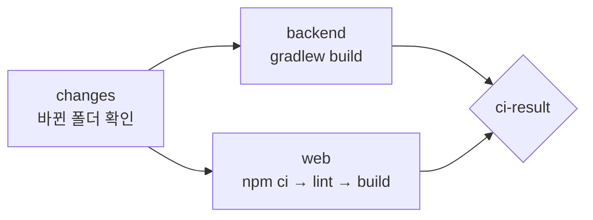

# 배포 절차 — CI/CD 파이프라인과 롤백
 
> 담당: 클라우드(INFRA) · 최종 수정: 2026-11-15
> 인프라 구성은 `docs/dev/specs/architecture.md`, 환경변수는 `docs/ops/env.md` 참고.
 
| 단계 | 상태 |
| --- | --- |
| CI — 빌드·테스트 | ✅ 사용 중 |
| CD — 무료 테스트 환경 | 🔨 구축 중 (KAN-61) |
| CD — AWS | ⏸ 보류 |
 
## 1. CI — 빌드·테스트 (사용 중)
 
**파일:** `.github/workflows/ci.yml`
**실행 시점:** `develop`·`main`으로 PR을 열거나 push할 때
 

 
| job | 실행 조건 | 하는 일 |
| --- | --- | --- |
| `changes` | 항상 | `dorny/paths-filter`로 바뀐 파트 판단 |
| `backend` | `backend/**` 또는 `ci.yml` 변경 | Java 17 + postgres:16 서비스 컨테이너로 `./gradlew build` (컴파일 + 테스트). 실패 시 테스트 리포트 업로드(7일) |
| `web` | `frontend/web/**` 또는 `ci.yml` 변경 | `.nvmrc`의 Node 버전으로 `npm ci` → `lint` → `build`. npm 캐시 사용 |
| `ci-result` | 항상 | 위 job 중 하나라도 실패·취소면 실패. **브랜치 보호의 필수 체크는 이 job 하나** |
 
**규칙**
- PR은 `ci-result` ✅ + 승인 2명이 있어야 머지된다 (Merge Commit만 허용).
- 내 파트가 안 바뀌어 job이 `Skipped`로 뜨는 것은 정상이다.
- CI에는 더미 값만 쓴다. 실제 비밀값은 넣지 않는다.
- 같은 브랜치에 새 커밋이 오면 이전 실행은 자동 취소된다.
 
**추가 예정**
- `ai-server/`, `frontend/extension/` 코드가 생기면 job 추가 (`ci.yml` 안 주석 참고)
- `actions/*` 버전 업그레이드 (Node 20 지원 종료 경고 대응)
- 주의: `discord-notification.yml`이 워크플로 이름 `CI`에 의존하므로 `name: CI`를 바꾸지 않는다.
 
## 2. CD — 무료 테스트 환경 (구축 중, KAN-61)
 
두 서비스 모두 GitHub 저장소를 연결하면 **브랜치에 push될 때 자동 배포**된다. 별도 워크플로 파일이 필요 없다.
 
| 대상 | 배포 트리거 | 빌드 위치 |
| --- | --- | --- |
| 웹 (Vercel) | `develop` push | Root Directory `frontend/web`, `npm run build` |
| 백엔드 (Render) | `develop` push | `backend/` Dockerfile |
| DB (Neon) | 배포 없음 | Flyway가 Spring 기동 시 마이그레이션 실행 |
 
> 배포 브랜치(`develop` vs `main`)와 Vercel 계정 소유자는 KAN-61에서 백엔드와 확정한다.
 
### 롤백
 
| 대상 | 방법 |
| --- | --- |
| 웹 | Vercel 대시보드 → Deployments → 이전 배포 선택 → Promote / Instant Rollback |
| 백엔드 | Render 대시보드 → Events/Deploys → 이전 배포에서 Rollback |
| 코드 자체 | 문제 커밋을 `git revert`하는 PR → 머지되면 자동 재배포 |
| DB | 아래 4장 참고 |
 
## 3. CD — AWS (보류)
 
결정 항목(도메인, 계정·예산, LLM 공급자)이 정해지면 `.github/workflows/deploy.yml`로 추가한다. 설계는 클라우드 기술기획서 V0.3 3.2 기준.
 
1. `main` 머지 시 Spring·FastAPI Docker 이미지를 빌드해 **ECR**에 올린다. AWS 로그인은 **GitHub OIDC 역할**로 하고 액세스 키를 저장하지 않는다.
2. 이미지 태그는 **커밋 SHA**로 고정한다. FastAPI 이미지에 포함된 루브릭 YAML은 태그(커밋)로 추적하고, 실제 사용 버전은 `RUBRIC_VERSION`과 응답 `meta.rubric_version`으로 확인한다. 두 값이 다르면 배포하지 않는다.
3. prod 배포 전 **RDS 수동 스냅샷**을 먼저 만든다.
4. **SSM Run Command**로 EC2에서 `docker compose pull && docker compose up -d` 실행.
5. 웹은 빌드 결과를 S3에 올리고 CloudFront 캐시를 무효화한다.
6. 익스텐션은 Chrome Web Store 심사 기간을 배포 일정에 포함한다.
 
### 롤백
 
- **앱:** 직전 정상 이미지 태그(커밋 SHA)를 지정해 같은 SSM 명령으로 다시 `up -d`.
- **웹:** 직전 빌드를 S3에 다시 올리고 캐시 무효화.
- 롤백 명령은 배포 워크플로와 함께 미리 만들어 두고, 파일럿 전 1회 리허설한다.
 
## 4. DB 마이그레이션과 롤백 원칙
 
- Flyway는 **앞으로만** 간다. 이미 적용된 `V*.sql` 파일은 수정하지 않는다. 되돌릴 때는 되돌리는 내용의 새 마이그레이션(`V{n+1}__...sql`)을 만든다.
- 앱을 이전 버전으로 롤백할 때, 새 마이그레이션이 이미 적용됐다면 이전 앱이 새 스키마에서 동작하는지 먼저 확인한다.
- 데이터가 손상된 경우:
  - 테스트 환경(Neon): 시점 복원 기능 사용. 무료 플랜은 최근 6시간까지만 복원 가능 (2026-11 공식 문서 기준).
  - AWS(RDS): PITR로 **새 인스턴스**를 복원한 뒤 접속 정보를 교체한다. 기존 인스턴스는 확인 후 삭제.
 
## 5. 배포 체크리스트
 
- [ ] `ci-result` ✅ 확인 후 머지
- [ ] 새 환경변수가 생겼다면 `docs/ops/env.md`와 배포 환경 설정에 같이 추가
- [ ] 새 Flyway 마이그레이션이 있다면 백엔드 담당에게 확인
- [ ] 배포 후 웹 접속 + `/actuator/health` 확인
- [ ] 문제 시 2·3장 롤백 절차 → 팀 채널에 공유
 
